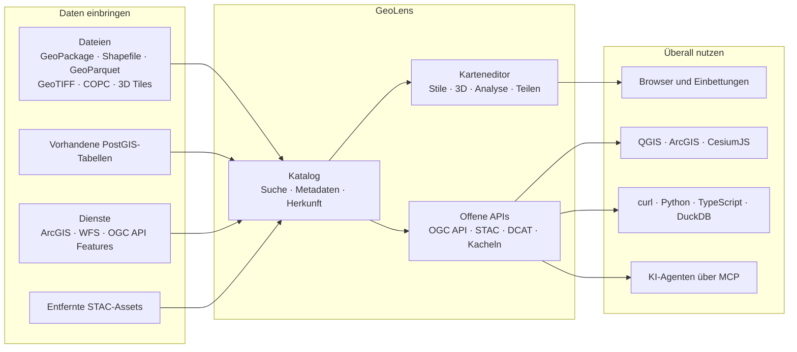

<p align="center">
  <picture>
    <source media="(prefers-color-scheme: dark)" srcset=".github/assets/geolens-emblem-dark.svg">
    
  </picture>
</p>

<h1 align="center">GeoLens</h1>

<p align="center">
  <b>Ein selbst gehosteter Geodatenkatalog und Karteneditor, der festhält, woher jeder Datensatz stammt.</b>
</p>

<p align="center">
  <a href="https://demo.getgeolens.com"><b>Live-Demo</b></a> ·
  <a href="#installation">Installation</a> ·
  <a href="https://docs.getgeolens.com">Dokumentation</a> ·
  <a href="#daten-von-überall-nutzen">QGIS oder Code anbinden</a> ·
  <a href="https://github.com/geolens-io/geolens/discussions">Discussions</a>
</p>

<div align="center">

[English](README.md) · [Español](README.es.md) · [Français](README.fr.md) · [Deutsch](README.de.md) · [简体中文](README.zh.md)

[](https://github.com/geolens-io/geolens/releases/latest)
[](https://github.com/geolens-io/geolens/actions/workflows/ci.yml)
[](LICENSE)
[](https://securityscorecards.dev/viewer/?uri=github.com/geolens-io/geolens)
[](https://www.bestpractices.dev/projects/15857)

</div>

<p align="center">
  <a href="https://demo.getgeolens.com/maps">
    <picture>
      <source media="(prefers-color-scheme: dark)" srcset=".github/assets/geolens-manhattan-3d-hero-dark.jpg">
      
    </picture>
  </a>
  <br>
  <sub>Manhattans Gebäude in ihren vermessenen Dachhöhen, nach Bauzeit eingefärbt, mit dem U-Bahn-Netz. <a href="https://demo.getgeolens.com/maps">Die Karten der Demo ansehen</a>.</sub>
</p>

GeoLens ist für Teams gedacht, deren Geodaten über Dateifreigaben, PostGIS-Datenbanken,
Webdienste und STAC-Kataloge verstreut sind. Es führt diese Daten in einem durchsuchbaren Katalog
zusammen, hält fest, woher jeder Datensatz stammt, und prüft, ob die Quelle noch aktuell ist. Teams
erstellen und teilen Karten im Browser, und QGIS, Skripte und KI-Agenten lesen dieselben Daten über
OGC API und STAC. GeoLens läuft mit Docker Compose auf Ihren eigenen Servern, sendet keine
Telemetrie und steht unter der Apache-2.0-Lizenz.

Die [Demo](https://demo.getgeolens.com) braucht weder Installation noch Konto; für den Karteneditor
melden Sie sich mit Google, GitHub oder Microsoft an. Demodaten können jederzeit gelöscht werden.

## Genauer hingeschaut

<table>
<tr>
<td width="50%" valign="top">
<picture>
<source media="(prefers-color-scheme: dark)" srcset=".github/assets/geolens-catalog-search-dark.png">

</picture>
<br><sub>Suche nach Bedeutung: „where storms hit the coast“ findet Hurrikanbahnen und Ebenen zur Küstenexposition.</sub>
</td>
<td width="50%" valign="top">
<picture>
<source media="(prefers-color-scheme: dark)" srcset=".github/assets/geolens-dataset-page-dark.png">

</picture>
<br><sub>Jeder Datensatz hat eine Seite mit seinen Metadaten und seiner Quelle, dazu eine Kartenvorschau, wenn er eine Ausdehnung hat.</sub>
</td>
</tr>
<tr>
<td width="50%" valign="top">
<picture>
<source media="(prefers-color-scheme: dark)" srcset=".github/assets/geolens-import-preview-dark.png">

</picture>
<br><sub>Vor dem Import einer Dienstebene zeigt GeoLens ihre Spalten und die ersten Zeilen.</sub>
</td>
<td width="50%" valign="top">
<picture>
<source media="(prefers-color-scheme: dark)" srcset=".github/assets/geolens-version-history-dark.png">

</picture>
<br><sub>Jedes Ersetzen wird im Verlauf festgehalten, und Sie können die vorherige Version wiederherstellen.</sub>
</td>
</tr>
<tr>
<td width="50%" valign="top">
<picture>
<source media="(prefers-color-scheme: dark)" srcset=".github/assets/geolens-builder-style-dark.png">

</picture>
<br><sub>Ebenen werden als Punkte, Symbole, Heatmaps oder Cluster dargestellt, und die Liste der Farbverläufe lässt sich auf farbenblindheitssichere beschränken.</sub>
</td>
<td width="50%" valign="top">
<picture>
<source media="(prefers-color-scheme: dark)" srcset=".github/assets/geolens-matterhorn-terrain-dark.jpg">

</picture>
<br><sub>3D-Gelände aus Ihren eigenen Höhendaten, hier das Matterhorn aus swissALTI3D-Lidar.</sub>
</td>
</tr>
<tr>
<td width="50%" valign="top">
<picture>
<source media="(prefers-color-scheme: dark)" srcset=".github/assets/geolens-stac-imagery-dark.jpg">

</picture>
<br><sub>Sentinel-2-Szenen, aus einem STAC-Katalog referenziert. Die Bilddaten bleiben, wo sie sind, und werden bei Bedarf gekachelt.</sub>
</td>
<td width="50%" valign="top">
<picture>
<source media="(prefers-color-scheme: dark)" srcset=".github/assets/geolens-share-embed-dark.png">

</picture>
<br><sub>Behalten Sie eine Karte für sich, öffnen Sie sie für Ihr Team oder machen Sie sie mit Link und Einbettungscode öffentlich.</sub>
</td>
</tr>
<tr>
<td width="50%" valign="top">
<picture>
<source media="(prefers-color-scheme: dark)" srcset=".github/assets/geolens-admin-overview-dark.png">

</picture>
<br><sub>Die Admin-Übersicht zeigt den Zustand der Dienste neben den Summen für Datensätze und Speicher.</sub>
</td>
<td width="50%" valign="top">
<picture>
<source media="(prefers-color-scheme: dark)" srcset=".github/assets/geolens-admin-permissions-dark.png">

</picture>
<br><sub>Die Rollen Betrachter, Bearbeiter und Administrator, wobei sich jede Funktion je Rolle ein- oder ausschalten lässt.</sub>
</td>
</tr>
</table>

## So greift alles ineinander



## Ein Katalog für verstreute Daten

- Laden Sie Shapefile, GeoPackage, GeoJSON, GeoParquet, FlatGeobuf, KML/KMZ, gezippte File
  Geodatabase, CSV, Excel oder GeoTIFF hoch (wird in Cloud-Optimized GeoTIFF umgewandelt).
  3D Tiles und COPC-Punktwolken werden für CesiumJS, QGIS und Potree bereitgestellt.
- Stellen Sie Tabellen, die bereits in der PostGIS-Datenbank von GeoLens liegen, direkt bereit,
  importieren Sie WFS-, ArcGIS- und OGC-API-Features-Layer und aktualisieren Sie sie bei Bedarf,
  oder referenzieren Sie entfernte STAC-Assets, ohne sie zu kopieren.
- Zeichnen Sie neue Datensätze im Browser.
- Finden Sie Daten mit der unscharfen Suche, oder nach Bedeutung, sobald ein Embedding-Anbieter
  konfiguriert ist. Filtern Sie nach Typ, Ort und Zeit, fassen Sie Datensätze zu Collections
  zusammen, bearbeiten Sie Metadaten und stellen Sie nach einem Austausch die vorherige Version eines Datensatzes wieder her.

## Wissen, woher jeder Datensatz stammt

<p align="center">
  <picture>
    <source media="(prefers-color-scheme: dark)" srcset=".github/assets/geolens-provenance-dark.png">
    
  </picture>
  <br>
  <sub>Ein aus dem USGS-Erdbebendienst importierter Datensatz.</sub>
</p>

Jeder Datensatz hält fest, woher er stammt: eine hochgeladene Datei, eine Datenbanktabelle, ein
Dienst, ein STAC-Element oder eine Zeichnung im Browser. Importierte Datensätze halten außerdem
fest, wann sie zuletzt aktualisiert wurden, und mit einem Aktualisierungsrhythmus markiert GeoLens
sie als aktuell, fällig oder überfällig. Bei Diensten und STAC-Quellen prüft GeoLens
außerdem, ob die Quelle noch antwortet, und meldet bei Diensten Schemaänderungen auf der
Quellseite, bevor sie Ihre Karten erreichen. Verschwindet ein Dienst, funktioniert die importierte Kopie weiter.

## Karten erstellen und teilen

- Punkt-, Symbol-, Heatmap-, Cluster-, Linien-, Pfeil-, Flächen-, 3D-Extrusions-, Raster- und
  Schummerungsebenen mit datengesteuerten Stilen, Beschriftungen, Symbolen, Mustern, Filtern und
  Popups. Das Gelände stammt aus Ihren eigenen Höhenmodellen.
- Puffer, Zentroid, Zuschneiden, Auflösen, räumliche Verknüpfung, Auswahl nach Lage, Messen und
  Verschneiden. Die meisten Operationen zeigen eine Vorschau auf der Karte, und jedes Ergebnis wird
  als neuer Datensatz gespeichert, im Editor oder über die CLI.
- Öffentliche Links zeigen Titel und Bild der Karte, wenn sie in Slack, Teams oder soziale
  Netzwerke eingefügt werden, und Karten lassen sich mit privaten Tokens in andere Websites
  einbetten.
- Die Oberfläche gibt es auf Englisch, Spanisch, Französisch, Deutsch und in vereinfachtem
  Chinesisch.

## Daten von überall nutzen

Vektordatensätze sind OGC-API-Features-Collections, der Katalog ist OGC API Records und STAC, und
jede Ebene hat eine Kachel-URL. Sie können das ohne Konto gegen die Demo ausprobieren (der zweite
Befehl braucht `jq`):

```sh
# Search the catalog (OGC API Records)
curl "https://demo.getgeolens.com/api/collections/datasets/items?q=volcanic%20eruptions"

# Read the top match with a CQL2 filter (OGC API Features): eruptions of VEI 6 or larger
ID=$(curl -s "https://demo.getgeolens.com/api/collections/datasets/items?q=volcanic%20eruptions&limit=1" | jq -r '.features[0].id')
curl -G "https://demo.getgeolens.com/api/collections/$ID/items" \
  --data-urlencode "filter=vei >= 6" -d limit=3
```

QGIS bindet dieselbe API als OGC-API-Features-Verbindung ein, wie die
[QGIS-Anleitung](https://docs.getgeolens.com/guides/api/qgis/) zeigt. Das
[GeoLens-Plugin für QGIS](https://github.com/geolens-io/qgis-geolens-plugin) ergänzt die
Katalogsuche, private Datensätze und Änderungen, die zu GeoLens zurücksynchronisiert werden.

<p align="center">
  
  <br>
  <sub>QGIS liest die Demo über OGC API Features, ohne Plugin.</sub>
</p>

| Standard | Wo | Nutzbar mit |
|---|---|---|
| OGC API Features, mit CQL2-Filterung und Queryables | `/api/collections/{id}/items` | QGIS, ArcGIS, GDAL/OGR und andere OGC-API-Clients |
| OGC API Records | `/api/collections/datasets/items` | Katalogsuche aus anderen Portalen und Werkzeugen |
| STAC API 1.0 | `/api/stac/` | STAC-Clients wie pystac-client und STAC Browser |
| DCAT 3, DCAT-US 3.0 und GeoDCAT-AP als JSON-LD | `/api/datasets/dcat/`, `/api/datasets/dcat-us/3.0/`, `/api/datasets/geodcat-ap/` | Harvesting in nationale und EU-Open-Data-Portale |
| Vektorkacheln und COG-Rasterkacheln | eine Kachel-URL an jeder Ebene | MapLibre, OpenLayers, Leaflet |
| 3D Tiles und COPC | die Seite jedes 3D-Datensatzes | CesiumJS, QGIS, Potree |

Daten lassen sich als GeoJSON, Shapefile, GeoPackage, CSV, FlatGeobuf, GeoParquet, PMTiles oder
Cloud-Optimized GeoTIFF exportieren.

Die `geolens`-CLI veröffentlicht Dateien und wendet Katalogmanifeste an, Python- und
TypeScript-SDKs decken die API ab, und ein rein lesender MCP-Server lässt KI-Agenten den Katalog
durchsuchen. [API-Referenz](https://docs.getgeolens.com/guides/api/) und
[SDK-Anleitungen](https://docs.getgeolens.com/guides/sdk/) dokumentieren sie, und die
[Beispielgalerie](https://geolens-io.github.io/geolens-examples/) enthält lauffähigen Code für
MapLibre, Leaflet, OpenLayers, das ArcGIS Maps SDK, QGIS und DuckDB.

## Optionale KI

<p align="center">
  <picture>
    <source media="(prefers-color-scheme: dark)" srcset=".github/assets/geolens-ask-ai-dark.png">
    
  </picture>
  <br>
  <sub>„How many of these hurricanes made landfall?“ liefert die Zahl, eine Tabelle und die Annahme, auf der die Antwort beruht.</sub>
</p>

GeoLens kann Fragen zu einem Datensatz beantworten, Karten anhand von Anfragen in normaler Sprache
bearbeiten, Metadaten entwerfen und in natürlicher Sprache suchen. Es funktioniert mit jedem
OpenAI-kompatiblen Endpunkt, auch mit einem lokalen Server wie Ollama, und mit Claude über
Anthropic, Microsoft Foundry, Amazon Bedrock oder Google Vertex AI. KI bleibt ausgeschaltet, bis
ein Administrator einen Anbieter konfiguriert, und jeder Arbeitsablauf funktioniert auch ohne.

## Installation

Sie brauchen Git, curl und Docker mit dem Compose-Plugin. Die
[Installationsanleitung](https://docs.getgeolens.com/guides/quickstart/install/) nennt die
erwarteten Versionen, den Arbeitsspeicher und die Ports.

```sh
curl -fsSL https://getgeolens.com/install.sh | sh    # clone, generate secrets, start the stack
cd geolens
grep '^GEOLENS_ADMIN_PASSWORD=' .env                  # the generated admin password
```

Öffnen Sie http://localhost:8080 und melden Sie sich mit diesem Passwort als `admin` an. Jedes
[Release](https://github.com/geolens-io/geolens/releases) enthält eine Datei `SHA256SUMS`, mit der
Sie `install.sh` vor der Ausführung prüfen können. Um stattdessen aus dem Quellcode zu bauen,
klonen Sie das Repository und führen `bash scripts/install.sh` aus; der erste Build dauert
5-10 Minuten.

Für die Produktion lesen Sie die
[Anleitung zur Cloud-Bereitstellung](https://docs.getgeolens.com/guides/quickstart/cloud-deployment/),
die auch nennt, was eine externe Datenbank braucht. Docker Compose ist der unterstützte Weg, und
[geolens-deployments](https://github.com/geolens-io/geolens-deployments) enthält ein von der
Community gepflegtes Helm-Chart und Terraform-Rezepte für AWS ECS Fargate und Azure Container Apps.

Die mitgelieferte Datenbank wird täglich gesichert, und die
[Backup-Anleitung](https://docs.getgeolens.com/guides/admin/backups/) behandelt externe Kopien und
Wiederherstellung. [UPGRADING.md](UPGRADING.md) behandelt Upgrades und Rollback,
[RUNBOOK.md](RUNBOOK.md) den Betrieb, und die
[Konfigurationsreferenz](https://docs.getgeolens.com/guides/quickstart/configuration/) listet jede
Einstellung auf.

## Ihr erster Datensatz

Ist die [CLI](https://docs.getgeolens.com/guides/cli/) installiert, veröffentlichen Sie die
Beispieldatei aus dem Installationsverzeichnis:

```sh
geolens login http://localhost:8080/api               # your admin username and password
geolens publish examples/manifests/first-catalog/city-parks.geojson --name "City Parks"
```

`geolens publish` gibt die URL des neuen Datensatzes aus. Um einen ganzen Katalog zu verwalten,
beschreiben Sie die Quellen in einem Manifest `geolens.yaml` und führen `geolens apply` aus;
[`examples/manifests/`](examples/manifests/) enthält Vorlagen.

Um die Karten und Datensätze der Demo zu laden, exportieren Sie `GEOLENS_ADMIN_PASSWORD` aus `.env`
und führen Sie `python scripts/seed-showcase.py --username admin` aus. Das Skript braucht
Python 3.10+ und `httpx` und lädt öffentliche Daten aus etwa einem Dutzend Quellen herunter;
[scripts/README.md](scripts/README.md) nennt Größen und Optionen.

## Datenschutz und Zugriff

- GeoLens sendet keine Telemetrie. Abgesehen von den Standard-Basiskartenkacheln und den entfernten
  Diensten oder STAC-Quellen, die Ihre Nutzer registrieren, stellt es nur für Funktionen
  ausgehende Verbindungen her, die ein Administrator aktiviert. [EGRESS.md](EGRESS.md) listet sie
  auf und erklärt den Betrieb ohne Internetzugang.
- Ihre Daten bleiben auch ohne GeoLens lesbar. Vektordatensätze sind gewöhnliche PostGIS-Tabellen
  in einem Schema `data`, Raster sind Cloud-Optimized GeoTIFFs in Ihrem eigenen Speicher (lokaler
  Datenträger, S3/MinIO oder Azure Blob), und der Katalog lässt sich über OGC API, STAC und DCAT
  exportieren.
- Die Anmeldung erfolgt über lokale Konten oder OAuth 2.0/OIDC (Google, Microsoft, GitHub oder ein
  generischer Anbieter), mit Rollen, Berechtigungen je Datensatz, API-Schlüsseln je Benutzer und
  einem Audit-Log. Die Selbstregistrierung ist standardmäßig deaktiviert.
- Hier veröffentlichte Funktionen bleiben frei.
  [EDITIONS.md](EDITIONS.md) beschreibt den optionalen bezahlten Support und die
  Erweiterungen.

## Bekannte Einschränkungen

- Die unterstützte Installation mit Docker Compose läuft auf einem Host. Für Hochverfügbarkeit
  betreiben Sie mehrere Replikate von API, Worker, Frontend und Titiler an einer verwalteten
  PostgreSQL-Datenbank mit automatischem Failover, mit gemeinsamem Objektspeicher und einem
  gemeinsamen Valkey- oder Redis-Cache. Mit Azure Blob oder lokalem Speicher brauchen die API- und
  Worker-Replikate zusätzlich ein gemeinsames Staging-Volume, denn nur S3 hält Uploads im Bucket.
  Lokaler Speicher legt alle Dateien dort ab, daher binden auch die Titiler-Replikate es ein.
  [geolens-deployments](https://github.com/geolens-io/geolens-deployments) enthält ein von der
  Community gepflegtes Helm-Chart, Terraform-Rezepte für AWS und Azure sowie Anleitungen für AWS,
  Azure, Google Cloud und DigitalOcean. GeoLens selbst clustert die Datenbank nicht und liest nicht
  von Replikaten.
- Eine Organisation pro Bereitstellung.
- Die Geländedarstellung setzt Höhenwerte in Metern voraus; andere vertikale Einheiten erscheinen
  überhöht.
- Die eigene REST-API von GeoLens kann sich zwischen Minor-Versionen ändern (die Standard-Endpunkte
  folgen ihren Spezifikationen). Der [CHANGELOG](CHANGELOG.md) listet Vertragsänderungen auf, und
  bei einer inkompatiblen Änderung bleibt die alte Form eine weitere Minor-Version funktionsfähig.

## Mitwirken

Fehlerberichte, Korrekturen, Übersetzungen und Dokumentation sind willkommen.
[CONTRIBUTING](.github/CONTRIBUTING.md) behandelt Einrichtung und Tests, und
[ARCHITECTURE](.github/ARCHITECTURE.md) zeigt den Code. Auch die Repositories für das
[QGIS-Plugin](https://github.com/geolens-io/qgis-geolens-plugin),
[Beispiele](https://github.com/geolens-io/geolens-examples) und
[Bereitstellungen](https://github.com/geolens-io/geolens-deployments) nehmen Issues und Pull
Requests an. Stellen Sie Fragen in den
[GitHub Discussions](https://github.com/geolens-io/geolens/discussions), melden Sie Fehler in den
[Issues](https://github.com/geolens-io/geolens/issues) und Sicherheitsprobleme privat, wie in
[SECURITY.md](.github/SECURITY.md) beschrieben. Die
[Roadmap](https://docs.getgeolens.com/roadmap/) zeigt, was geplant ist.

## Aufgebaut auf

GeoLens baut auf diesen Open-Source-Projekten auf. Danke an alle, die sie pflegen.

- [PostgreSQL](https://www.postgresql.org/) und [PostGIS](https://postgis.net/) halten den Katalog und alle
  Vektordatensätze, und [pgvector](https://github.com/pgvector/pgvector) speichert die Embeddings für die Suche
  nach Bedeutung.
- [GDAL](https://gdal.org/) liest die Dateien und Dienste, die GeoLens importiert, und schreibt die
  Formate, die es exportiert; [PROJ](https://proj.org/) übernimmt die Koordinatentransformationen.
- [TiTiler](https://developmentseed.org/titiler/) liefert Rasterkacheln aus Cloud Optimized GeoTIFFs.
- [FastAPI](https://fastapi.tiangolo.com/) stellt die API bereit, und [Procrastinate](https://procrastinate.readthedocs.io/) führt
  Hintergrundjobs mit PostgreSQL als Warteschlange aus.
- [MapLibre GL JS](https://maplibre.org/) zeichnet die Karten, [deck.gl](https://deck.gl/) und
  [loaders.gl](https://loaders.gl/) stellen 3D Tiles und Punktwolken dar, und
  [Terra Draw](https://terradraw.io/) übernimmt Zeichnen und Bearbeiten.
- Die Web-App ist in [React](https://react.dev/) geschrieben.

Die Namen gehören ihren Inhabern, und ihre Nennung bedeutet nicht, dass sie GeoLens empfehlen;
siehe [TRADEMARKS.md](TRADEMARKS.md#other-projects-names).

## Lizenz

GeoLens steht unter der [Apache License 2.0](LICENSE). Name, Logo und Markenmaterialien von
GeoLens fallen nicht unter diese Lizenz; siehe [TRADEMARKS.md](TRADEMARKS.md). Quellenangaben zu
Beispieldaten stehen in [THIRD_PARTY_DATA.md](THIRD_PARTY_DATA.md). Die Web-App liefert die
Lizenzhinweise für den mitgelieferten Code unter `/third-party-licenses.txt` aus, und die
Copyleft-Hinweise des Backend-Images stehen in [backend/licenses](backend/licenses/).

Projektrichtlinien: [Editionen](EDITIONS.md) · [Support](SUPPORT.md) · [Governance](GOVERNANCE.md) · [Maintainer](MAINTAINERS.md) · [Sicherheit](.github/SECURITY.md) · [Release-Prozess](RELEASE.md) · [ausgehender Datenverkehr &amp; Air-Gap](EGRESS.md)
