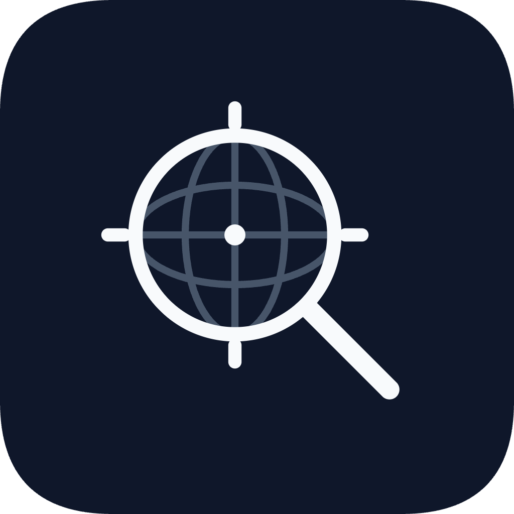
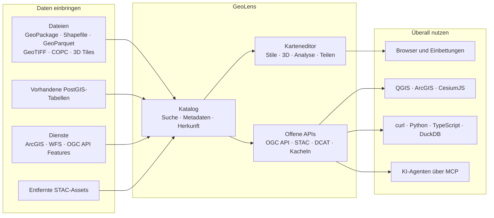

<p align="center">
  
</p>

<h1 align="center">GeoLens</h1>

<p align="center">
  <b>Ein selbst gehosteter Geodatenkatalog und Karteneditor, der festhält, woher jeder Datensatz stammt.</b>
</p>

<p align="center">
  <a href="https://demo.getgeolens.com"><b>Live-Demo</b></a> ·
  <a href="#installation">Installation</a> ·
  <a href="https://docs.getgeolens.com">Dokumentation</a> ·
  <a href="#daten-von-überall-nutzen">QGIS oder Code anbinden</a> ·
  <a href="https://github.com/geolens-io/geolens/discussions">Discussions</a>
</p>

<div align="center">

[English](README.md) · [Español](README.es.md) · [Français](README.fr.md) · [Deutsch](README.de.md) · [简体中文](README.zh.md)

[](https://github.com/geolens-io/geolens/releases/latest)
[](https://github.com/geolens-io/geolens/actions/workflows/ci.yml)
[](LICENSE)

</div>

<p align="center">
  <a href="https://demo.getgeolens.com/maps">
    <picture>
      <source media="(prefers-color-scheme: dark)" srcset=".github/assets/geolens-manhattan-3d-hero-dark.jpg">
      
    </picture>
  </a>
  <br>
  <sub>Manhattans Gebäude in ihren vermessenen Dachhöhen, nach Bauzeit eingefärbt, mit dem U-Bahn-Netz. <a href="https://demo.getgeolens.com/maps">Die Karten der Demo ansehen</a>.</sub>
</p>

GeoLens ist für Teams gedacht, deren Geodaten über Dateifreigaben, PostGIS-Datenbanken,
Webdienste und STAC-Kataloge verstreut sind. Es führt diese Daten in einem durchsuchbaren Katalog
zusammen, hält fest, woher jeder Datensatz stammt, und prüft, ob die Quelle noch aktuell ist. Teams
erstellen und teilen Karten im Browser, und QGIS, Skripte und KI-Agenten lesen dieselben Daten über
OGC API und STAC. GeoLens läuft mit Docker Compose auf Ihren eigenen Servern, sendet keine
Telemetrie und steht unter der Apache-2.0-Lizenz.

Die [Demo](https://demo.getgeolens.com) braucht weder Installation noch Konto; für den Karteneditor
melden Sie sich mit Google, GitHub oder Microsoft an. Demodaten können jederzeit gelöscht werden.

## So greift alles ineinander



## Ein Katalog für verstreute Daten

<p align="center">
  <picture>
    <source media="(prefers-color-scheme: dark)" srcset=".github/assets/geolens-catalog-search-dark.png">
    
  </picture>
  <br>
  <sub>Suche nach Bedeutung: „where storms hit the coast“ findet Hurrikanbahnen, Sturmkorridore und Ebenen zur Küstenexposition.</sub>
</p>

- Laden Sie Shapefile, GeoPackage, GeoJSON, GeoParquet, FlatGeobuf, KML/KMZ, gezippte File
  Geodatabase, CSV, Excel oder GeoTIFF hoch (wird in Cloud-Optimized GeoTIFF umgewandelt).
  3D Tiles und COPC-Punktwolken werden für CesiumJS, QGIS und Potree bereitgestellt.
- Stellen Sie Tabellen, die bereits in der PostGIS-Datenbank von GeoLens liegen, direkt bereit,
  importieren Sie WFS-, ArcGIS- und OGC-API-Features-Layer und aktualisieren Sie sie bei Bedarf,
  oder referenzieren Sie entfernte STAC-Assets, ohne sie zu kopieren.
- Zeichnen Sie neue Datensätze im Browser.
- Finden Sie Daten mit der unscharfen Suche, oder nach Bedeutung, sobald ein Embedding-Anbieter
  konfiguriert ist. Filtern Sie nach Typ, Ort und Zeit, fassen Sie Datensätze zu Collections
  zusammen, bearbeiten Sie Metadaten und stellen Sie nach einem Austausch die vorherige Version eines Datensatzes wieder her.

## Wissen, woher jeder Datensatz stammt

<p align="center">
  <picture>
    <source media="(prefers-color-scheme: dark)" srcset=".github/assets/geolens-provenance-dark.png">
    
  </picture>
  <br>
  <sub>Ein aus dem USGS-Erdbebendienst importierter Datensatz.</sub>
</p>

Jeder Datensatz hält die Datei, Tabelle, den Dienst oder das STAC-Element fest, aus dem er stammt,
und wann er zuletzt aktualisiert wurde. Geben Sie ihm einen Aktualisierungsrhythmus, und GeoLens
markiert ihn als aktuell, fällig oder überfällig. Bei Diensten und STAC-Quellen prüft GeoLens
außerdem, ob die Quelle noch antwortet, und meldet Schemaänderungen auf der Quellseite, bevor sie
Ihre Karten erreichen. Verschwindet ein Dienst, funktioniert die importierte Kopie weiter.

## Karten erstellen und teilen

<p align="center">
  <picture>
    <source media="(prefers-color-scheme: dark)" srcset=".github/assets/geolens-matterhorn-terrain-dark.jpg">
    
  </picture>
  <br>
  <sub>Das Matterhorn als 3D-Gelände aus swissALTI3D-Lidar, mit Gipfeln und Kletterrouten aus OpenStreetMap.</sub>
</p>

- Punkt-, Symbol-, Heatmap-, Cluster-, Linien-, Pfeil-, Flächen-, 3D-Extrusions-, Raster- und
  Schummerungsebenen mit datengesteuerten Stilen, Beschriftungen, Symbolen, Mustern, Filtern und
  Popups. Das Gelände stammt aus Ihren eigenen Höhenmodellen.
- Puffer, Zentroid, Zuschneiden, Auflösen, räumliche Verknüpfung, Auswahl nach Lage, Messen und
  Verschneiden. Die meisten Operationen zeigen eine Vorschau auf der Karte, und jedes Ergebnis wird
  als neuer Datensatz gespeichert, im Editor oder über die CLI.
- Öffentliche Links zeigen Titel und Bild der Karte, wenn sie in Slack, Teams oder soziale
  Netzwerke eingefügt werden, und Karten lassen sich mit privaten Tokens in andere Websites
  einbetten.
- Die Oberfläche gibt es auf Englisch, Spanisch, Französisch, Deutsch und in vereinfachtem
  Chinesisch.

## Daten von überall nutzen

Vektordatensätze sind OGC-API-Features-Collections, der Katalog ist OGC API Records und STAC, und
jede Ebene hat eine Kachel-URL. Sie können das ohne Konto gegen die Demo ausprobieren (der zweite
Befehl braucht `jq`):

```sh
# Search the catalog (OGC API Records)
curl "https://demo.getgeolens.com/api/collections/datasets/items?q=volcanic%20eruptions"

# Read the top match with a CQL2 filter (OGC API Features): eruptions of VEI 6 or larger
ID=$(curl -s "https://demo.getgeolens.com/api/collections/datasets/items?q=volcanic%20eruptions&limit=1" | jq -r '.features[0].id')
curl -G "https://demo.getgeolens.com/api/collections/$ID/items" \
  --data-urlencode "filter=vei >= 6" -d limit=3
```

Fügen Sie in QGIS `https://demo.getgeolens.com/api/` als WFS-/OGC-API-Features-Verbindung hinzu,
um die öffentlichen Datensätze als Ebenen aufzulisten. Die
[QGIS-Anleitung](https://docs.getgeolens.com/guides/api/qgis/) beschreibt die Schritte.

<p align="center">
  
  <br>
  <sub>QGIS liest die Demo über OGC API Features, ohne Plugin.</sub>
</p>

| Standard | Wo | Nutzbar mit |
|---|---|---|
| OGC API Features, mit CQL2-Filterung und Queryables | `/api/collections/{id}/items` | QGIS, ArcGIS, GDAL/OGR und andere OGC-API-Clients |
| OGC API Records | `/api/collections/datasets/items` | Katalogsuche aus anderen Portalen und Werkzeugen |
| STAC API 1.0 | `/api/stac/` | STAC-Clients wie pystac-client und STAC Browser |
| DCAT 3, DCAT-US 3.0 und GeoDCAT-AP als JSON-LD | `/api/datasets/dcat/`, `/api/datasets/dcat-us/3.0/`, `/api/datasets/geodcat-ap/` | Harvesting in nationale und EU-Open-Data-Portale |
| Vektorkacheln und COG-Rasterkacheln | eine Kachel-URL an jeder Ebene | MapLibre, OpenLayers, Leaflet |
| 3D Tiles und COPC | die Seite jedes 3D-Datensatzes | CesiumJS, QGIS, Potree |

Vektorkacheln lassen unterhalb von Zoomstufe 10 Attributspalten weg; hängen Sie
`cols=<column>,<column>` an eine Kachel-URL an, um bestimmte Spalten zu behalten. Daten lassen sich
als GeoJSON, Shapefile, GeoPackage, CSV, FlatGeobuf, GeoParquet, PMTiles oder Cloud-Optimized
GeoTIFF exportieren.

Die `geolens`-CLI veröffentlicht Dateien und wendet Katalogmanifeste an, Python- und
TypeScript-SDKs decken die API ab, und ein rein lesender MCP-Server lässt KI-Agenten den Katalog
durchsuchen. Die [Beispielgalerie](https://geolens-io.github.io/geolens-examples/) enthält
lauffähigen Code für MapLibre, Leaflet, OpenLayers, das ArcGIS Maps SDK, QGIS und DuckDB.

## Optionale KI

<p align="center">
  <picture>
    <source media="(prefers-color-scheme: dark)" srcset=".github/assets/geolens-ask-ai-dark.png">
    
  </picture>
  <br>
  <sub>„How many of these hurricanes made landfall?“ liefert die Zahl, eine Tabelle und die Annahme, auf der die Antwort beruht.</sub>
</p>

GeoLens kann Fragen zu einem Datensatz beantworten, Karten anhand von Anfragen in normaler Sprache
bearbeiten, Metadaten entwerfen und in natürlicher Sprache suchen. Es funktioniert mit jedem
OpenAI-kompatiblen Endpunkt, auch mit einem lokalen Server wie Ollama, und mit Claude über
Anthropic, Microsoft Foundry, Amazon Bedrock oder Google Vertex AI. KI bleibt ausgeschaltet, bis
ein Administrator einen Anbieter konfiguriert, und jeder Arbeitsablauf funktioniert auch ohne.

## Installation

Sie brauchen Git, Docker Engine 24+ und Docker Compose v2. Eine frische Installation startet sechs
Container mit etwa 1,3 GB Arbeitsspeicher auf linux/amd64 oder linux/arm64.

```sh
curl -fsSL https://getgeolens.com/install.sh | sh    # clone, generate secrets, start the stack
cd geolens
grep '^GEOLENS_ADMIN_PASSWORD=' .env                  # the generated admin password
```

Öffnen Sie http://localhost:8080 und melden Sie sich als `admin` an, dem Standardbenutzernamen des
Installers. Der Installer erzeugt Geheimnisse und das Admin-Passwort, lädt die vorgefertigten Images
und startet den Stack in etwa einer Minute. Um das Skript zuvor zu prüfen, laden Sie `install.sh`
und `SHA256SUMS` aus demselben [Release](https://github.com/geolens-io/geolens/releases) herunter
und führen Sie `sha256sum -c SHA256SUMS` aus (unter macOS `shasum -a 256 -c SHA256SUMS`).

- Zum Bauen aus dem Quellcode klonen Sie das Repository und führen `bash scripts/install.sh` aus.
  Der erste Build dauert 5-10 Minuten.
- Die vorgefertigten Images sind `ghcr.io/geolens-io/geolens-api` und
  `ghcr.io/geolens-io/geolens-frontend`, und `latest` ist die neueste stabile Version.
- Für die Produktion lesen Sie die
  [Installationsanleitung](https://docs.getgeolens.com/guides/quickstart/install/) und die Anleitungen
  für [verwaltete Cloud-Dienste](https://docs.getgeolens.com/guides/quickstart/cloud-deployment/).
  Docker Compose ist der unterstützte Weg; ein experimentelles, von der Community gepflegtes
  Helm-Chart liegt in
  [geolens-deployments](https://github.com/geolens-io/geolens-deployments).

Eine externe Datenbank muss PostgreSQL 15+ mit PostGIS, pgvector 0.5+, pg_trgm und unaccent sein,
und ihre Sicherung liegt bei Ihnen. Die mitgelieferte Datenbank wird täglich und wöchentlich
gesichert, optional mit externen Kopien auf S3. Um eine Installation mit vorgefertigten Images zu
aktualisieren, führen Sie `./scripts/upgrade.sh` im Installationsverzeichnis aus: Das Skript sichert
die Datenbank, lädt die neuen Images und migriert hinter einer Zustandsprüfung. Bei Quell-Builds
aktualisieren Sie den Checkout und bauen neu. [UPGRADING.md](UPGRADING.md) behandelt beides,
einschließlich Rollback.

[RUNBOOK.md](RUNBOOK.md) behandelt den Betrieb, `infra/monitoring/` enthält Prometheus-Alarmregeln
und ein Grafana-Dashboard, und die
[Konfigurationsreferenz](https://docs.getgeolens.com/guides/quickstart/configuration/) listet jede
Einstellung auf.

## Ihr erster Datensatz

Veröffentlichen Sie die Beispieldatei mit der CLI und lesen Sie sie dann über OGC API Features zurück:

```sh
pip install geolens-cli                               # needs Python 3.11+
geolens login http://localhost:8080/api               # your admin username and password
geolens publish examples/manifests/first-catalog/city-parks.geojson --name "City Parks"
export GEOLENS_API_KEY="paste-your-api-key-here"      # create one on your Settings page
curl -H "X-Api-Key: $GEOLENS_API_KEY" \
  "http://localhost:8080/api/collections/<dataset-id>/items?limit=5"
```

`geolens publish` gibt die URL des Datensatzes aus, die auf seine ID endet. Um einen ganzen Katalog
zu verwalten, beschreiben Sie die Quellen in einem Manifest `geolens.yaml` und führen
`geolens apply` aus; [`examples/manifests/`](examples/manifests/) enthält Vorlagen, und die
[CLI-Anleitung](https://docs.getgeolens.com/guides/cli/) beschreibt das Schema.

Um die Karten und Datensätze der Demo (öffentliche offene Daten) in Ihre Installation zu laden,
führen Sie das Seed-Skript aus. Verwenden Sie Ihren eigenen Admin-Benutzernamen, falls Sie ihn
geändert haben.

```sh
pip install httpx
GEOLENS_ADMIN_PASSWORD="$(grep '^GEOLENS_ADMIN_PASSWORD=' .env | cut -d= -f2-)" \
  python scripts/seed-showcase.py --username admin
```

Die [API-Referenz](https://docs.getgeolens.com/guides/api/) und die
[SDK-Anleitungen](https://docs.getgeolens.com/guides/sdk/) behandeln den Rest.

## Datenschutz und Zugriff

- GeoLens sendet keine Telemetrie. Abgesehen von den Standard-Basiskartenkacheln und den entfernten
  Diensten oder STAC-Quellen, die Ihre Nutzer registrieren, stellt es nur für Funktionen
  ausgehende Verbindungen her, die ein Administrator aktiviert. [EGRESS.md](EGRESS.md) listet sie
  auf und erklärt den Betrieb ohne Internetzugang.
- Ihre Daten bleiben auch ohne GeoLens lesbar. Vektordatensätze sind gewöhnliche PostGIS-Tabellen
  in einem Schema `data`, Raster sind Cloud-Optimized GeoTIFFs in Ihrem eigenen Speicher (lokaler
  Datenträger, S3/MinIO oder Azure Blob), und der Katalog lässt sich über OGC API, STAC und DCAT
  exportieren.
- Die Anmeldung erfolgt über lokale Konten oder OAuth 2.0/OIDC (Google, Microsoft, GitHub oder ein
  generischer Anbieter), mit Rollen, Berechtigungen je Datensatz, API-Schlüsseln je Benutzer und
  einem Audit-Log. Die Selbstregistrierung ist standardmäßig deaktiviert.
- Alles in diesem Repository steht unter Apache 2.0, und hier veröffentlichte Funktionen bleiben
  frei. [EDITIONS.md](EDITIONS.md) beschreibt den optionalen bezahlten Support und die
  Erweiterungen.

## Bekannte Einschränkungen

- Eine PostgreSQL-Instanz, ohne integrierte Hochverfügbarkeit oder Clusterbildung.
- Eine Organisation pro Bereitstellung.
- Die Geländedarstellung setzt Höhenwerte in Metern voraus; andere vertikale Einheiten erscheinen
  überhöht.
- Die eigene REST-API von GeoLens kann sich zwischen Minor-Versionen ändern (die Standard-Endpunkte
  folgen ihren Spezifikationen). Der [CHANGELOG](CHANGELOG.md) listet Vertragsänderungen auf, und
  bei einer inkompatiblen Änderung bleibt die alte Form eine weitere Minor-Version funktionsfähig.

## Mitwirken

Fehlerberichte, Korrekturen, Übersetzungen und Dokumentation sind willkommen.
[CONTRIBUTING](.github/CONTRIBUTING.md) behandelt die Einrichtung (`make dev-init`, dann
`make dev`), Tests und das DCO-Sign-off, und [ARCHITECTURE](.github/ARCHITECTURE.md) zeigt den
Code. Stellen Sie Fragen in den
[GitHub Discussions](https://github.com/geolens-io/geolens/discussions), melden Sie Fehler in den
[Issues](https://github.com/geolens-io/geolens/issues) und Sicherheitsprobleme privat, wie in
[SECURITY.md](.github/SECURITY.md) beschrieben. Die
[Roadmap](https://docs.getgeolens.com/roadmap/) zeigt, was geplant ist.

## Lizenz

GeoLens steht unter der [Apache License 2.0](LICENSE). Name, Logo und Markenmaterialien von
GeoLens fallen nicht unter diese Lizenz; siehe [TRADEMARKS.md](TRADEMARKS.md). Quellenangaben zu
Beispieldaten stehen in [THIRD_PARTY_DATA.md](THIRD_PARTY_DATA.md).

Projektrichtlinien: [Editionen](EDITIONS.md) · [Support](SUPPORT.md) · [Governance](GOVERNANCE.md) · [Maintainer](MAINTAINERS.md) · [Sicherheit](.github/SECURITY.md) · [Release-Prozess](RELEASE.md) · [ausgehender Datenverkehr &amp; Air-Gap](EGRESS.md)
