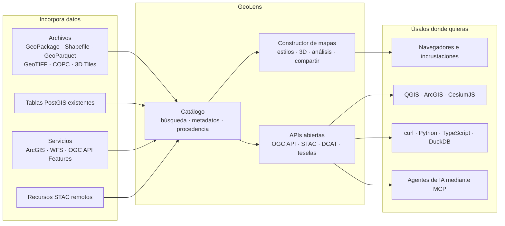

<p align="center">
  
</p>

<h1 align="center">GeoLens</h1>

<p align="center">
  <b>Un catálogo de datos espaciales y constructor de mapas autoalojado que registra el origen de cada conjunto de datos.</b>
</p>

<p align="center">
  <a href="https://demo.getgeolens.com"><b>Demostración en vivo</b></a> ·
  <a href="#instalación">Instalación</a> ·
  <a href="https://docs.getgeolens.com">Documentación</a> ·
  <a href="#usa-los-datos-desde-cualquier-lugar">Conecta QGIS o código</a> ·
  <a href="https://github.com/geolens-io/geolens/discussions">Debates</a>
</p>

<div align="center">

[English](README.md) · [Español](README.es.md) · [Français](README.fr.md) · [Deutsch](README.de.md) · [简体中文](README.zh.md)

[](https://github.com/geolens-io/geolens/releases/latest)
[](https://github.com/geolens-io/geolens/actions/workflows/ci.yml)
[](LICENSE)

</div>

<p align="center">
  <a href="https://demo.getgeolens.com/maps">
    <picture>
      <source media="(prefers-color-scheme: dark)" srcset=".github/assets/geolens-manhattan-3d-hero-dark.jpg">
      
    </picture>
  </a>
  <br>
  <sub>Los edificios de Manhattan a la altura medida de sus tejados, coloreados por época de construcción, con la red de metro. <a href="https://demo.getgeolens.com/maps">Explora los mapas de la demostración</a>.</sub>
</p>

GeoLens está pensado para equipos cuyos datos espaciales están repartidos entre recursos
compartidos de archivos, bases de datos PostGIS, servicios web y catálogos STAC. Los reúne en un
único catálogo con búsqueda, registra el origen de cada conjunto de datos y comprueba si su fuente
sigue vigente. Los equipos crean y comparten mapas en el navegador, y QGIS, los scripts y los
agentes de IA leen los mismos datos mediante OGC API y STAC. Se ejecuta en tus propios servidores
con Docker Compose, no envía telemetría y tiene licencia Apache 2.0.

La [demostración](https://demo.getgeolens.com) no requiere instalación ni cuenta; inicia sesión
con Google, GitHub o Microsoft para usar el constructor de mapas. Los datos de la demostración
pueden borrarse en cualquier momento.

## Cómo encaja todo



## Un catálogo para datos dispersos

<p align="center">
  <picture>
    <source media="(prefers-color-scheme: dark)" srcset=".github/assets/geolens-catalog-search-dark.png">
    
  </picture>
  <br>
  <sub>Búsqueda por significado: "where storms hit the coast" encuentra trayectorias de huracanes, corredores de tormentas y capas de exposición costera.</sub>
</p>

- Sube Shapefile, GeoPackage, GeoJSON, GeoParquet, FlatGeobuf, KML/KMZ, File Geodatabase
  comprimida en zip, CSV, Excel o GeoTIFF (convertido a Cloud-Optimized GeoTIFF). Los 3D Tiles y
  las nubes de puntos COPC se alojan para CesiumJS, QGIS y Potree.
- Sirve in situ las tablas que ya están en la base de datos PostGIS de GeoLens, importa capas WFS,
  ArcGIS y OGC API Features y actualízalas bajo demanda, o referencia recursos STAC remotos sin
  copiarlos.
- Dibuja conjuntos de datos nuevos en el navegador.
- Encuentra datos con búsqueda aproximada, o por significado una vez configurado un proveedor de
  embeddings. Filtra por tipo, lugar y fecha, agrupa los conjuntos de datos en colecciones, edita
  los metadatos y restaura versiones anteriores.

## Conoce el origen de cada conjunto de datos

<p align="center">
  <picture>
    <source media="(prefers-color-scheme: dark)" srcset=".github/assets/geolens-provenance-dark.png">
    
  </picture>
  <br>
  <sub>Un conjunto de datos importado del servicio de terremotos del USGS.</sub>
</p>

Cada conjunto de datos registra el archivo, la tabla, el servicio o el ítem STAC del que procede y
cuándo se actualizó por última vez. Si le indicas una frecuencia de actualización, GeoLens lo
marca como actualizado, pendiente o atrasado. En los servicios y las fuentes STAC, GeoLens también
comprueba que la fuente siga respondiendo y avisa de los cambios de esquema en origen antes de que
lleguen a tus mapas. Si un servicio desaparece, la copia importada sigue funcionando.

## Crea y comparte mapas

<p align="center">
  <picture>
    <source media="(prefers-color-scheme: dark)" srcset=".github/assets/geolens-matterhorn-terrain-dark.jpg">
    
  </picture>
  <br>
  <sub>El Cervino como terreno 3D a partir de lidar swissALTI3D, con cumbres y rutas de escalada de OpenStreetMap.</sub>
</p>

- Capas de puntos, símbolos, mapas de calor, agrupaciones, líneas, flechas, polígonos, extrusión
  3D, ráster y sombreado del relieve, con estilos basados en datos, etiquetas, iconos, patrones,
  filtros y ventanas emergentes. El terreno procede de tus propios modelos de elevación.
- Zona de influencia, centroide, recorte, disolución, unión espacial, selección por ubicación,
  medición e intersección. La mayoría de las operaciones se previsualizan en el mapa, y cada
  resultado se guarda como un conjunto de datos nuevo, desde el constructor o desde la CLI.
- Los enlaces públicos muestran el título y la imagen del mapa al pegarse en Slack, Teams o
  redes sociales, y los mapas se incrustan en otros sitios con tokens privados.
- La interfaz está en inglés, español, francés, alemán y chino simplificado.

## Usa los datos desde cualquier lugar

Los conjuntos de datos vectoriales son colecciones OGC API Features, el catálogo es OGC API
Records y STAC, y cada capa tiene una URL de teselas. Puedes probarlo con la demostración sin
cuenta (el segundo comando necesita `jq`):

```sh
# Search the catalog (OGC API Records)
curl "https://demo.getgeolens.com/api/collections/datasets/items?q=volcanic%20eruptions"

# Read the top match with a CQL2 filter (OGC API Features): eruptions of VEI 6 or larger
ID=$(curl -s "https://demo.getgeolens.com/api/collections/datasets/items?q=volcanic%20eruptions&limit=1" | jq -r '.features[0].id')
curl -G "https://demo.getgeolens.com/api/collections/$ID/items" \
  --data-urlencode "filter=vei >= 6" -d limit=3
```

En QGIS, añade `https://demo.getgeolens.com/api/` como conexión WFS / OGC API Features para ver
los conjuntos de datos públicos como capas. La
[guía de QGIS](https://docs.getgeolens.com/guides/api/qgis/) explica los pasos.

<p align="center">
  
  <br>
  <sub>QGIS leyendo la demostración mediante OGC API Features, sin ningún complemento.</sub>
</p>

| Estándar | Dónde | Úsalo con |
|---|---|---|
| OGC API Features, con filtrado CQL2 y queryables | `/api/collections/{id}/items` | QGIS, ArcGIS, GDAL/OGR y otros clientes OGC API |
| OGC API Records | `/api/collections/datasets/items` | Búsqueda en el catálogo desde otros portales y herramientas |
| STAC API 1.0 | `/api/stac/` | Clientes STAC como pystac-client y STAC Browser |
| DCAT 3, DCAT-US 3.0 y GeoDCAT-AP como JSON-LD | `/api/datasets/dcat/`, `/api/datasets/dcat-us/3.0/`, `/api/datasets/geodcat-ap/` | Recolección en portales de datos abiertos nacionales y de la UE |
| Teselas vectoriales y teselas ráster COG | una URL de teselas en cada capa | MapLibre, OpenLayers, Leaflet |
| 3D Tiles y COPC | la página de cada conjunto de datos 3D | CesiumJS, QGIS, Potree |

Las teselas vectoriales omiten las columnas de atributos por debajo del zoom 10; añade
`cols=<column>,<column>` a la URL de una tesela para conservar columnas concretas. Los datos se
exportan como GeoJSON, Shapefile, GeoPackage, CSV, FlatGeobuf, GeoParquet, PMTiles o
Cloud-Optimized GeoTIFF.

La CLI `geolens` publica archivos y aplica manifiestos de catálogo, los SDK de Python y TypeScript
cubren la API, y un servidor MCP de solo lectura permite a los agentes de IA buscar en el
catálogo. La [galería de ejemplos](https://geolens-io.github.io/geolens-examples/) incluye código
ejecutable para MapLibre, Leaflet, OpenLayers, el ArcGIS Maps SDK, QGIS y DuckDB.

## IA opcional

<p align="center">
  <picture>
    <source media="(prefers-color-scheme: dark)" srcset=".github/assets/geolens-ask-ai-dark.png">
    
  </picture>
  <br>
  <sub>"How many of these hurricanes made landfall?" devuelve el recuento, una tabla y el supuesto en que se basa la respuesta.</sub>
</p>

GeoLens puede responder preguntas sobre un conjunto de datos, editar mapas a partir de peticiones
en lenguaje natural, redactar metadatos y buscar en lenguaje natural. Funciona con cualquier
endpoint compatible con OpenAI, incluido un servidor local como Ollama, y con Claude a través de
Anthropic, Microsoft Foundry, Amazon Bedrock o Google Vertex AI. La IA permanece desactivada hasta
que un administrador configura un proveedor, y todos los flujos de trabajo funcionan sin ella.

## Instalación

Necesitas Docker Engine 24+ y Docker Compose v2. Una instalación nueva ejecuta seis contenedores
con unos 1,3 GB de memoria en linux/amd64 o linux/arm64.

```sh
curl -fsSL https://getgeolens.com/install.sh | sh    # clone, generate secrets, start the stack
cd geolens
grep '^GEOLENS_ADMIN_PASSWORD=' .env                  # the generated admin password
```

Abre http://localhost:8080 e inicia sesión como `admin`, el usuario predeterminado del
instalador. El instalador genera los secretos y la contraseña de administrador, descarga las
imágenes precompiladas e inicia la pila en cerca de un minuto. Para verificar antes el script,
descarga `install.sh` y `SHA256SUMS` de la misma
[versión](https://github.com/geolens-io/geolens/releases) y ejecuta `sha256sum -c SHA256SUMS`
(`shasum -a 256 -c SHA256SUMS` en macOS).

- Para compilar desde el código fuente, clona el repositorio y ejecuta `bash scripts/install.sh`.
  La primera compilación tarda 5-10 minutos.
- Las imágenes precompiladas son `ghcr.io/geolens-io/geolens-api` y
  `ghcr.io/geolens-io/geolens-frontend`, y `latest` es la última versión estable.
- Para producción, consulta la [Guía de instalación](https://docs.getgeolens.com/guides/quickstart/install/)
  y las guías de [servicios gestionados en la nube](https://docs.getgeolens.com/guides/quickstart/cloud-deployment/).
  Docker Compose es la vía compatible; un chart de Helm experimental, mantenido por la comunidad,
  está en [geolens-deployments](https://github.com/geolens-io/geolens-deployments).

Una base de datos externa debe ser PostgreSQL 15+ con PostGIS, pgvector 0.5+, pg_trgm y unaccent,
y sus copias de seguridad corren por tu cuenta. La base de datos incluida se copia a diario y
semanalmente, con copias externas opcionales en S3. Para actualizar una instalación con imágenes
precompiladas, ejecuta `./scripts/upgrade.sh` en el directorio de instalación: hace una copia de
seguridad de la base de datos, descarga las nuevas imágenes y migra con una comprobación de
estado. Las instalaciones compiladas desde el código fuente actualizan el repositorio y vuelven a
compilar. [UPGRADING.md](UPGRADING.md) cubre ambos casos, incluida la reversión.

[RUNBOOK.md](RUNBOOK.md) cubre las operaciones, `infra/monitoring/` incluye reglas de alerta de
Prometheus y un panel de Grafana, y la
[Referencia de configuración](https://docs.getgeolens.com/guides/quickstart/configuration/) lista
todos los ajustes.

## Tu primer conjunto de datos

Publica el archivo de ejemplo con la CLI y léelo de vuelta mediante OGC API Features:

```sh
pip install geolens-cli                               # needs Python 3.11+
geolens login http://localhost:8080/api               # your admin username and password
geolens publish examples/manifests/first-catalog/city-parks.geojson --name "City Parks"
export GEOLENS_API_KEY="paste-your-api-key-here"      # create one on your Settings page
curl -H "X-Api-Key: $GEOLENS_API_KEY" \
  "http://localhost:8080/api/collections/<dataset-id>/items?limit=5"
```

`geolens publish` imprime la URL del conjunto de datos, que termina en su id. Para gestionar un
catálogo completo, describe las fuentes en un manifiesto `geolens.yaml` y ejecuta `geolens apply`;
[`examples/manifests/`](examples/manifests/) tiene plantillas y la
[guía de la CLI](https://docs.getgeolens.com/guides/cli/) describe el esquema.

Para cargar en tu instalación los mapas y conjuntos de datos de la demostración (datos abiertos
públicos), ejecuta el script de carga. Usa tu propio usuario administrador si lo cambiaste.

```sh
pip install httpx
GEOLENS_ADMIN_PASSWORD="$(grep '^GEOLENS_ADMIN_PASSWORD=' .env | cut -d= -f2-)" \
  python scripts/seed-showcase.py --username admin
```

La [referencia de la API](https://docs.getgeolens.com/guides/api/) y las
[guías de los SDK](https://docs.getgeolens.com/guides/sdk/) cubren el resto.

## Privacidad y acceso

- GeoLens no envía telemetría. Salvo las teselas del mapa base predeterminado y los servicios
  remotos o las fuentes STAC que registran tus usuarios, solo realiza conexiones salientes para
  las funciones que un administrador activa. [EGRESS.md](EGRESS.md) las lista y explica cómo
  operar en un entorno aislado de la red.
- Tus datos siguen siendo legibles sin GeoLens. Los conjuntos de datos vectoriales son tablas
  PostGIS normales en un esquema `data`, los ráster son Cloud-Optimized GeoTIFF en tu propio
  almacenamiento (disco local, S3/MinIO o Azure Blob), y el catálogo se exporta mediante OGC API,
  STAC y DCAT.
- El inicio de sesión usa cuentas locales u OAuth 2.0/OIDC (Google, Microsoft, GitHub o un
  proveedor genérico), con roles, permisos por conjunto de datos, claves de API por usuario y un
  registro de auditoría. El autorregistro está desactivado por defecto.
- Todo lo de este repositorio es Apache 2.0, y las funciones publicadas aquí seguirán siendo
  gratuitas. [EDITIONS.md](EDITIONS.md) describe el soporte de pago y los complementos opcionales.

## Limitaciones conocidas

- Una sola instancia de PostgreSQL, sin alta disponibilidad ni clústeres integrados.
- Una organización por instalación.
- La representación del terreno supone que la elevación está en metros; otras unidades verticales
  se representan exageradas.
- La API REST propia de GeoLens puede cambiar entre versiones menores (los endpoints de los
  estándares siguen sus especificaciones). El [CHANGELOG](CHANGELOG.md) lista los cambios de
  contrato, y un cambio incompatible mantiene la forma anterior funcionando durante una versión
  menor más.

## Cómo contribuir

Se agradecen los informes de errores, las correcciones, las traducciones y la documentación.
[CONTRIBUTING](.github/CONTRIBUTING.md) cubre la configuración (`make dev-init` y después
`make dev`), las pruebas y la firma DCO, y [ARCHITECTURE](.github/ARCHITECTURE.md) describe el
código. Haz tus preguntas en [GitHub Discussions](https://github.com/geolens-io/geolens/discussions),
informa de los errores en [Issues](https://github.com/geolens-io/geolens/issues) y comunica los
problemas de seguridad de forma privada, como se describe en [SECURITY.md](.github/SECURITY.md).
La [hoja de ruta](https://docs.getgeolens.com/roadmap/) muestra lo planificado.

## Licencia

GeoLens se distribuye bajo la [Apache License 2.0](LICENSE). El nombre, el logotipo y los
recursos de marca de GeoLens no están cubiertos por esta licencia; consulta
[TRADEMARKS.md](TRADEMARKS.md). La atribución de los datos de muestra está en
[THIRD_PARTY_DATA.md](THIRD_PARTY_DATA.md).

Políticas del proyecto: [ediciones](EDITIONS.md) · [soporte](SUPPORT.md) · [gobernanza](GOVERNANCE.md) · [mantenedores](MAINTAINERS.md) · [seguridad](.github/SECURITY.md) · [proceso de publicación](RELEASE.md) · [salida de red y entornos aislados](EGRESS.md)
