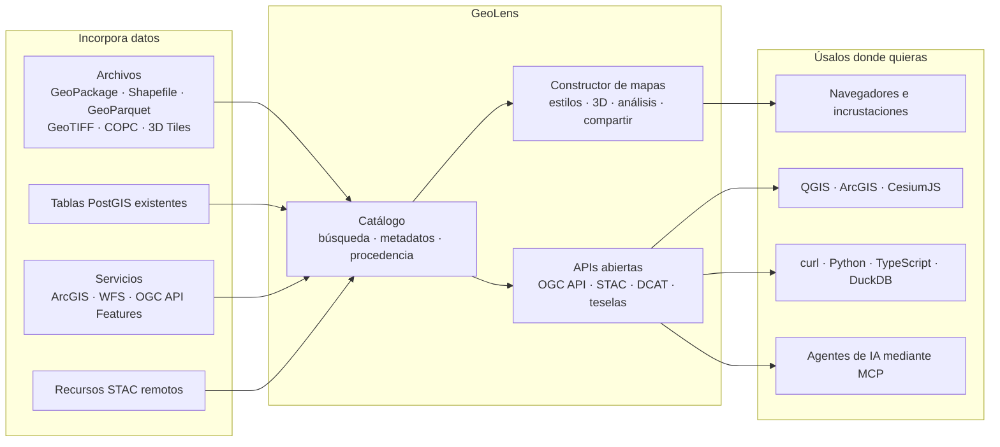

<p align="center">
  
</p>

<h1 align="center">GeoLens</h1>

<p align="center">
  <b>Un catálogo de datos espaciales y constructor de mapas autoalojado que registra el origen de cada conjunto de datos.</b>
</p>

<p align="center">
  <a href="https://demo.getgeolens.com"><b>Demostración en vivo</b></a> ·
  <a href="#instalación">Instalación</a> ·
  <a href="https://docs.getgeolens.com">Documentación</a> ·
  <a href="#usa-los-datos-desde-cualquier-lugar">Conecta QGIS o código</a> ·
  <a href="https://github.com/geolens-io/geolens/discussions">Debates</a>
</p>

<div align="center">

[English](README.md) · [Español](README.es.md) · [Français](README.fr.md) · [Deutsch](README.de.md) · [简体中文](README.zh.md)

[](https://github.com/geolens-io/geolens/releases/latest)
[](https://github.com/geolens-io/geolens/actions/workflows/ci.yml)
[](LICENSE)

</div>

<p align="center">
  <a href="https://demo.getgeolens.com/maps/146eddc1-30af-4c8e-aa6f-a6569e663823">
    <picture>
      <source media="(prefers-color-scheme: dark)" srcset=".github/assets/geolens-manhattan-3d-hero-dark.jpg">
      
    </picture>
  </a>
  <br>
  <sub>Los edificios de Manhattan a la altura medida de sus tejados, coloreados por época de construcción, con la red de metro. <a href="https://demo.getgeolens.com/maps/146eddc1-30af-4c8e-aa6f-a6569e663823">Abre este mapa en la demostración</a>.</sub>
</p>

Los datos espaciales suelen estar en muchos lugares a la vez: recursos compartidos de archivos,
bases de datos PostGIS, servicios ArcGIS y WFS, catálogos STAC. GeoLens los reúne en un único
catálogo con búsqueda y registra el origen de cada conjunto de datos y si su fuente sigue
vigente. Las personas crean y comparten mapas a partir de ese catálogo en el navegador, mientras
QGIS, los scripts y los agentes de IA leen los mismos datos mediante OGC API y STAC. GeoLens se
ejecuta en tus propios servidores con Docker Compose, no envía telemetría y tiene licencia
Apache 2.0.

La [demostración](https://demo.getgeolens.com) no requiere instalación. Explora el catálogo y los
mapas sin una cuenta, o inicia sesión con Google, GitHub o Microsoft para probar el constructor de
mapas (los datos de la demostración pueden borrarse en cualquier momento).

## Cómo encaja todo



## Un catálogo para datos dispersos

<p align="center">
  <picture>
    <source media="(prefers-color-scheme: dark)" srcset=".github/assets/geolens-catalog-search-dark.png">
    
  </picture>
  <br>
  <sub>Búsqueda por significado: "where storms hit the coast" encuentra trayectorias de huracanes, corredores de tormentas y capas de exposición costera, cada una con su origen indicado.</sub>
</p>

- **Sube archivos.** Shapefile, GeoPackage, GeoJSON, GeoParquet, FlatGeobuf, KML/KMZ, File
  Geodatabase comprimida en zip, CSV y Excel. Los GeoTIFF se convierten en Cloud-Optimized
  GeoTIFF, y muchos ráster pueden combinarse en un mosaico dentro de un único VRT. Los conjuntos
  3D Tiles y las nubes de puntos COPC se alojan para CesiumJS, QGIS y Potree.
- **Registra lo que ya tienes.** Las tablas que ya están en la base de datos PostGIS de GeoLens
  se sirven in situ. Las capas WFS, ArcGIS FeatureServer y MapServer, y OGC API Features se
  importan y se actualizan bajo demanda. Los recursos STAC remotos se referencian sin copiarse.
- **Dibuja datos nuevos** en el navegador cuando aún no existen en ningún sitio.
- **Vuelve a encontrarlos.** La búsqueda aproximada funciona desde el primer momento, y la
  búsqueda por significado se activa al configurar un proveedor de embeddings. Filtra por tipo,
  lugar y fecha, agrupa los conjuntos de datos en colecciones, edita metadatos tipados y restaura
  versiones anteriores.

## Conoce el origen de cada conjunto de datos

<p align="center">
  <picture>
    <source media="(prefers-color-scheme: dark)" srcset=".github/assets/geolens-provenance-dark.png">
    
  </picture>
  <br>
  <sub>Terremotos importados del servicio del USGS. GeoLens conserva su propia copia y muestra cuándo actualizó y comprobó la fuente por última vez, y si esa fuente está en buen estado, vigente y sin cambios.</sub>
</p>

Cada conjunto de datos registra cómo entró en el catálogo: de qué archivo, tabla, servicio o ítem
STAC procede y cuándo se actualizó por última vez. Si declaras con qué frecuencia debe
actualizarse un conjunto de datos, GeoLens lo marca como actualizado, pendiente o atrasado. En
los servicios y las fuentes STAC también comprueba que la fuente siga respondiendo y avisa de los
cambios de esquema en origen antes de que lleguen a tus mapas. Si un servicio desaparece, el
conjunto de datos importado sigue funcionando con la copia de GeoLens.

## Crea y comparte mapas

<p align="center">
  <picture>
    <source media="(prefers-color-scheme: dark)" srcset=".github/assets/geolens-matterhorn-terrain-dark.jpg">
    
  </picture>
  <br>
  <sub>El Cervino como terreno 3D a partir de lidar swissALTI3D, con cumbres y rutas de escalada de OpenStreetMap.</sub>
</p>

- **Capas y estilos.** Capas de puntos, símbolos, mapas de calor, agrupaciones, líneas, flechas,
  polígonos, extrusión 3D, ráster y sombreado del relieve, con estilos basados en datos,
  etiquetas, iconos, patrones, filtros y ventanas emergentes. El terreno procede de tus propios
  modelos de elevación.
- **Análisis.** Zona de influencia, centroide, recorte, disolución, unión espacial, selección por
  ubicación, medición e intersección. La mayoría de las operaciones se previsualizan antes en el
  mapa, y cada resultado se guarda como un conjunto de datos nuevo, desde el constructor o desde
  la CLI.
- **Compartir.** Los enlaces públicos se despliegan con el título y la imagen del propio mapa en
  Slack, Teams y redes sociales. Los mapas se incrustan en otros sitios con tokens de
  incrustación privados.
- **Herramientas cotidianas.** Dibujo, leyenda, medición, historial del mapa y atajos de
  teclado, en inglés, español, francés, alemán o chino simplificado, con temas claro y oscuro.

## Usa los datos desde cualquier lugar

Cada conjunto de datos vectorial es una colección OGC API Features, el propio catálogo es OGC API
Records y STAC, y cada capa tiene una URL de teselas. Pruébalo con la demostración, sin instalar
nada ni crear una cuenta:

```sh
# Search the catalog (OGC API Records)
curl "https://demo.getgeolens.com/api/collections/datasets/items?q=volcano"

# Read a dataset with a CQL2 filter (OGC API Features): eruptions of VEI 6 or larger
curl -G "https://demo.getgeolens.com/api/collections/3b549894-ad65-4fbf-8fe1-9a163a8e8215/items" \
  --data-urlencode "filter=vei >= 6" -d limit=3
```

En QGIS, añade `https://demo.getgeolens.com/api/` como conexión WFS / OGC API Features y los
conjuntos de datos públicos aparecerán como capas; la
[guía de QGIS](https://docs.getgeolens.com/guides/api/qgis/) explica los pasos.

<p align="center">
  
  <br>
  <sub>QGIS leyendo el catálogo de la demostración mediante OGC API Features, sin ningún complemento: terremotos recientes, erupciones y límites de placas, todo servido por GeoLens.</sub>
</p>

| Estándar | Dónde | Úsalo con |
|---|---|---|
| OGC API Features, con filtrado CQL2 y queryables | `/api/collections/{id}/items` | QGIS, ArcGIS, GDAL/OGR y otros clientes OGC API |
| OGC API Records | `/api/collections/datasets/items` | Búsqueda en el catálogo desde otros portales y herramientas |
| STAC API 1.0 | `/api/stac/` | Clientes STAC como pystac-client y STAC Browser |
| DCAT 3, DCAT-US 3.0 y GeoDCAT-AP como JSON-LD | `/api/datasets/dcat/`, `/api/datasets/dcat-us/3.0/`, `/api/datasets/geodcat-ap/` | Recolección en portales de datos abiertos nacionales y de la UE |
| Teselas vectoriales y teselas ráster COG | una URL de teselas en cada capa | MapLibre, OpenLayers, Leaflet |
| 3D Tiles y COPC | la página de cada conjunto de datos 3D | CesiumJS, QGIS, Potree |

Las teselas vectoriales omiten las columnas de atributos por debajo del zoom 10; añade
`cols=<column>,<column>` a la URL de una tesela para conservar columnas concretas en todos los
zooms. Los datos salen como GeoJSON, Shapefile, GeoPackage, CSV o FlatGeobuf con reproyección
opcional, como GeoParquet, como archivos PMTiles para alojamiento estático o como
Cloud-Optimized GeoTIFF.

Para scripts y automatización hay una CLI `geolens`, que publica archivos y aplica manifiestos de
catálogo, SDK de Python y TypeScript generados a partir de la especificación OpenAPI, y un
servidor MCP de solo lectura que permite a los agentes de IA buscar en el catálogo y consultar
entidades. La [galería de ejemplos](https://geolens-io.github.io/geolens-examples/) incluye código
ejecutable para MapLibre, Leaflet, OpenLayers, el ArcGIS Maps SDK, QGIS y DuckDB. Sus ejemplos de
solo lectura se ejecutan contra la demostración, y la CI los repite allí cada semana.

## IA, solo si la quieres

<p align="center">
  <picture>
    <source media="(prefers-color-scheme: dark)" srcset=".github/assets/geolens-ask-ai-dark.png">
    
  </picture>
  <br>
  <sub>"How many of these hurricanes made landfall?" obtiene el recuento, una tabla y el supuesto en que se basa la respuesta, con un botón que abre el resultado en el constructor de mapas.</sub>
</p>

GeoLens puede responder preguntas sobre un conjunto de datos, editar mapas a partir de peticiones
en lenguaje natural, redactar metadatos y buscar en lenguaje natural. Funciona con cualquier
endpoint compatible con OpenAI, incluido un servidor de modelos local como Ollama, o con Claude a
través de Anthropic, Microsoft Foundry, Amazon Bedrock o Google Vertex AI. Todo permanece
desactivado hasta que un administrador configura un proveedor, y todos los flujos de trabajo
funcionan sin él.

## Instalación

Necesitas Docker Engine 24+ y Docker Compose v2. Una instalación nueva ejecuta seis contenedores
con unos 1,3 GB de memoria, en linux/amd64 o linux/arm64.

```sh
curl -fsSL https://getgeolens.com/install.sh | sh    # clone, generate secrets, start the stack
cd geolens
grep '^GEOLENS_ADMIN_PASSWORD=' .env                  # the generated admin password
```

Después abre http://localhost:8080 e inicia sesión como `admin`. El instalador clona GeoLens en
`./geolens`, escribe `.env` con secretos generados y una contraseña de administrador aleatoria,
descarga las imágenes precompiladas e inicia la pila en cerca de un minuto. Para revisar el script
antes de ejecutarlo, descarga `install.sh` y `SHA256SUMS` de la misma
[versión](https://github.com/geolens-io/geolens/releases) y ejecuta `sha256sum -c SHA256SUMS`
(`shasum -a 256 -c SHA256SUMS` en macOS).

Otras formas de empezar:

- **Desde el código fuente:** clona el repositorio y ejecuta `bash scripts/install.sh`. Compila
  todas las imágenes localmente, lo que tarda 5-10 minutos la primera vez.
- **Imágenes precompiladas:** `ghcr.io/geolens-io/geolens-api` y `ghcr.io/geolens-io/geolens-frontend`.
  La etiqueta `latest` sigue la última versión estable.
- **Producción:** la [Guía de instalación](https://docs.getgeolens.com/guides/quickstart/install/)
  cubre la configuración de producción y la resolución de problemas, y hay guías para
  [servicios gestionados en la nube](https://docs.getgeolens.com/guides/quickstart/cloud-deployment/).
  Docker Compose es la vía compatible; un chart de Helm experimental, mantenido por la comunidad,
  está en [geolens-deployments](https://github.com/geolens-io/geolens-deployments).

Una base de datos externa debe ser PostgreSQL 15+ con PostGIS, pgvector 0.5+, pg_trgm y unaccent.
Tras la instalación, las copias de seguridad se ejecutan por defecto a diario y semanalmente, con
copias externas opcionales en S3. Para actualizar, ejecuta `./scripts/upgrade.sh` desde el
directorio de instalación: hace una copia de seguridad de la base de datos, descarga las nuevas
imágenes y migra con una comprobación de estado, y [UPGRADING.md](UPGRADING.md) explica cómo
revertir. Las páginas de administración muestran el estado, el uso, los trabajos y el registro de
auditoría, y el repositorio incluye métricas de Prometheus, reglas de alerta y un panel de
Grafana. [RUNBOOK.md](RUNBOOK.md) cubre copias de seguridad, restauraciones, monitorización y
respuesta a incidentes, y la
[Referencia de configuración](https://docs.getgeolens.com/guides/quickstart/configuration/) lista
todos los ajustes.

## Tu primer conjunto de datos

Publica el archivo de ejemplo desde la línea de comandos y léelo de vuelta como lo haría cualquier
cliente OGC API Features:

```sh
pip install geolens-cli                               # needs Python 3.11+
geolens login http://localhost:8080/api               # your admin username and password
geolens publish examples/manifests/first-catalog/city-parks.geojson --name "City Parks"
export GEOLENS_API_KEY="paste-your-api-key-here"      # create one on your Settings page
curl -H "X-Api-Key: $GEOLENS_API_KEY" \
  "http://localhost:8080/api/collections/<dataset-id>/items?limit=5"
```

`geolens publish` imprime la URL del nuevo conjunto de datos, que termina en su id. Para un
catálogo completo, describe las fuentes en un manifiesto `geolens.yaml` y ejecuta `geolens apply`;
[`examples/manifests/`](examples/manifests/) tiene plantillas y la
[guía de la CLI](https://docs.getgeolens.com/guides/cli/) describe el esquema.

Para cargar los mapas y conjuntos de datos de la demostración en tu propia instalación (descarga
datos abiertos públicos):

```sh
pip install httpx
python scripts/seed-showcase.py --username admin \
  --password "$(grep '^GEOLENS_ADMIN_PASSWORD=' .env | cut -d= -f2-)"
```

La [referencia de la API](https://docs.getgeolens.com/guides/api/) y las
[guías de los SDK](https://docs.getgeolens.com/guides/sdk/) profundizan más.

## Privado por diseño

- **Sin telemetría.** Salvo las teselas del mapa base predeterminado, GeoLens solo realiza
  conexiones salientes para las funciones que un administrador activa. [EGRESS.md](EGRESS.md)
  lista cada una y explica cómo operar en un entorno aislado de la red.
- **Tus datos siguen siendo legibles sin GeoLens.** Los conjuntos de datos vectoriales son tablas
  PostGIS normales en un esquema `data` de tu base de datos, los ráster son Cloud-Optimized
  GeoTIFF en tu propio almacenamiento (disco local, S3/MinIO o Azure Blob), y todo el catálogo se
  exporta mediante OGC API, STAC y DCAT.
- **Control de acceso.** Cuentas locales o inicio de sesión OAuth 2.0/OIDC (Google, Microsoft,
  GitHub o un proveedor genérico), roles, permisos por conjunto de datos, claves de API por
  usuario y un registro de auditoría de las acciones administrativas. El autorregistro está
  desactivado por defecto.
- **Gratis para siempre.** Todo lo de este repositorio es Apache 2.0, y las funciones publicadas
  aquí seguirán siendo gratuitas. [EDITIONS.md](EDITIONS.md) describe el soporte de pago y los
  complementos opcionales.

## Limitaciones conocidas

- Una sola instancia de PostgreSQL, sin alta disponibilidad ni clústeres integrados.
- Una organización por instalación.
- La representación del terreno supone que la elevación está en metros; otras unidades verticales
  se representan exageradas.
- Los endpoints de OGC API, STAC y teselas siguen sus especificaciones, pero la API REST propia de
  GeoLens aún puede cambiar entre versiones menores. El [CHANGELOG](CHANGELOG.md) lista los
  cambios de contrato, y un cambio incompatible mantiene la forma anterior funcionando durante al
  menos una versión menor más.

## Cómo contribuir

Se agradecen los informes de errores, las correcciones, las traducciones y la documentación.
[CONTRIBUTING](.github/CONTRIBUTING.md) explica la configuración de desarrollo (`make dev-init` y
después `make dev`), las pruebas que necesita cada cambio y la firma DCO en los commits.
[ARCHITECTURE](.github/ARCHITECTURE.md) describe los servicios y el código, y la
[hoja de ruta](https://docs.getgeolens.com/roadmap/) muestra lo planificado.

Las preguntas e ideas van a [GitHub Discussions](https://github.com/geolens-io/geolens/discussions),
los errores a [Issues](https://github.com/geolens-io/geolens/issues), y [SUPPORT.md](SUPPORT.md)
indica dónde más preguntar. Informa de los problemas de seguridad de forma privada, como se
describe en [SECURITY.md](.github/SECURITY.md).

## Licencia

GeoLens se distribuye bajo la [Apache License 2.0](LICENSE). El nombre, el logotipo y los
recursos de marca de GeoLens no están cubiertos por esta licencia; consulta
[TRADEMARKS.md](TRADEMARKS.md). La atribución de los datos de muestra está en
[THIRD_PARTY_DATA.md](THIRD_PARTY_DATA.md).

Políticas del proyecto: [ediciones](EDITIONS.md) · [gobernanza](GOVERNANCE.md) · [mantenedores](MAINTAINERS.md) · [seguridad](.github/SECURITY.md) · [proceso de publicación](RELEASE.md) · [salida de red y entornos aislados](EGRESS.md)
