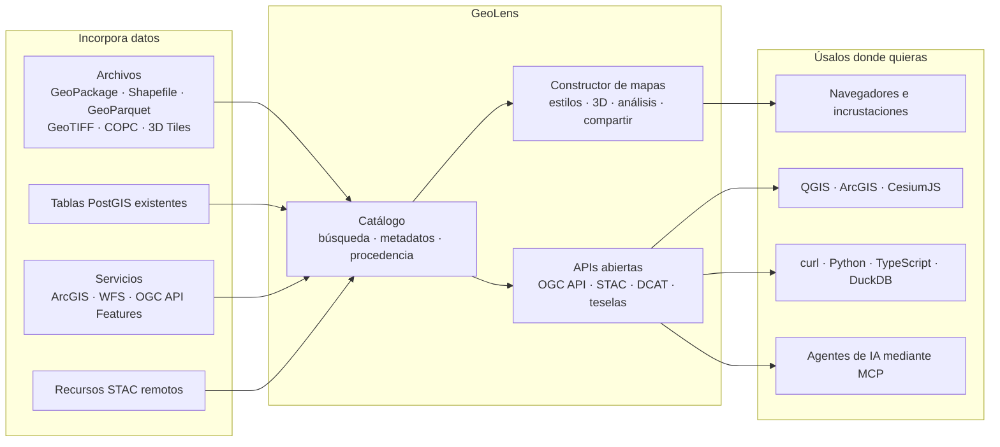

<p align="center">
  <picture>
    <source media="(prefers-color-scheme: dark)" srcset=".github/assets/geolens-emblem-dark.svg">
    
  </picture>
</p>

<h1 align="center">GeoLens</h1>

<p align="center">
  <b>Un catálogo de datos espaciales y constructor de mapas autoalojado que registra el origen de cada conjunto de datos.</b>
</p>

<p align="center">
  <a href="https://demo.getgeolens.com"><b>Demostración en vivo</b></a> ·
  <a href="#instalación">Instalación</a> ·
  <a href="https://docs.getgeolens.com">Documentación</a> ·
  <a href="#usa-los-datos-desde-cualquier-lugar">Conecta QGIS o código</a> ·
  <a href="https://github.com/geolens-io/geolens/discussions">Debates</a>
</p>

<div align="center">

[English](README.md) · [Español](README.es.md) · [Français](README.fr.md) · [Deutsch](README.de.md) · [简体中文](README.zh.md)

[](https://github.com/geolens-io/geolens/releases/latest)
[](https://github.com/geolens-io/geolens/actions/workflows/ci.yml)
[](LICENSE)
[](https://securityscorecards.dev/viewer/?uri=github.com/geolens-io/geolens)

</div>

<p align="center">
  <a href="https://demo.getgeolens.com/maps">
    <picture>
      <source media="(prefers-color-scheme: dark)" srcset=".github/assets/geolens-manhattan-3d-hero-dark.jpg">
      
    </picture>
  </a>
  <br>
  <sub>Los edificios de Manhattan a la altura medida de sus tejados, coloreados por época de construcción, con la red de metro. <a href="https://demo.getgeolens.com/maps">Explora los mapas de la demostración</a>.</sub>
</p>

GeoLens está pensado para equipos cuyos datos espaciales están repartidos entre recursos
compartidos de archivos, bases de datos PostGIS, servicios web y catálogos STAC. Los reúne en un
único catálogo con búsqueda, registra el origen de cada conjunto de datos y comprueba si su fuente
sigue vigente. Los equipos crean y comparten mapas en el navegador, y QGIS, los scripts y los
agentes de IA leen los mismos datos mediante OGC API y STAC. Se ejecuta en tus propios servidores
con Docker Compose, no envía telemetría y tiene licencia Apache 2.0.

La [demostración](https://demo.getgeolens.com) no requiere instalación ni cuenta; inicia sesión
con Google, GitHub o Microsoft para usar el constructor de mapas. Los datos de la demostración
pueden borrarse en cualquier momento.

## Un vistazo más de cerca

<table>
<tr>
<td width="50%" valign="top">
<picture>
<source media="(prefers-color-scheme: dark)" srcset=".github/assets/geolens-catalog-search-dark.png">

</picture>
<br><sub>Búsqueda por significado: "where storms hit the coast" encuentra trayectorias de huracanes y capas de exposición costera.</sub>
</td>
<td width="50%" valign="top">
<picture>
<source media="(prefers-color-scheme: dark)" srcset=".github/assets/geolens-dataset-page-dark.png">

</picture>
<br><sub>Cada conjunto de datos tiene una página con sus metadatos y su fuente, y con una vista previa del mapa cuando tiene extensión.</sub>
</td>
</tr>
<tr>
<td width="50%" valign="top">
<picture>
<source media="(prefers-color-scheme: dark)" srcset=".github/assets/geolens-import-preview-dark.png">

</picture>
<br><sub>Antes de importar una capa de servicio, GeoLens previsualiza sus columnas y las primeras filas.</sub>
</td>
<td width="50%" valign="top">
<picture>
<source media="(prefers-color-scheme: dark)" srcset=".github/assets/geolens-version-history-dark.png">

</picture>
<br><sub>Cada reemplazo queda registrado en el historial, y puedes restaurar la versión anterior.</sub>
</td>
</tr>
<tr>
<td width="50%" valign="top">
<picture>
<source media="(prefers-color-scheme: dark)" srcset=".github/assets/geolens-builder-style-dark.png">

</picture>
<br><sub>Las capas se representan como puntos, símbolos, mapas de calor o agrupaciones, y la lista de rampas puede limitarse a las aptas para daltonismo.</sub>
</td>
<td width="50%" valign="top">
<picture>
<source media="(prefers-color-scheme: dark)" srcset=".github/assets/geolens-matterhorn-terrain-dark.jpg">

</picture>
<br><sub>Terreno 3D a partir de tus propios datos de elevación, aquí el Cervino con lidar swissALTI3D.</sub>
</td>
</tr>
<tr>
<td width="50%" valign="top">
<picture>
<source media="(prefers-color-scheme: dark)" srcset=".github/assets/geolens-stac-imagery-dark.jpg">

</picture>
<br><sub>Escenas Sentinel-2 referenciadas desde un catálogo STAC. Las imágenes se quedan donde están y se sirven en teselas bajo demanda.</sub>
</td>
<td width="50%" valign="top">
<picture>
<source media="(prefers-color-scheme: dark)" srcset=".github/assets/geolens-share-embed-dark.png">

</picture>
<br><sub>Mantén un mapa para ti, ábrelo a tu equipo o hazlo público con un enlace y un código de incrustación.</sub>
</td>
</tr>
<tr>
<td width="50%" valign="top">
<picture>
<source media="(prefers-color-scheme: dark)" srcset=".github/assets/geolens-admin-overview-dark.png">

</picture>
<br><sub>El resumen de administración muestra el estado de los servicios junto a los totales de datos y almacenamiento.</sub>
</td>
<td width="50%" valign="top">
<picture>
<source media="(prefers-color-scheme: dark)" srcset=".github/assets/geolens-admin-permissions-dark.png">

</picture>
<br><sub>Roles de lector, editor y administrador, con cada capacidad activada o desactivada por rol.</sub>
</td>
</tr>
</table>

## Cómo encaja todo



## Un catálogo para datos dispersos

- Sube Shapefile, GeoPackage, GeoJSON, GeoParquet, FlatGeobuf, KML/KMZ, File Geodatabase
  comprimida en zip, CSV, Excel o GeoTIFF (convertido a Cloud-Optimized GeoTIFF). Los 3D Tiles y
  las nubes de puntos COPC se alojan para CesiumJS, QGIS y Potree.
- Sirve in situ las tablas que ya están en la base de datos PostGIS de GeoLens, importa capas WFS,
  ArcGIS y OGC API Features y actualízalas bajo demanda, o referencia recursos STAC remotos sin
  copiarlos.
- Dibuja conjuntos de datos nuevos en el navegador.
- Encuentra datos con búsqueda aproximada, o por significado una vez configurado un proveedor de
  embeddings. Filtra por tipo, lugar y fecha, agrupa los conjuntos de datos en colecciones, edita
  los metadatos y restaura la versión anterior de un conjunto de datos tras un reemplazo.

## Conoce el origen de cada conjunto de datos

<p align="center">
  <picture>
    <source media="(prefers-color-scheme: dark)" srcset=".github/assets/geolens-provenance-dark.png">
    
  </picture>
  <br>
  <sub>Un conjunto de datos importado del servicio de terremotos del USGS.</sub>
</p>

Cada conjunto de datos registra su origen: un archivo subido, una tabla de base de datos, un
servicio, un ítem STAC o un dibujo hecho en el navegador. Los conjuntos de datos importados
registran además cuándo se actualizaron por última vez, y con una frecuencia de actualización
GeoLens los marca como actualizados, pendientes o atrasados. En los servicios y las fuentes STAC, GeoLens también
comprueba que la fuente siga respondiendo y, en los servicios, avisa de los cambios de esquema en
origen antes de que lleguen a tus mapas. Si un servicio desaparece, la copia importada sigue funcionando.

## Crea y comparte mapas

- Capas de puntos, símbolos, mapas de calor, agrupaciones, líneas, flechas, polígonos, extrusión
  3D, ráster y sombreado del relieve, con estilos basados en datos, etiquetas, iconos, patrones,
  filtros y ventanas emergentes. El terreno procede de tus propios modelos de elevación.
- Zona de influencia, centroide, recorte, disolución, unión espacial, selección por ubicación,
  medición e intersección. La mayoría de las operaciones se previsualizan en el mapa, y cada
  resultado se guarda como un conjunto de datos nuevo, desde el constructor o desde la CLI.
- Los enlaces públicos muestran el título y la imagen del mapa al pegarse en Slack, Teams o
  redes sociales, y los mapas se incrustan en otros sitios con tokens privados.
- La interfaz está en inglés, español, francés, alemán y chino simplificado.

## Usa los datos desde cualquier lugar

Los conjuntos de datos vectoriales son colecciones OGC API Features, el catálogo es OGC API
Records y STAC, y cada capa tiene una URL de teselas. Puedes probarlo con la demostración sin
cuenta (el segundo comando necesita `jq`):

```sh
# Search the catalog (OGC API Records)
curl "https://demo.getgeolens.com/api/collections/datasets/items?q=volcanic%20eruptions"

# Read the top match with a CQL2 filter (OGC API Features): eruptions of VEI 6 or larger
ID=$(curl -s "https://demo.getgeolens.com/api/collections/datasets/items?q=volcanic%20eruptions&limit=1" | jq -r '.features[0].id')
curl -G "https://demo.getgeolens.com/api/collections/$ID/items" \
  --data-urlencode "filter=vei >= 6" -d limit=3
```

QGIS añade la misma API como conexión OGC API Features, como muestra la
[guía de QGIS](https://docs.getgeolens.com/guides/api/qgis/). El
[complemento de GeoLens para QGIS](https://github.com/geolens-io/qgis-geolens-plugin) añade
búsqueda en el catálogo, conjuntos de datos privados y ediciones que se sincronizan con GeoLens.

<p align="center">
  
  <br>
  <sub>QGIS leyendo la demostración mediante OGC API Features, sin ningún complemento.</sub>
</p>

| Estándar | Dónde | Úsalo con |
|---|---|---|
| OGC API Features, con filtrado CQL2 y queryables | `/api/collections/{id}/items` | QGIS, ArcGIS, GDAL/OGR y otros clientes OGC API |
| OGC API Records | `/api/collections/datasets/items` | Búsqueda en el catálogo desde otros portales y herramientas |
| STAC API 1.0 | `/api/stac/` | Clientes STAC como pystac-client y STAC Browser |
| DCAT 3, DCAT-US 3.0 y GeoDCAT-AP como JSON-LD | `/api/datasets/dcat/`, `/api/datasets/dcat-us/3.0/`, `/api/datasets/geodcat-ap/` | Recolección en portales de datos abiertos nacionales y de la UE |
| Teselas vectoriales y teselas ráster COG | una URL de teselas en cada capa | MapLibre, OpenLayers, Leaflet |
| 3D Tiles y COPC | la página de cada conjunto de datos 3D | CesiumJS, QGIS, Potree |

Los datos se exportan como GeoJSON, Shapefile, GeoPackage, CSV, FlatGeobuf, GeoParquet, PMTiles o
Cloud-Optimized GeoTIFF.

La CLI `geolens` publica archivos y aplica manifiestos de catálogo, los SDK de Python y TypeScript
cubren la API, y un servidor MCP de solo lectura permite a los agentes de IA buscar en el
catálogo. La [referencia de la API](https://docs.getgeolens.com/guides/api/) y las
[guías de los SDK](https://docs.getgeolens.com/guides/sdk/) los documentan, y la
[galería de ejemplos](https://geolens-io.github.io/geolens-examples/) incluye código
ejecutable para MapLibre, Leaflet, OpenLayers, el ArcGIS Maps SDK, QGIS y DuckDB.

## IA opcional

<p align="center">
  <picture>
    <source media="(prefers-color-scheme: dark)" srcset=".github/assets/geolens-ask-ai-dark.png">
    
  </picture>
  <br>
  <sub>"How many of these hurricanes made landfall?" devuelve el recuento, una tabla y el supuesto en que se basa la respuesta.</sub>
</p>

GeoLens puede responder preguntas sobre un conjunto de datos, editar mapas a partir de peticiones
en lenguaje natural, redactar metadatos y buscar en lenguaje natural. Funciona con cualquier
endpoint compatible con OpenAI, incluido un servidor local como Ollama, y con Claude a través de
Anthropic, Microsoft Foundry, Amazon Bedrock o Google Vertex AI. La IA permanece desactivada hasta
que un administrador configura un proveedor, y todos los flujos de trabajo funcionan sin ella.

## Instalación

Necesitas Git, curl y Docker con el plugin Compose. La
[Guía de instalación](https://docs.getgeolens.com/guides/quickstart/install/) indica las versiones,
la memoria y los puertos que espera.

```sh
curl -fsSL https://getgeolens.com/install.sh | sh    # clone, generate secrets, start the stack
cd geolens
grep '^GEOLENS_ADMIN_PASSWORD=' .env                  # the generated admin password
```

Abre http://localhost:8080 e inicia sesión como `admin` con esa contraseña. Cada
[versión](https://github.com/geolens-io/geolens/releases) incluye un archivo `SHA256SUMS` para
comprobar `install.sh` antes de ejecutarlo. Para compilar desde el código fuente, clona el
repositorio y ejecuta `bash scripts/install.sh`; la primera compilación tarda 5-10 minutos.

Para producción, consulta la
[guía de despliegue en la nube](https://docs.getgeolens.com/guides/quickstart/cloud-deployment/),
que también indica lo que necesita una base de datos externa. Docker Compose es la vía con soporte
oficial, y [geolens-deployments](https://github.com/geolens-io/geolens-deployments) tiene un chart
de Helm y recetas de Terraform para AWS ECS Fargate y Azure Container Apps, mantenidos por la
comunidad.

La base de datos incluida se copia a diario, y la
[guía de copias de seguridad](https://docs.getgeolens.com/guides/admin/backups/) cubre las copias
externas y las restauraciones. [UPGRADING.md](UPGRADING.md) cubre las actualizaciones y la
reversión, [RUNBOOK.md](RUNBOOK.md) cubre las operaciones, y la
[Referencia de configuración](https://docs.getgeolens.com/guides/quickstart/configuration/) lista
todos los ajustes.

## Tu primer conjunto de datos

Con la [CLI](https://docs.getgeolens.com/guides/cli/) instalada, publica el archivo de ejemplo
desde el directorio de instalación:

```sh
geolens login http://localhost:8080/api               # your admin username and password
geolens publish examples/manifests/first-catalog/city-parks.geojson --name "City Parks"
```

`geolens publish` imprime la URL del nuevo conjunto de datos. Para gestionar un catálogo completo,
describe las fuentes en un manifiesto `geolens.yaml` y ejecuta `geolens apply`;
[`examples/manifests/`](examples/manifests/) tiene plantillas.

Para cargar los mapas y conjuntos de datos de la demostración, exporta `GEOLENS_ADMIN_PASSWORD`
desde `.env` y ejecuta `python scripts/seed-showcase.py --username admin`. El script necesita
Python 3.10+ y `httpx`, y descarga datos públicos de una docena de fuentes;
[scripts/README.md](scripts/README.md) indica los tamaños y las opciones.

## Privacidad y acceso

- GeoLens no envía telemetría. Salvo las teselas del mapa base predeterminado y los servicios
  remotos o las fuentes STAC que registran tus usuarios, solo realiza conexiones salientes para
  las funciones que un administrador activa. [EGRESS.md](EGRESS.md) las lista y explica cómo
  operar en un entorno aislado de la red.
- Tus datos siguen siendo legibles sin GeoLens. Los conjuntos de datos vectoriales son tablas
  PostGIS normales en un esquema `data`, los ráster son Cloud-Optimized GeoTIFF en tu propio
  almacenamiento (disco local, S3/MinIO o Azure Blob), y el catálogo se exporta mediante OGC API,
  STAC y DCAT.
- El inicio de sesión usa cuentas locales u OAuth 2.0/OIDC (Google, Microsoft, GitHub o un
  proveedor genérico), con roles, permisos por conjunto de datos, claves de API por usuario y un
  registro de auditoría. El autorregistro está desactivado por defecto.
- Las funciones publicadas en este repositorio seguirán siendo gratuitas.
  [EDITIONS.md](EDITIONS.md) describe el soporte de pago y los complementos opcionales.

## Limitaciones conocidas

- La instalación con soporte oficial, Docker Compose, se ejecuta en un solo host. Para alta
  disponibilidad, ejecuta varias réplicas de la API, el worker, el frontend y Titiler contra un
  PostgreSQL gestionado con conmutación por error automática, con almacenamiento de objetos
  compartido y una única caché Valkey o Redis. Con Azure Blob o almacenamiento local, las réplicas
  de la API y del worker necesitan además un volumen de staging compartido, porque solo S3 guarda
  las subidas en el bucket. El almacenamiento local guarda ahí todos los archivos, así que las
  réplicas de Titiler también lo montan.
  [geolens-deployments](https://github.com/geolens-io/geolens-deployments) tiene un chart de Helm
  mantenido por la comunidad, recetas de Terraform para AWS y Azure, y guías para AWS, Azure, Google
  Cloud y DigitalOcean. GeoLens no agrupa la base de datos en clúster ni lee de réplicas.
- Una organización por instalación.
- La representación del terreno supone que la elevación está en metros; otras unidades verticales
  se representan exageradas.
- La API REST propia de GeoLens puede cambiar entre versiones menores (los endpoints de los
  estándares siguen sus especificaciones). El [CHANGELOG](CHANGELOG.md) lista los cambios de
  contrato, y un cambio incompatible mantiene la forma anterior funcionando durante una versión
  menor más.

## Cómo contribuir

Se agradecen los informes de errores, las correcciones, las traducciones y la documentación.
[CONTRIBUTING](.github/CONTRIBUTING.md) cubre la configuración y las pruebas, y
[ARCHITECTURE](.github/ARCHITECTURE.md) describe el código. Los repositorios del
[complemento de QGIS](https://github.com/geolens-io/qgis-geolens-plugin), de los
[ejemplos](https://github.com/geolens-io/geolens-examples) y de los
[despliegues](https://github.com/geolens-io/geolens-deployments) también aceptan issues y pull
requests. Haz tus preguntas en [GitHub Discussions](https://github.com/geolens-io/geolens/discussions),
informa de los errores en [Issues](https://github.com/geolens-io/geolens/issues) y comunica los
problemas de seguridad de forma privada, como se describe en [SECURITY.md](.github/SECURITY.md).
La [hoja de ruta](https://docs.getgeolens.com/roadmap/) muestra lo planificado.

## Basado en

GeoLens se basa en estos proyectos de código abierto. Gracias a todas las personas que los
mantienen.

- [PostgreSQL](https://www.postgresql.org/) y [PostGIS](https://postgis.net/) guardan el catálogo y todos los
  conjuntos de datos vectoriales, y [pgvector](https://github.com/pgvector/pgvector) almacena los embeddings de la
  búsqueda por significado.
- [GDAL](https://gdal.org/) lee los archivos y servicios que GeoLens importa y escribe los formatos que
  exporta, y [PROJ](https://proj.org/) se encarga de las transformaciones de coordenadas.
- [TiTiler](https://developmentseed.org/titiler/) sirve teselas ráster a partir de Cloud Optimized GeoTIFF.
- [FastAPI](https://fastapi.tiangolo.com/) sirve la API, y [Procrastinate](https://procrastinate.readthedocs.io/) ejecuta las
  tareas en segundo plano con PostgreSQL como cola.
- [MapLibre GL JS](https://maplibre.org/) dibuja los mapas, [deck.gl](https://deck.gl/) y
  [loaders.gl](https://loaders.gl/) muestran 3D Tiles y nubes de puntos, y
  [Terra Draw](https://terradraw.io/) se encarga del dibujo y la edición.
- La aplicación web está escrita en [React](https://react.dev/).

Estos nombres pertenecen a sus propietarios, y mencionarlos no implica que respalden GeoLens;
consulta [TRADEMARKS.md](TRADEMARKS.md#other-projects-names).

## Licencia

GeoLens se distribuye bajo la [Apache License 2.0](LICENSE). El nombre, el logotipo y los
recursos de marca de GeoLens no están cubiertos por esta licencia; consulta
[TRADEMARKS.md](TRADEMARKS.md). La atribución de los datos de muestra está en
[THIRD_PARTY_DATA.md](THIRD_PARTY_DATA.md). La aplicación web sirve los avisos de licencia del
código que incluye en `/third-party-licenses.txt`, y los avisos copyleft de la imagen del
backend están en [backend/licenses](backend/licenses/).

Políticas del proyecto: [ediciones](EDITIONS.md) · [soporte](SUPPORT.md) · [gobernanza](GOVERNANCE.md) · [mantenedores](MAINTAINERS.md) · [seguridad](.github/SECURITY.md) · [proceso de publicación](RELEASE.md) · [salida de red y entornos aislados](EGRESS.md)
