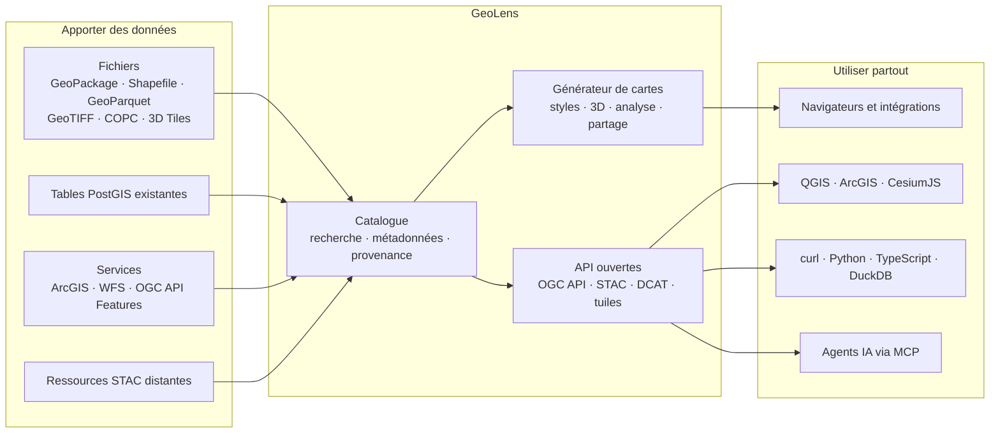

<p align="center">
  <picture>
    <source media="(prefers-color-scheme: dark)" srcset=".github/assets/geolens-emblem-dark.svg">
    
  </picture>
</p>

<h1 align="center">GeoLens</h1>

<p align="center">
  <b>Un catalogue de données spatiales et un générateur de cartes auto-hébergés, qui gardent la trace de l’origine de chaque jeu de données.</b>
</p>

<p align="center">
  <a href="https://demo.getgeolens.com"><b>Démonstration en ligne</b></a> ·
  <a href="#installation">Installation</a> ·
  <a href="https://docs.getgeolens.com">Documentation</a> ·
  <a href="#utiliser-les-données-partout">Connecter QGIS ou du code</a> ·
  <a href="https://github.com/geolens-io/geolens/discussions">Discussions</a>
</p>

<div align="center">

[English](README.md) · [Español](README.es.md) · [Français](README.fr.md) · [Deutsch](README.de.md) · [简体中文](README.zh.md)

[](https://github.com/geolens-io/geolens/releases/latest)
[](https://github.com/geolens-io/geolens/actions/workflows/ci.yml)
[](LICENSE)
[](https://securityscorecards.dev/viewer/?uri=github.com/geolens-io/geolens)
[](https://www.bestpractices.dev/projects/15857)

</div>

<p align="center">
  <a href="https://demo.getgeolens.com/maps">
    <picture>
      <source media="(prefers-color-scheme: dark)" srcset=".github/assets/geolens-manhattan-3d-hero-dark.jpg">
      
    </picture>
  </a>
  <br>
  <sub>Les bâtiments de Manhattan à la hauteur relevée de leur toit, colorés selon l’époque de construction, avec le réseau de métro. <a href="https://demo.getgeolens.com/maps">Parcourir les cartes de la démonstration</a>.</sub>
</p>

GeoLens s’adresse aux équipes dont les données spatiales sont dispersées entre partages de
fichiers, bases PostGIS, services web et catalogues STAC. Il les réunit dans un seul catalogue
consultable, consigne l’origine de chaque jeu de données et vérifie que la source est toujours à
jour. Les équipes créent et partagent des cartes dans le navigateur, et QGIS, les scripts et les
agents IA lisent les mêmes données via OGC API et STAC. Il s’exécute sur vos propres serveurs avec
Docker Compose, n’envoie aucune télémétrie et est publié sous licence Apache 2.0.

La [démonstration](https://demo.getgeolens.com) ne demande ni installation ni compte ; connectez-vous
avec Google, GitHub ou Microsoft pour utiliser le générateur de cartes. Les données de
démonstration peuvent être effacées à tout moment.

## De plus près

<table>
<tr>
<td width="50%" valign="top">
<picture>
<source media="(prefers-color-scheme: dark)" srcset=".github/assets/geolens-catalog-search-dark.png">

</picture>
<br><sub>Recherche par le sens : « where storms hit the coast » trouve des trajectoires d’ouragans et des couches d’exposition du littoral.</sub>
</td>
<td width="50%" valign="top">
<picture>
<source media="(prefers-color-scheme: dark)" srcset=".github/assets/geolens-dataset-page-dark.png">

</picture>
<br><sub>Chaque jeu de données a une page avec ses métadonnées et sa source, plus un aperçu cartographique lorsqu’il a une emprise.</sub>
</td>
</tr>
<tr>
<td width="50%" valign="top">
<picture>
<source media="(prefers-color-scheme: dark)" srcset=".github/assets/geolens-import-preview-dark.png">

</picture>
<br><sub>Avant d’importer une couche de service, GeoLens en affiche les colonnes et les premières lignes.</sub>
</td>
<td width="50%" valign="top">
<picture>
<source media="(prefers-color-scheme: dark)" srcset=".github/assets/geolens-version-history-dark.png">

</picture>
<br><sub>Chaque remplacement est consigné dans l’historique, et vous pouvez restaurer la version précédente.</sub>
</td>
</tr>
<tr>
<td width="50%" valign="top">
<picture>
<source media="(prefers-color-scheme: dark)" srcset=".github/assets/geolens-builder-style-dark.png">

</picture>
<br><sub>Les couches s’affichent en points, symboles, cartes de chaleur ou regroupements, et la liste des palettes peut se limiter à celles adaptées au daltonisme.</sub>
</td>
<td width="50%" valign="top">
<picture>
<source media="(prefers-color-scheme: dark)" srcset=".github/assets/geolens-matterhorn-terrain-dark.jpg">

</picture>
<br><sub>Un terrain 3D issu de vos propres données d’élévation, ici le Cervin à partir du lidar swissALTI3D.</sub>
</td>
</tr>
<tr>
<td width="50%" valign="top">
<picture>
<source media="(prefers-color-scheme: dark)" srcset=".github/assets/geolens-stac-imagery-dark.jpg">

</picture>
<br><sub>Des scènes Sentinel-2 référencées depuis un catalogue STAC. L’imagerie reste où elle est et est découpée en tuiles à la demande.</sub>
</td>
<td width="50%" valign="top">
<picture>
<source media="(prefers-color-scheme: dark)" srcset=".github/assets/geolens-share-embed-dark.png">

</picture>
<br><sub>Gardez une carte pour vous, ouvrez-la à votre équipe ou rendez-la publique avec un lien et un code d’intégration.</sub>
</td>
</tr>
<tr>
<td width="50%" valign="top">
<picture>
<source media="(prefers-color-scheme: dark)" srcset=".github/assets/geolens-admin-overview-dark.png">

</picture>
<br><sub>L’aperçu de l’administration montre l’état des services à côté des totaux de jeux de données et de stockage.</sub>
</td>
<td width="50%" valign="top">
<picture>
<source media="(prefers-color-scheme: dark)" srcset=".github/assets/geolens-admin-permissions-dark.png">

</picture>
<br><sub>Les rôles lecteur, éditeur et administrateur, avec chaque capacité activée ou non par rôle.</sub>
</td>
</tr>
</table>

## Comment tout s’articule



## Un seul catalogue pour des données dispersées

- Chargez des Shapefile, GeoPackage, GeoJSON, GeoParquet, FlatGeobuf, KML/KMZ, File Geodatabase
  zippées, CSV, Excel ou GeoTIFF (convertis en Cloud-Optimized GeoTIFF). Les jeux 3D Tiles et les
  nuages de points COPC sont hébergés pour CesiumJS, QGIS et Potree.
- Servez sur place les tables déjà présentes dans la base PostGIS de GeoLens, importez des couches
  WFS, ArcGIS et OGC API Features et actualisez-les à la demande, ou référencez des ressources
  STAC distantes sans les copier.
- Dessinez de nouveaux jeux de données dans le navigateur.
- Retrouvez les données par recherche approximative, ou par le sens une fois un fournisseur
  d’embeddings configuré. Filtrez par type, lieu et période, regroupez les jeux de données en
  collections, modifiez les métadonnées et restaurez la version précédente d'un jeu de données après un remplacement.

## Savoir d’où vient chaque jeu de données

<p align="center">
  <picture>
    <source media="(prefers-color-scheme: dark)" srcset=".github/assets/geolens-provenance-dark.png">
    
  </picture>
  <br>
  <sub>Un jeu de données importé depuis le service de séismes de l’USGS.</sub>
</p>

Chaque jeu de données consigne son origine : un fichier chargé, une table de base de données, un
service, un élément STAC ou un dessin réalisé dans le navigateur. Les jeux importés consignent aussi
la date de leur dernière actualisation, et avec une fréquence de mise à jour, GeoLens les marque
comme à jour, à actualiser ou en retard. Pour les services et les sources STAC, GeoLens
vérifie aussi que la source répond encore et, pour les services, signale les changements de
schéma en amont avant qu’ils n’atteignent vos cartes. Si un service disparaît, la copie importée continue de
fonctionner.

## Créer et partager des cartes

- Couches de points, de symboles, de cartes de chaleur, de regroupements, de lignes, de flèches,
  de remplissages, d’extrusion 3D, de rasters et d’ombrage du relief, avec styles pilotés par les
  données, étiquettes, icônes, motifs, filtres et fenêtres contextuelles. Le terrain provient de
  vos propres modèles d’élévation.
- Tampon, centroïde, découpage, fusion, jointure spatiale, sélection par localisation, mesure et
  intersection. La plupart des opérations s’affichent d’abord en aperçu sur la carte, et chaque
  résultat est enregistré comme un nouveau jeu de données, depuis le générateur ou la CLI.
- Les liens publics affichent le titre et l’image de la carte lorsqu’ils sont collés dans Slack,
  Teams ou les réseaux sociaux, et les cartes s’intègrent à d’autres sites avec des jetons privés.
- L’interface est disponible en anglais, espagnol, français, allemand et chinois simplifié.

## Utiliser les données partout

Les jeux de données vectoriels sont des collections OGC API Features, le catalogue est exposé en
OGC API Records et STAC, et chaque couche dispose d’une URL de tuiles. Vous pouvez l’essayer sur la
démonstration sans compte (la deuxième commande nécessite `jq`) :

```sh
# Search the catalog (OGC API Records)
curl "https://demo.getgeolens.com/api/collections/datasets/items?q=volcanic%20eruptions"

# Read the top match with a CQL2 filter (OGC API Features): eruptions of VEI 6 or larger
ID=$(curl -s "https://demo.getgeolens.com/api/collections/datasets/items?q=volcanic%20eruptions&limit=1" | jq -r '.features[0].id')
curl -G "https://demo.getgeolens.com/api/collections/$ID/items" \
  --data-urlencode "filter=vei >= 6" -d limit=3
```

QGIS ajoute la même API comme connexion OGC API Features, comme le montre le
[guide QGIS](https://docs.getgeolens.com/guides/api/qgis/). L’[extension GeoLens pour QGIS](https://github.com/geolens-io/qgis-geolens-plugin)
ajoute la recherche dans le catalogue, les jeux de données privés et des modifications synchronisées
vers GeoLens.

<p align="center">
  
  <br>
  <sub>QGIS lit la démonstration via OGC API Features, sans extension.</sub>
</p>

| Standard | Emplacement | À utiliser avec |
|---|---|---|
| OGC API Features, avec filtrage CQL2 et queryables | `/api/collections/{id}/items` | QGIS, ArcGIS, GDAL/OGR et autres clients OGC API |
| OGC API Records | `/api/collections/datasets/items` | Recherche dans le catalogue depuis d’autres portails et outils |
| STAC API 1.0 | `/api/stac/` | Clients STAC comme pystac-client et STAC Browser |
| DCAT 3, DCAT-US 3.0 et GeoDCAT-AP en JSON-LD | `/api/datasets/dcat/`, `/api/datasets/dcat-us/3.0/`, `/api/datasets/geodcat-ap/` | Moissonnage vers les portails nationaux et européens de données ouvertes |
| Tuiles vectorielles et tuiles raster COG | une URL de tuiles sur chaque couche | MapLibre, OpenLayers, Leaflet |
| 3D Tiles et COPC | la page de chaque jeu de données 3D | CesiumJS, QGIS, Potree |

Les données s’exportent en GeoJSON, Shapefile, GeoPackage, CSV, FlatGeobuf, GeoParquet, PMTiles ou
Cloud-Optimized GeoTIFF.

La CLI `geolens` publie des fichiers et applique des manifestes de catalogue, des SDK Python et
TypeScript couvrent l’API, et un serveur MCP en lecture seule permet aux agents IA de chercher dans
le catalogue. La [référence de l’API](https://docs.getgeolens.com/guides/api/) et les
[guides des SDK](https://docs.getgeolens.com/guides/sdk/) les documentent, et la
[galerie d’exemples](https://geolens-io.github.io/geolens-examples/) propose du code exécutable
pour MapLibre, Leaflet, OpenLayers, l’ArcGIS Maps SDK, QGIS et DuckDB.

## IA facultative

<p align="center">
  <picture>
    <source media="(prefers-color-scheme: dark)" srcset=".github/assets/geolens-ask-ai-dark.png">
    
  </picture>
  <br>
  <sub>« How many of these hurricanes made landfall? » renvoie le décompte, un tableau et l’hypothèse sur laquelle repose la réponse.</sub>
</p>

GeoLens peut répondre à des questions sur un jeu de données, modifier des cartes à partir de
demandes en langage courant, rédiger des métadonnées et chercher en langage naturel. Il fonctionne
avec n’importe quel point de terminaison compatible OpenAI, y compris un serveur local comme
Ollama, et avec Claude via Anthropic, Microsoft Foundry, Amazon Bedrock ou Google Vertex AI.
L’IA reste désactivée tant qu’un administrateur n’a pas configuré de fournisseur, et chaque
workflow fonctionne sans elle.

## Installation

Il vous faut Git, curl et Docker avec le plugin Compose. Le
[guide d’installation](https://docs.getgeolens.com/guides/quickstart/install/) indique les
versions, la mémoire et les ports attendus.

```sh
curl -fsSL https://getgeolens.com/install.sh | sh    # clone, generate secrets, start the stack
cd geolens
grep '^GEOLENS_ADMIN_PASSWORD=' .env                  # the generated admin password
```

Ouvrez http://localhost:8080 et connectez-vous en tant que `admin` avec ce mot de passe. Chaque
[version](https://github.com/geolens-io/geolens/releases) inclut un fichier `SHA256SUMS` pour
vérifier `install.sh` avant de l’exécuter. Pour compiler depuis les sources, clonez le dépôt et
lancez `bash scripts/install.sh` ; la première compilation prend 5-10 minutes.

Pour la production, lisez le
[guide de déploiement cloud](https://docs.getgeolens.com/guides/quickstart/cloud-deployment/), qui
indique aussi ce qu’exige une base de données externe. Docker Compose est la voie prise en charge,
et [geolens-deployments](https://github.com/geolens-io/geolens-deployments) propose un chart Helm
maintenu par la communauté et des recettes Terraform pour AWS ECS Fargate et Azure Container Apps.

La base fournie est sauvegardée chaque jour, et le
[guide des sauvegardes](https://docs.getgeolens.com/guides/admin/backups/) couvre les copies hors
site et les restaurations. [UPGRADING.md](UPGRADING.md) couvre les mises à jour et le retour
arrière, [RUNBOOK.md](RUNBOOK.md) couvre l’exploitation, et la
[référence de configuration](https://docs.getgeolens.com/guides/quickstart/configuration/) liste
chaque paramètre.

## Votre premier jeu de données

Une fois la [CLI](https://docs.getgeolens.com/guides/cli/) installée, publiez le fichier d’exemple
depuis le répertoire d’installation :

```sh
geolens login http://localhost:8080/api               # your admin username and password
geolens publish examples/manifests/first-catalog/city-parks.geojson --name "City Parks"
```

`geolens publish` affiche l’URL du nouveau jeu de données. Pour gérer un catalogue entier, décrivez
les sources dans un manifeste `geolens.yaml` et lancez `geolens apply` ;
[`examples/manifests/`](examples/manifests/) contient des modèles.

Pour charger les cartes et les jeux de données de la démonstration, exportez
`GEOLENS_ADMIN_PASSWORD` depuis `.env` et lancez
`python scripts/seed-showcase.py --username admin`. Le script nécessite Python 3.10+ et `httpx` et
télécharge des données publiques depuis une douzaine de sources ; [scripts/README.md](scripts/README.md)
donne les tailles et les options.

## Confidentialité et accès

- GeoLens n’envoie aucune télémétrie. Hormis les tuiles de fond de carte par défaut et les
  services distants ou sources STAC que vos utilisateurs enregistrent, il n’effectue d’appels
  sortants que pour les fonctions qu’un administrateur active. [EGRESS.md](EGRESS.md) les liste et
  explique comment fonctionner en réseau isolé.
- Vos données restent lisibles sans GeoLens. Les jeux de données vectoriels sont de simples tables
  PostGIS dans un schéma `data`, les rasters sont des Cloud-Optimized GeoTIFF dans votre propre
  stockage (disque local, S3/MinIO ou Azure Blob), et le catalogue s’exporte via OGC API, STAC et
  DCAT.
- La connexion utilise des comptes locaux ou OAuth 2.0/OIDC (Google, Microsoft, GitHub ou un
  fournisseur générique), avec rôles, permissions par jeu de données, clés d’API par utilisateur et
  journal d’audit. L’inscription libre est désactivée par défaut.
- Les fonctions publiées dans ce dépôt restent gratuites. [EDITIONS.md](EDITIONS.md) décrit le
  support payant et les modules complémentaires facultatifs.

## Limites connues

- L’installation prise en charge, Docker Compose, tourne sur un seul hôte. Pour la haute
  disponibilité, exécutez plusieurs réplicas de l’API, du worker, du frontend et de Titiler sur une
  base PostgreSQL gérée avec basculement automatique, un stockage objet partagé et un seul cache
  Valkey ou Redis. Avec Azure Blob ou le stockage local, les réplicas de l’API et du worker ont
  aussi besoin d’un volume de staging partagé, car seul S3 garde les envois dans le bucket. Le
  stockage local y conserve tous les fichiers, donc les réplicas de Titiler le montent aussi.
  [geolens-deployments](https://github.com/geolens-io/geolens-deployments) propose un chart Helm
  maintenu par la communauté, des recettes Terraform pour AWS et Azure, et des guides pour AWS,
  Azure, Google Cloud et DigitalOcean. GeoLens ne met pas lui-même la base en cluster et ne lit pas
  depuis des réplicas.
- Une organisation par déploiement.
- Le rendu du terrain suppose une élévation en mètres ; les autres unités verticales produisent un
  rendu exagéré.
- L’API REST propre à GeoLens peut changer entre versions mineures (les points de terminaison
  standard suivent leurs spécifications). Le [CHANGELOG](CHANGELOG.md) liste les changements de
  contrat, et un changement incompatible conserve l’ancienne forme fonctionnelle pendant une
  version mineure supplémentaire.

## Contribuer

Les rapports de bogues, correctifs, traductions et contributions à la documentation sont les
bienvenus. [CONTRIBUTING](.github/CONTRIBUTING.md) couvre la configuration et les tests,
et [ARCHITECTURE](.github/ARCHITECTURE.md) cartographie le code. Les dépôts de
l’[extension QGIS](https://github.com/geolens-io/qgis-geolens-plugin), des
[exemples](https://github.com/geolens-io/geolens-examples) et des
[déploiements](https://github.com/geolens-io/geolens-deployments) acceptent aussi les tickets et les
pull requests. Posez vos questions dans les
[GitHub Discussions](https://github.com/geolens-io/geolens/discussions), signalez les bogues dans
les [Issues](https://github.com/geolens-io/geolens/issues) et les problèmes de sécurité en privé,
comme décrit dans [SECURITY.md](.github/SECURITY.md). La
[feuille de route](https://docs.getgeolens.com/roadmap/) montre ce qui est prévu.

## Construit sur

GeoLens repose sur ces projets open source. Merci à toutes les personnes qui les maintiennent.

- [PostgreSQL](https://www.postgresql.org/) et [PostGIS](https://postgis.net/) stockent le catalogue et tous les
  jeux de données vectoriels, et [pgvector](https://github.com/pgvector/pgvector) conserve les embeddings de la
  recherche par le sens.
- [GDAL](https://gdal.org/) lit les fichiers et services que GeoLens importe et écrit les formats qu’il
  exporte, et [PROJ](https://proj.org/) prend en charge les transformations de coordonnées.
- [TiTiler](https://developmentseed.org/titiler/) sert les tuiles raster à partir de Cloud Optimized GeoTIFF.
- [FastAPI](https://fastapi.tiangolo.com/) sert l’API, et [Procrastinate](https://procrastinate.readthedocs.io/)
  exécute les tâches de fond avec PostgreSQL comme file d’attente.
- [MapLibre GL JS](https://maplibre.org/) dessine les cartes, [deck.gl](https://deck.gl/) et
  [loaders.gl](https://loaders.gl/) affichent les 3D Tiles et les nuages de points, et
  [Terra Draw](https://terradraw.io/) gère le dessin et l’édition.
- L’application web est écrite en [React](https://react.dev/).

Ces noms appartiennent à leurs propriétaires, et leur mention ne signifie pas qu’ils soutiennent
GeoLens ; voir [TRADEMARKS.md](TRADEMARKS.md#other-projects-names).

## Licence

GeoLens est publié sous la [licence Apache 2.0](LICENSE). Le nom, le logo et les éléments de
marque de GeoLens ne sont pas couverts par cette licence ; voir [TRADEMARKS.md](TRADEMARKS.md).
L’attribution des données d’exemple figure dans [THIRD_PARTY_DATA.md](THIRD_PARTY_DATA.md).
L’application web sert les mentions de licence du code qu’elle embarque à
`/third-party-licenses.txt`, et les mentions copyleft de l’image backend figurent dans
[backend/licenses](backend/licenses/).

Politiques du projet : [éditions](EDITIONS.md) · [support](SUPPORT.md) · [gouvernance](GOVERNANCE.md) · [mainteneurs](MAINTAINERS.md) · [sécurité](.github/SECURITY.md) · [processus de publication](RELEASE.md) · [sorties réseau &amp; réseau isolé](EGRESS.md)
