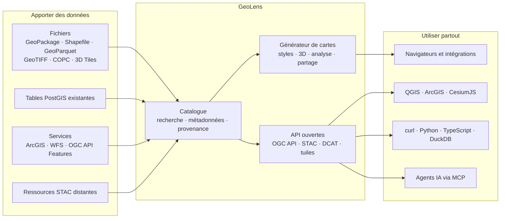

<p align="center">
  
</p>

<h1 align="center">GeoLens</h1>

<p align="center">
  <b>Un catalogue de données spatiales et un générateur de cartes auto-hébergés, qui gardent la trace de l’origine de chaque jeu de données.</b>
</p>

<p align="center">
  <a href="https://demo.getgeolens.com"><b>Démonstration en ligne</b></a> ·
  <a href="#installation">Installation</a> ·
  <a href="https://docs.getgeolens.com">Documentation</a> ·
  <a href="#utiliser-les-données-partout">Connecter QGIS ou du code</a> ·
  <a href="https://github.com/geolens-io/geolens/discussions">Discussions</a>
</p>

<div align="center">

[English](README.md) · [Español](README.es.md) · [Français](README.fr.md) · [Deutsch](README.de.md) · [简体中文](README.zh.md)

[](https://github.com/geolens-io/geolens/releases/latest)
[](https://github.com/geolens-io/geolens/actions/workflows/ci.yml)
[](LICENSE)

</div>

<p align="center">
  <a href="https://demo.getgeolens.com/maps/146eddc1-30af-4c8e-aa6f-a6569e663823">
    <picture>
      <source media="(prefers-color-scheme: dark)" srcset=".github/assets/geolens-manhattan-3d-hero-dark.jpg">
      
    </picture>
  </a>
  <br>
  <sub>Les bâtiments de Manhattan à la hauteur relevée de leur toit, colorés selon l’époque de construction, avec le réseau de métro. <a href="https://demo.getgeolens.com/maps/146eddc1-30af-4c8e-aa6f-a6569e663823">Ouvrir cette carte dans la démonstration</a>.</sub>
</p>

Les données spatiales se trouvent souvent à plusieurs endroits à la fois : partages de fichiers,
bases PostGIS, services ArcGIS et WFS, catalogues STAC. GeoLens les réunit dans un seul catalogue
consultable et consigne l’origine de chaque jeu de données ainsi que l’actualité de sa source. Les
utilisateurs créent et partagent des cartes à partir de ce catalogue dans le navigateur, tandis que
QGIS, les scripts et les agents IA lisent les mêmes données via OGC API et STAC. GeoLens
s’exécute sur vos propres serveurs avec Docker Compose, n’envoie aucune télémétrie et est publié
sous licence Apache 2.0.

La [démonstration](https://demo.getgeolens.com) ne demande aucune installation. Parcourez le
catalogue et les cartes sans compte, ou connectez-vous avec Google, GitHub ou Microsoft pour
essayer le générateur de cartes (les données de démonstration peuvent être effacées à tout
moment).

## Comment tout s’articule



## Un seul catalogue pour des données dispersées

<p align="center">
  <picture>
    <source media="(prefers-color-scheme: dark)" srcset=".github/assets/geolens-catalog-search-dark.png">
    
  </picture>
  <br>
  <sub>Recherche par le sens : « où les tempêtes touchent la côte » trouve des trajectoires d’ouragans, des couloirs de tempêtes et des couches d’exposition du littoral, chacune indiquant son origine.</sub>
</p>

- **Charger des fichiers.** Shapefile, GeoPackage, GeoJSON, GeoParquet, FlatGeobuf, KML/KMZ,
  File Geodatabase zippée, CSV et Excel. Les GeoTIFF deviennent des Cloud-Optimized GeoTIFF, et
  plusieurs rasters peuvent être assemblés en une mosaïque VRT. Les jeux 3D Tiles et les nuages de
  points COPC sont hébergés pour CesiumJS, QGIS et Potree.
- **Enregistrer ce que vous avez déjà.** Les tables déjà présentes dans la base PostGIS de GeoLens
  sont servies sur place. Les couches WFS, ArcGIS FeatureServer et MapServer, et OGC API Features
  sont importées et actualisées à la demande. Les ressources STAC distantes sont référencées sans
  être copiées.
- **Dessiner de nouvelles données** dans le navigateur quand elles n’existent encore nulle part.
- **Les retrouver.** La recherche approximative fonctionne d’emblée, et la recherche par le sens
  s’active dès que vous configurez un fournisseur d’embeddings. Filtrez par type, lieu et période,
  regroupez les jeux de données en collections, modifiez des métadonnées typées et restaurez des
  versions antérieures.

## Savoir d’où vient chaque jeu de données

<p align="center">
  <picture>
    <source media="(prefers-color-scheme: dark)" srcset=".github/assets/geolens-provenance-dark.png">
    
  </picture>
  <br>
  <sub>Séismes importés depuis le service de l’USGS. GeoLens conserve sa propre copie et indique quand il a actualisé et vérifié la source pour la dernière fois, et si cette source est opérationnelle, à jour et inchangée.</sub>
</p>

Chaque jeu de données consigne comment il est entré dans le catalogue : de quel fichier, table,
service ou élément STAC il provient, et quand il a été actualisé pour la dernière fois. Indiquez à
quelle fréquence un jeu doit être mis à jour et GeoLens le marque comme à jour, à actualiser ou en
retard. Pour les services et les sources STAC, il vérifie aussi que la source répond encore et
signale les changements de schéma en amont avant qu’ils n’atteignent vos cartes. Si un service
disparaît, le jeu importé continue de fonctionner à partir de la copie de GeoLens.

## Créer et partager des cartes

<p align="center">
  <picture>
    <source media="(prefers-color-scheme: dark)" srcset=".github/assets/geolens-matterhorn-terrain-dark.jpg">
    
  </picture>
  <br>
  <sub>Le Cervin en terrain 3D à partir du lidar swissALTI3D, avec les sommets et les itinéraires d’escalade d’OpenStreetMap.</sub>
</p>

- **Couches et styles.** Couches de points, de symboles, de cartes de chaleur, de regroupements,
  de lignes, de flèches, de remplissages, d’extrusion 3D, de rasters et d’ombrage du relief, avec
  styles pilotés par les données, étiquettes, icônes, motifs, filtres et fenêtres contextuelles.
  Le terrain provient de vos propres modèles d’élévation.
- **Analyse.** Tampon, centroïde, découpage, fusion, jointure spatiale, sélection par
  localisation, mesure et intersection. La plupart des opérations s’affichent d’abord en aperçu
  sur la carte, et chaque résultat est enregistré comme un nouveau jeu de données, depuis le
  générateur ou la CLI.
- **Partage.** Les liens publics s’affichent avec le titre et l’image de la carte dans Slack,
  Teams et les réseaux sociaux. Les cartes s’intègrent à d’autres sites avec des jetons
  d’intégration privés.
- **Outils du quotidien.** Dessin, légende, mesure, historique de la carte et raccourcis clavier,
  en anglais, espagnol, français, allemand ou chinois simplifié, avec des thèmes clair et sombre.

## Utiliser les données partout

Chaque jeu de données vectoriel est une collection OGC API Features, le catalogue lui-même est
exposé en OGC API Records et STAC, et chaque couche dispose d’une URL de tuiles. Essayez-le sur la
démonstration, sans installation ni compte (la deuxième commande utilise `jq`) :

```sh
# Search the catalog (OGC API Records)
curl "https://demo.getgeolens.com/api/collections/datasets/items?q=volcanic%20eruptions"

# Read the top match with a CQL2 filter (OGC API Features): eruptions of VEI 6 or larger
ID=$(curl -s "https://demo.getgeolens.com/api/collections/datasets/items?q=volcanic%20eruptions&limit=1" | jq -r '.features[0].id')
curl -G "https://demo.getgeolens.com/api/collections/$ID/items" \
  --data-urlencode "filter=vei >= 6" -d limit=3
```

Dans QGIS, ajoutez `https://demo.getgeolens.com/api/` comme connexion WFS / OGC API Features et
les jeux de données publics apparaissent comme couches ; le
[guide QGIS](https://docs.getgeolens.com/guides/api/qgis/) détaille les étapes.

<p align="center">
  
  <br>
  <sub>QGIS lit le catalogue de la démonstration via OGC API Features, sans extension : séismes récents, éruptions et limites de plaques, le tout servi par GeoLens.</sub>
</p>

| Standard | Emplacement | À utiliser avec |
|---|---|---|
| OGC API Features, avec filtrage CQL2 et queryables | `/api/collections/{id}/items` | QGIS, ArcGIS, GDAL/OGR et autres clients OGC API |
| OGC API Records | `/api/collections/datasets/items` | Recherche dans le catalogue depuis d’autres portails et outils |
| STAC API 1.0 | `/api/stac/` | Clients STAC comme pystac-client et STAC Browser |
| DCAT 3, DCAT-US 3.0 et GeoDCAT-AP en JSON-LD | `/api/datasets/dcat/`, `/api/datasets/dcat-us/3.0/`, `/api/datasets/geodcat-ap/` | Moissonnage vers les portails nationaux et européens de données ouvertes |
| Tuiles vectorielles et tuiles raster COG | une URL de tuiles sur chaque couche | MapLibre, OpenLayers, Leaflet |
| 3D Tiles et COPC | la page de chaque jeu de données 3D | CesiumJS, QGIS, Potree |

Les tuiles vectorielles omettent les colonnes d’attributs en dessous du zoom 10 ; ajoutez
`cols=<column>,<column>` à une URL de tuiles pour conserver certaines colonnes à tous les zooms.
Les données sortent en GeoJSON, Shapefile, GeoPackage, CSV ou FlatGeobuf avec reprojection
facultative, en GeoParquet, en archives PMTiles pour l’hébergement statique, ou en Cloud-Optimized
GeoTIFF.

Pour les scripts et l’automatisation, il y a la CLI `geolens`, qui publie des fichiers et applique
des manifestes de catalogue, des SDK Python et TypeScript générés à partir de la spécification
OpenAPI, et un serveur MCP en lecture seule qui permet aux agents IA de chercher dans le catalogue
et d’interroger les entités. La [galerie d’exemples](https://geolens-io.github.io/geolens-examples/)
propose du code exécutable pour MapLibre, Leaflet, OpenLayers, l’ArcGIS Maps SDK, QGIS et DuckDB.
Ses exemples en lecture seule s’exécutent sur la démonstration, et la CI les rejoue chaque semaine.

## L’IA, seulement si vous le voulez

<p align="center">
  <picture>
    <source media="(prefers-color-scheme: dark)" srcset=".github/assets/geolens-ask-ai-dark.png">
    
  </picture>
  <br>
  <sub>« Combien de ces ouragans ont touché terre ? » obtient le décompte, un tableau et l’hypothèse derrière la réponse, avec un bouton qui ouvre le résultat dans le générateur de cartes.</sub>
</p>

GeoLens peut répondre à des questions sur un jeu de données, modifier des cartes à partir de
demandes en langage courant, rédiger des métadonnées et chercher en langage naturel. Il fonctionne
avec n’importe quel point de terminaison compatible OpenAI, y compris un serveur de modèles local
comme Ollama, ou avec Claude via Anthropic, Microsoft Foundry, Amazon Bedrock ou Google Vertex AI.
Tout reste désactivé tant qu’un administrateur n’a pas configuré de fournisseur, et chaque
workflow fonctionne sans IA.

## Installation

Il vous faut Docker Engine 24+ et Docker Compose v2. Une installation neuve exécute six conteneurs
avec environ 1,3 Go de mémoire, sur linux/amd64 ou linux/arm64.

```sh
curl -fsSL https://getgeolens.com/install.sh | sh    # clone, generate secrets, start the stack
cd geolens
grep '^GEOLENS_ADMIN_PASSWORD=' .env                  # the generated admin password
```

Ouvrez ensuite http://localhost:8080 et connectez-vous en tant que `admin`. L’installateur clone
GeoLens dans `./geolens`, écrit `.env` avec des secrets générés et un mot de passe administrateur
aléatoire, télécharge les images précompilées et démarre la pile en une minute environ. Pour
vérifier le script avant de l’exécuter, téléchargez `install.sh` et `SHA256SUMS` depuis la même
[version](https://github.com/geolens-io/geolens/releases) et lancez `sha256sum -c SHA256SUMS`
(`shasum -a 256 -c SHA256SUMS` sous macOS).

Autres façons de procéder :

- **Depuis les sources :** clonez le dépôt et lancez `bash scripts/install.sh`. Il compile toutes
  les images en local, ce qui prend 5-10 minutes la première fois.
- **Images précompilées :** `ghcr.io/geolens-io/geolens-api` et
  `ghcr.io/geolens-io/geolens-frontend`. La balise `latest` suit la dernière version stable.
- **Production :** le [guide d’installation](https://docs.getgeolens.com/guides/quickstart/install/)
  couvre les paramètres de production et le dépannage, et il existe des guides pour les
  [services cloud gérés](https://docs.getgeolens.com/guides/quickstart/cloud-deployment/).
  Docker Compose est la voie prise en charge ; un chart Helm expérimental, maintenu par la
  communauté, se trouve dans [geolens-deployments](https://github.com/geolens-io/geolens-deployments).

Une base de données externe doit être PostgreSQL 15+ avec PostGIS, pgvector 0.5+, pg_trgm et
unaccent. Après l’installation, des sauvegardes s’exécutent par défaut chaque jour et chaque
semaine, avec des copies hors site facultatives vers S3. Pour mettre à jour, lancez
`./scripts/upgrade.sh` depuis le répertoire d’installation : il sauvegarde la base, télécharge les
nouvelles images et migre derrière un contrôle de santé, et [UPGRADING.md](UPGRADING.md) décrit
les étapes de retour arrière. Les pages d’administration montrent l’état de santé, l’usage, les
tâches et le journal d’audit, et des métriques Prometheus, des règles d’alerte et un tableau de
bord Grafana sont fournis dans le dépôt. [RUNBOOK.md](RUNBOOK.md) couvre les sauvegardes, les
restaurations, la supervision et la réponse aux incidents, et la
[référence de configuration](https://docs.getgeolens.com/guides/quickstart/configuration/) liste
chaque paramètre.

## Votre premier jeu de données

Publiez le fichier d’exemple en ligne de commande, puis relisez-le comme le ferait n’importe quel
client OGC API Features :

```sh
pip install geolens-cli                               # needs Python 3.11+
geolens login http://localhost:8080/api               # your admin username and password
geolens publish examples/manifests/first-catalog/city-parks.geojson --name "City Parks"
export GEOLENS_API_KEY="paste-your-api-key-here"      # create one on your Settings page
curl -H "X-Api-Key: $GEOLENS_API_KEY" \
  "http://localhost:8080/api/collections/<dataset-id>/items?limit=5"
```

`geolens publish` affiche l’URL du nouveau jeu de données, qui se termine par son identifiant. Pour
un catalogue entier, décrivez les sources dans un manifeste `geolens.yaml` et lancez
`geolens apply` ; [`examples/manifests/`](examples/manifests/) contient des modèles et le
[guide de la CLI](https://docs.getgeolens.com/guides/cli/) donne le schéma.

Pour charger les cartes et les jeux de données de la démonstration dans votre propre installation
(cela télécharge des données ouvertes publiques) :

```sh
pip install httpx
python scripts/seed-showcase.py --username admin \
  --password "$(grep '^GEOLENS_ADMIN_PASSWORD=' .env | cut -d= -f2-)"
```

La [référence de l’API](https://docs.getgeolens.com/guides/api/) et les
[guides des SDK](https://docs.getgeolens.com/guides/sdk/) vont plus loin.

## Confidentialité dès la conception

- **Aucune télémétrie.** Hormis les tuiles de fond de carte par défaut et les services distants
  et sources STAC que vos utilisateurs choisissent d’enregistrer, GeoLens n’effectue d’appels
  sortants que pour les fonctions qu’un administrateur active. [EGRESS.md](EGRESS.md) les liste
  toutes et explique comment fonctionner en réseau isolé.
- **Vos données restent lisibles sans GeoLens.** Les jeux de données vectoriels sont de simples
  tables PostGIS dans un schéma `data` de votre base, les rasters sont des Cloud-Optimized GeoTIFF
  dans votre propre stockage (disque local, S3/MinIO ou Azure Blob), et tout le catalogue
  s’exporte via OGC API, STAC et DCAT.
- **Contrôle d’accès.** Comptes locaux ou connexion OAuth 2.0/OIDC (Google, Microsoft, GitHub ou
  un fournisseur générique), rôles, permissions par jeu de données, clés d’API par utilisateur et
  journal d’audit des actions d’administration. L’inscription libre est désactivée par défaut.
- **Gratuit pour toujours.** Tout ce qui se trouve dans ce dépôt est sous licence Apache 2.0, et
  les fonctions publiées ici restent gratuites. [EDITIONS.md](EDITIONS.md) décrit le support
  payant et les modules complémentaires facultatifs.

## Limites connues

- Une seule instance PostgreSQL, sans haute disponibilité ni clustering intégrés.
- Une organisation par déploiement.
- Le rendu du terrain suppose une élévation en mètres ; les autres unités verticales produisent un
  rendu exagéré.
- Les points de terminaison OGC API, STAC et de tuiles suivent leurs spécifications, mais l’API
  REST propre à GeoLens peut encore changer entre versions mineures. Le [CHANGELOG](CHANGELOG.md)
  liste les changements de contrat, et un changement incompatible conserve l’ancienne forme
  fonctionnelle pendant au moins une version mineure supplémentaire.

## Contribuer

Les rapports de bogues, correctifs, traductions et contributions à la documentation sont tous les
bienvenus. [CONTRIBUTING](.github/CONTRIBUTING.md) explique la configuration de développement
(`make dev-init`, puis `make dev`), les tests requis pour chaque changement et la signature DCO
des commits. [ARCHITECTURE](.github/ARCHITECTURE.md) cartographie les services et le code, et la
[feuille de route](https://docs.getgeolens.com/roadmap/) montre ce qui est prévu.

Les questions et les idées vont dans les [GitHub Discussions](https://github.com/geolens-io/geolens/discussions),
les bogues dans les [Issues](https://github.com/geolens-io/geolens/issues), et
[SUPPORT.md](SUPPORT.md) indique où demander ailleurs. Signalez les problèmes de sécurité en privé,
comme décrit dans [SECURITY.md](.github/SECURITY.md).

## Licence

GeoLens est publié sous la [licence Apache 2.0](LICENSE). Le nom, le logo et les éléments de
marque de GeoLens ne sont pas couverts par cette licence ; voir [TRADEMARKS.md](TRADEMARKS.md).
L’attribution des données d’exemple figure dans [THIRD_PARTY_DATA.md](THIRD_PARTY_DATA.md).

Politiques du projet : [éditions](EDITIONS.md) · [gouvernance](GOVERNANCE.md) · [mainteneurs](MAINTAINERS.md) · [sécurité](.github/SECURITY.md) · [processus de publication](RELEASE.md) · [sorties réseau &amp; réseau isolé](EGRESS.md)
