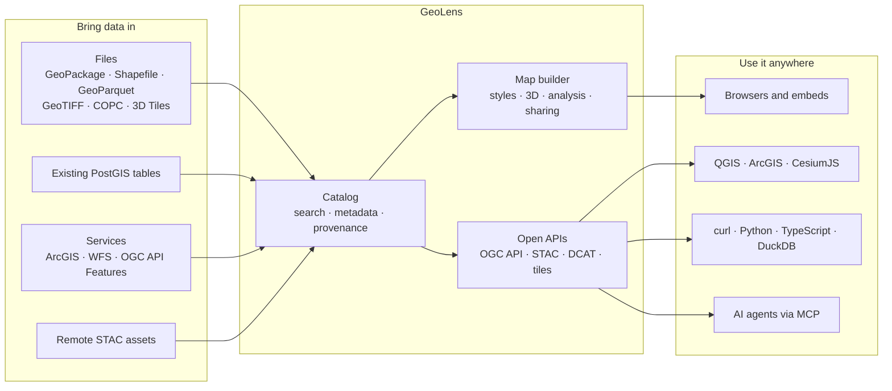

<p align="center">
  <picture>
    <source media="(prefers-color-scheme: dark)" srcset=".github/assets/geolens-emblem-dark.svg">
    
  </picture>
</p>

<h1 align="center">GeoLens</h1>

<p align="center">
  <b>A self-hosted spatial data catalog and map builder that keeps track of where every dataset came from.</b>
</p>

<p align="center">
  <a href="https://demo.getgeolens.com"><b>Live demo</b></a> ·
  <a href="#install">Install</a> ·
  <a href="https://docs.getgeolens.com">Documentation</a> ·
  <a href="#use-the-data-from-anywhere">Connect QGIS or code</a> ·
  <a href="https://github.com/geolens-io/geolens/discussions">Discussions</a>
</p>

<div align="center">

[English](README.md) · [Español](README.es.md) · [Français](README.fr.md) · [Deutsch](README.de.md) · [简体中文](README.zh.md)

[](https://github.com/geolens-io/geolens/releases/latest)
[](https://github.com/geolens-io/geolens/actions/workflows/ci.yml)
[](LICENSE)
[](https://securityscorecards.dev/viewer/?uri=github.com/geolens-io/geolens)

</div>

<p align="center">
  <a href="https://demo.getgeolens.com/maps">
    <picture>
      <source media="(prefers-color-scheme: dark)" srcset=".github/assets/geolens-manhattan-3d-hero-dark.jpg">
      
    </picture>
  </a>
  <br>
  <sub>Manhattan's buildings at their surveyed roof heights, colored by construction era, with the subway network. <a href="https://demo.getgeolens.com/maps">Browse the demo's maps</a>.</sub>
</p>

GeoLens is for teams whose spatial data is spread across file shares, PostGIS databases, web
services and STAC catalogs. It puts that data in one searchable catalog, records where each
dataset came from and checks whether the source is still current. Teams build and share maps in
the browser, and QGIS, scripts and AI agents read the same data through OGC API and STAC. It runs
on your own servers with Docker Compose, sends no telemetry and is licensed under Apache 2.0.

The [demo](https://demo.getgeolens.com) needs no install or account; sign in with Google, GitHub
or Microsoft to use the map builder. Demo data may be wiped at any time.

## A closer look

<table>
<tr>
<td width="50%" valign="top">
<picture>
<source media="(prefers-color-scheme: dark)" srcset=".github/assets/geolens-catalog-search-dark.png">

</picture>
<br><sub>Search by meaning: "where storms hit the coast" finds hurricane tracks and coastal exposure layers.</sub>
</td>
<td width="50%" valign="top">
<picture>
<source media="(prefers-color-scheme: dark)" srcset=".github/assets/geolens-dataset-page-dark.png">

</picture>
<br><sub>Each dataset has a page with its metadata and source, plus a map preview when it has an extent.</sub>
</td>
</tr>
<tr>
<td width="50%" valign="top">
<picture>
<source media="(prefers-color-scheme: dark)" srcset=".github/assets/geolens-import-preview-dark.png">

</picture>
<br><sub>Before you import a service layer, GeoLens previews its columns and first rows.</sub>
</td>
<td width="50%" valign="top">
<picture>
<source media="(prefers-color-scheme: dark)" srcset=".github/assets/geolens-version-history-dark.png">

</picture>
<br><sub>Each replacement is recorded in the history, and you can restore the previous version.</sub>
</td>
</tr>
<tr>
<td width="50%" valign="top">
<picture>
<source media="(prefers-color-scheme: dark)" srcset=".github/assets/geolens-builder-style-dark.png">

</picture>
<br><sub>Layers render as points, symbols, heatmaps or clusters, and the ramp list can be limited to colorblind-safe ones.</sub>
</td>
<td width="50%" valign="top">
<picture>
<source media="(prefers-color-scheme: dark)" srcset=".github/assets/geolens-matterhorn-terrain-dark.jpg">

</picture>
<br><sub>3D terrain from your own elevation data, here the Matterhorn from swissALTI3D lidar.</sub>
</td>
</tr>
<tr>
<td width="50%" valign="top">
<picture>
<source media="(prefers-color-scheme: dark)" srcset=".github/assets/geolens-stac-imagery-dark.jpg">

</picture>
<br><sub>Sentinel-2 scenes referenced from a STAC catalog. The imagery stays where it is and is tiled on request.</sub>
</td>
<td width="50%" valign="top">
<picture>
<source media="(prefers-color-scheme: dark)" srcset=".github/assets/geolens-share-embed-dark.png">

</picture>
<br><sub>Keep a map to yourself, open it to your team, or make it public with a link and embed code.</sub>
</td>
</tr>
<tr>
<td width="50%" valign="top">
<picture>
<source media="(prefers-color-scheme: dark)" srcset=".github/assets/geolens-admin-overview-dark.png">

</picture>
<br><sub>The admin overview shows service health next to dataset and storage totals.</sub>
</td>
<td width="50%" valign="top">
<picture>
<source media="(prefers-color-scheme: dark)" srcset=".github/assets/geolens-admin-permissions-dark.png">

</picture>
<br><sub>Viewer, editor and admin roles, with each capability switched on or off per role.</sub>
</td>
</tr>
</table>

## How it fits together



## One catalog for scattered data

- Upload Shapefile, GeoPackage, GeoJSON, GeoParquet, FlatGeobuf, KML/KMZ, zipped File
  Geodatabase, CSV, Excel or GeoTIFF (converted to Cloud-Optimized GeoTIFF). 3D Tiles and COPC
  point clouds are hosted for CesiumJS, QGIS and Potree.
- Serve tables already in GeoLens's PostGIS database in place, import WFS, ArcGIS and OGC API
  Features layers and refresh them on demand, or reference remote STAC assets without copying
  them.
- Draw new datasets in the browser.
- Find data with fuzzy search, or by meaning once an embedding provider is configured. Filter by
  type, place and time, group datasets into collections, edit metadata and restore a dataset's
  previous version after a replacement.

## Know where every dataset came from

<p align="center">
  <picture>
    <source media="(prefers-color-scheme: dark)" srcset=".github/assets/geolens-provenance-dark.png">
    
  </picture>
  <br>
  <sub>A dataset imported from the USGS earthquake service.</sub>
</p>

Each dataset records where it came from: an uploaded file, a database table, a service, a STAC
item or a drawing in the browser. Imported datasets also record when they were last refreshed, and
with an update cadence GeoLens marks them fresh, due or overdue. For services and
STAC sources, GeoLens also checks that the source still answers, and for services it flags upstream
schema changes before they reach your maps. If a service disappears, the imported copy keeps working.

## Build and share maps

- Point, symbol, heatmap, cluster, line, arrow, fill, 3D extrusion, raster and hillshade layers,
  with data-driven styles, labels, icons, patterns, filters and popups. Terrain comes from your own
  elevation models.
- Buffer, centroid, clip, dissolve, spatial join, select by location, measure and intersect. Most
  operations preview on the map, and each result is saved as a new dataset, from the builder or
  the CLI.
- Public links show the map's title and image when pasted into Slack, Teams or social posts, and
  maps embed in other sites with private tokens.
- The interface is in English, Spanish, French, German and Simplified Chinese.

## Use the data from anywhere

Vector datasets are OGC API Features collections, the catalog is OGC API Records and STAC, and
every layer has a tile URL. You can try this against the demo without an account (the second
command needs `jq`):

```sh
# Search the catalog (OGC API Records)
curl "https://demo.getgeolens.com/api/collections/datasets/items?q=volcanic%20eruptions"

# Read the top match with a CQL2 filter (OGC API Features): eruptions of VEI 6 or larger
ID=$(curl -s "https://demo.getgeolens.com/api/collections/datasets/items?q=volcanic%20eruptions&limit=1" | jq -r '.features[0].id')
curl -G "https://demo.getgeolens.com/api/collections/$ID/items" \
  --data-urlencode "filter=vei >= 6" -d limit=3
```

QGIS adds the same API as an OGC API Features connection, as the
[QGIS guide](https://docs.getgeolens.com/guides/api/qgis/) shows. The
[GeoLens plugin for QGIS](https://github.com/geolens-io/qgis-geolens-plugin) adds catalog search,
private datasets and edits that sync back to GeoLens.

<p align="center">
  
  <br>
  <sub>QGIS reading the demo over OGC API Features, without a plugin.</sub>
</p>

| Standard | Where | Use it with |
|---|---|---|
| OGC API Features, with CQL2 filtering and queryables | `/api/collections/{id}/items` | QGIS, ArcGIS, GDAL/OGR and other OGC API clients |
| OGC API Records | `/api/collections/datasets/items` | Catalog search from other portals and tools |
| STAC API 1.0 | `/api/stac/` | STAC clients such as pystac-client and STAC Browser |
| DCAT 3, DCAT-US 3.0 and GeoDCAT-AP as JSON-LD | `/api/datasets/dcat/`, `/api/datasets/dcat-us/3.0/`, `/api/datasets/geodcat-ap/` | Harvesting into national and EU open-data portals |
| Vector tiles and COG raster tiles | a tile URL on every layer | MapLibre, OpenLayers, Leaflet |
| 3D Tiles and COPC | each 3D dataset's page | CesiumJS, QGIS, Potree |

Data exports as GeoJSON, Shapefile, GeoPackage, CSV, FlatGeobuf, GeoParquet, PMTiles or
Cloud-Optimized GeoTIFF.

The `geolens` CLI publishes files and applies catalog manifests, Python and TypeScript SDKs cover
the API, and a read-only MCP server lets AI agents search the catalog. The
[API reference](https://docs.getgeolens.com/guides/api/) and
[SDK guides](https://docs.getgeolens.com/guides/sdk/) document them, and the
[examples gallery](https://geolens-io.github.io/geolens-examples/) has runnable code for
MapLibre, Leaflet, OpenLayers, the ArcGIS Maps SDK, QGIS and DuckDB.

## Optional AI

<p align="center">
  <picture>
    <source media="(prefers-color-scheme: dark)" srcset=".github/assets/geolens-ask-ai-dark.png">
    
  </picture>
  <br>
  <sub>"How many of these hurricanes made landfall?" returns the count, a table and the assumption the answer rests on.</sub>
</p>

GeoLens can answer questions about a dataset, edit maps from plain-language requests, draft
metadata and search in natural language. It works with any OpenAI-compatible endpoint, including
a local server such as Ollama, and with Claude through Anthropic, Microsoft Foundry, Amazon Bedrock
or Google Vertex AI. AI stays off until an administrator configures a provider, and every workflow
works without it.

## Install

You need Git, curl and Docker with the Compose plugin. The
[Install Guide](https://docs.getgeolens.com/guides/quickstart/install/) lists the versions, memory
and ports it expects.

```sh
curl -fsSL https://getgeolens.com/install.sh | sh    # clone, generate secrets, start the stack
cd geolens
grep '^GEOLENS_ADMIN_PASSWORD=' .env                  # the generated admin password
```

Open http://localhost:8080 and sign in as `admin` with that password. Each
[release](https://github.com/geolens-io/geolens/releases) includes a `SHA256SUMS` file for checking
`install.sh` before you run it. To build from source instead, clone the repository and run
`bash scripts/install.sh`; the first build takes 5-10 minutes.

For production, read the
[cloud deployment guide](https://docs.getgeolens.com/guides/quickstart/cloud-deployment/), which
also lists what an external database needs. Docker Compose is the supported path, and
[geolens-deployments](https://github.com/geolens-io/geolens-deployments) has a community-maintained
Helm chart and Terraform recipes for AWS ECS Fargate and Azure Container Apps.

The bundled database is backed up daily, and the
[backup guide](https://docs.getgeolens.com/guides/admin/backups/) covers off-site copies and
restores. [UPGRADING.md](UPGRADING.md) covers upgrades and rollback, [RUNBOOK.md](RUNBOOK.md)
covers operations, and the
[Configuration Reference](https://docs.getgeolens.com/guides/quickstart/configuration/) lists every
setting.

## Your first dataset

With the [CLI](https://docs.getgeolens.com/guides/cli/) installed, publish the sample file from the
install directory:

```sh
geolens login http://localhost:8080/api               # your admin username and password
geolens publish examples/manifests/first-catalog/city-parks.geojson --name "City Parks"
```

`geolens publish` prints the new dataset's URL. To manage a whole catalog, describe the sources in
a `geolens.yaml` manifest and run `geolens apply`; [`examples/manifests/`](examples/manifests/) has
templates.

To load the demo's maps and datasets, export `GEOLENS_ADMIN_PASSWORD` from `.env` and run
`python scripts/seed-showcase.py --username admin`. The script needs Python 3.10+ and `httpx` and
downloads public data from about a dozen sources; [scripts/README.md](scripts/README.md) has the
sizes and options.

## Privacy and access

- GeoLens sends no telemetry. Apart from the default basemap tiles and the remote services or
  STAC sources your users register, it makes outbound calls only for features an administrator
  turns on. [EGRESS.md](EGRESS.md) lists them and explains how to run air-gapped.
- Your data stays readable without GeoLens. Vector datasets are ordinary PostGIS tables in a
  `data` schema, rasters are Cloud-Optimized GeoTIFFs in your own storage (local disk, S3/MinIO or
  Azure Blob), and the catalog exports through OGC API, STAC and DCAT.
- Sign-in uses local accounts or OAuth 2.0/OIDC (Google, Microsoft, GitHub or a generic provider),
  with roles, per-dataset permissions, per-user API keys and an audit log. Self-registration is
  off by default.
- Features released in this repository stay free.
  [EDITIONS.md](EDITIONS.md) describes the optional paid support and add-ons.

## Known limitations

- The supported install, Docker Compose, runs on one host. For high availability, run several
  replicas of the API, worker, frontend and Titiler against a managed PostgreSQL with automatic
  failover, shared object storage and one Valkey or Redis cache. With Azure Blob or local storage,
  API and worker replicas also need a shared staging volume, since only S3 keeps uploads in the
  bucket. Local storage keeps every file on that volume, so Titiler replicas mount it too.
  [geolens-deployments](https://github.com/geolens-io/geolens-deployments) has a
  community-maintained Helm chart, Terraform recipes for AWS and Azure, and guides for AWS, Azure,
  Google Cloud and DigitalOcean. GeoLens itself doesn't cluster the database or read from replicas.
- One organization per deployment.
- Terrain rendering assumes elevation in meters; other vertical units render exaggerated.
- GeoLens's own REST API can change between minor releases (the standards endpoints follow their
  specifications). The [CHANGELOG](CHANGELOG.md) lists contract changes, and a breaking change
  keeps the old form working for one more minor release.

## Contributing

Bug reports, fixes, translations and docs are welcome. [CONTRIBUTING](.github/CONTRIBUTING.md)
covers setup, tests and DCO sign-off, and [ARCHITECTURE](.github/ARCHITECTURE.md) maps the code.
The [QGIS plugin](https://github.com/geolens-io/qgis-geolens-plugin),
[examples](https://github.com/geolens-io/geolens-examples) and
[deployments](https://github.com/geolens-io/geolens-deployments) repositories take issues and pull
requests too. Ask questions in
[GitHub Discussions](https://github.com/geolens-io/geolens/discussions), report bugs in
[Issues](https://github.com/geolens-io/geolens/issues), and report security problems privately as
described in [SECURITY.md](.github/SECURITY.md). The [roadmap](https://docs.getgeolens.com/roadmap/)
shows what's planned.

## Built on

GeoLens is built on these open source projects. Thanks to everyone who maintains them.

- [PostgreSQL](https://www.postgresql.org/) and [PostGIS](https://postgis.net/) hold the catalog and every vector dataset, and
  [pgvector](https://github.com/pgvector/pgvector) stores the embeddings behind search by meaning.
- [GDAL](https://gdal.org/) reads the files and services GeoLens imports and writes the formats it exports,
  and [PROJ](https://proj.org/) handles coordinate transformations.
- [TiTiler](https://developmentseed.org/titiler/) serves raster tiles from Cloud Optimized GeoTIFFs.
- [FastAPI](https://fastapi.tiangolo.com/) serves the API, and [Procrastinate](https://procrastinate.readthedocs.io/) runs background
  jobs with PostgreSQL as the queue.
- [MapLibre GL JS](https://maplibre.org/) draws the maps, [deck.gl](https://deck.gl/) and
  [loaders.gl](https://loaders.gl/) render 3D Tiles and point clouds, and [Terra Draw](https://terradraw.io/)
  handles drawing and editing.
- The web app is written in [React](https://react.dev/).

These names belong to their owners, and listing them doesn't mean they endorse GeoLens; see
[TRADEMARKS.md](TRADEMARKS.md#other-projects-names).

## License

GeoLens is licensed under the [Apache License 2.0](LICENSE). The GeoLens name, logo and brand
assets are not covered by this license; see [TRADEMARKS.md](TRADEMARKS.md). Sample-data
attribution is in [THIRD_PARTY_DATA.md](THIRD_PARTY_DATA.md). The web app serves the license notices for the
code it bundles at `/third-party-licenses.txt`, and the backend image's copyleft notices are in
[backend/licenses](backend/licenses/).

Project policies: [editions](EDITIONS.md) · [support](SUPPORT.md) · [governance](GOVERNANCE.md) · [maintainers](MAINTAINERS.md) · [security](.github/SECURITY.md) · [release process](RELEASE.md) · [egress &amp; air-gap](EGRESS.md)
