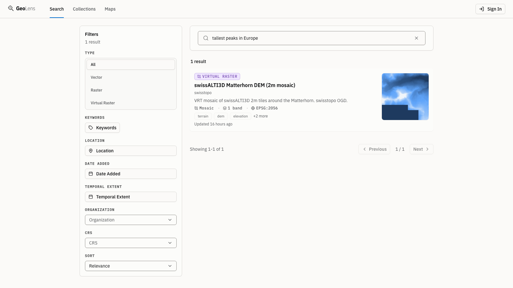
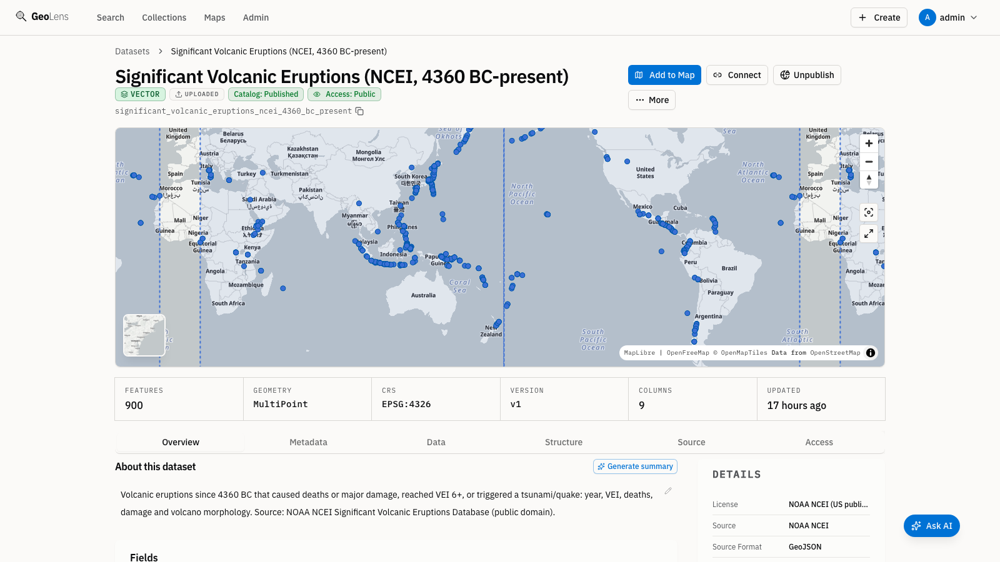
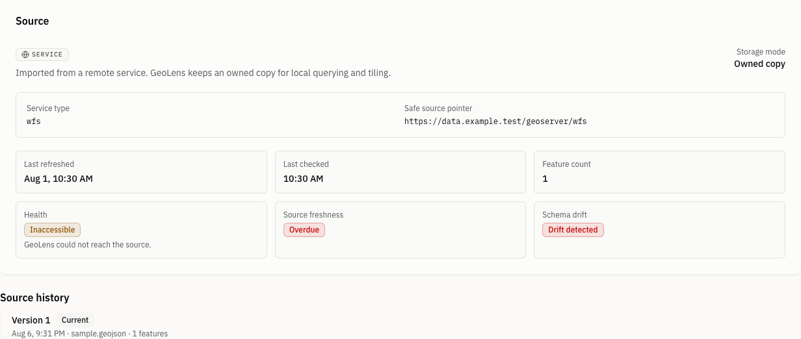
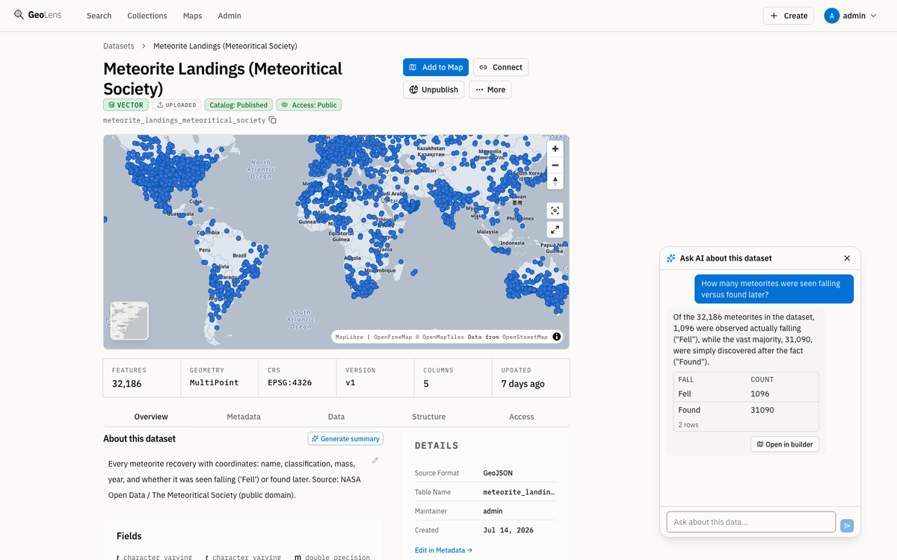
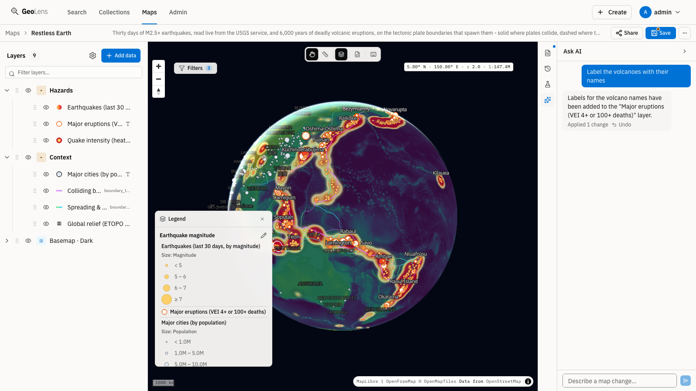
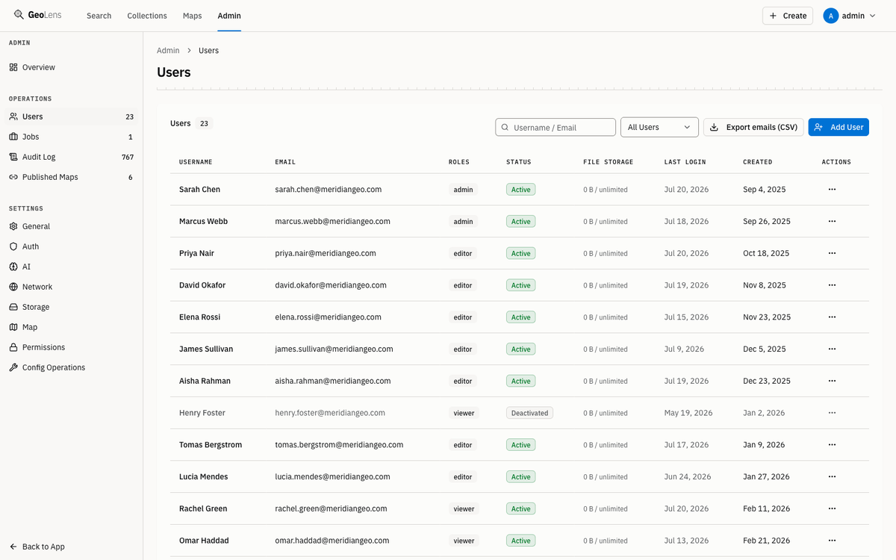
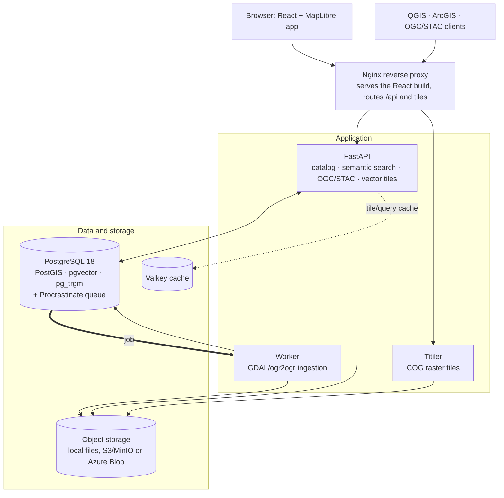

<p align="center">
  
</p>

<h1 align="center">GeoLens</h1>

<p align="center">
  <b>An open-source spatial data catalog and map builder that runs on your own infrastructure.</b><br>
  Files, database tables, service imports and remote STAC assets go into one searchable catalog that
  records where each dataset came from. Teams build and share maps from it, and desktop GIS and
  scripts read the same data through OGC API and STAC.
</p>

<div align="center">

[English](README.md) · [Español](README.es.md) · [Français](README.fr.md) · [Deutsch](README.de.md) · [简体中文](README.zh.md)

</div>

<p align="center">
  <a href="https://github.com/geolens-io/geolens/releases/latest"></a>
  <a href="LICENSE"></a>
  <a href="https://github.com/geolens-io/geolens/actions/workflows/ci.yml"></a>
  <a href="https://pypi.org/project/geolens/"></a>
  <a href="https://www.npmjs.com/package/@geolens/sdk"></a>
  
  
</p>

<p align="center">
  <a href="https://demo.getgeolens.com"></a>
  <a href="#get-geolens"></a>
  <a href="https://docs.getgeolens.com"></a>
  <br>
  <sub>The demo needs no install. Browse the sample catalog and maps without an account, or sign in with Google, GitHub or Microsoft to try the map builder. Demo data may be wiped at any time.</sub>
</p>

<p align="center">
  <a href="https://demo.getgeolens.com/maps"></a>
  <br>
  <sub>Every Manhattan building extruded to its roof height and colored by the era it was built, with the subway beneath.</sub>
</p>

## Why GeoLens

- **One catalog for scattered data.** Upload files, draw new datasets in the browser, register
  tables already in GeoLens's PostGIS database, import WFS, ArcGIS and OGC API Features services,
  or point at remote STAC assets. All of it shares one search, with fuzzy matching built in and
  search by meaning once you configure an embedding provider.
- **Provenance you can see.** Every dataset records how it entered the catalog and when it was
  last refreshed. For a service import, GeoLens also checks that the source still answers and
  warns when a refresh is overdue or the upstream schema has changed.
- **Open standards instead of lock-in.** Vector datasets are OGC API Features collections, the
  catalog is OGC API Records, STAC and DCAT, and every layer has a tile URL. Data leaves as
  GeoPackage, GeoParquet, FlatGeobuf, PMTiles or Cloud-Optimized GeoTIFF.
- **Maps you can share.** Compose multi-layer maps in the browser with data-driven styles,
  labels, clusters, 3D buildings and terrain, then share a public link or embed the map in
  another site.
- **Private by default.** There is no telemetry. Apart from the default basemap tiles, GeoLens
  makes outbound calls only for features an administrator turns on, and [EGRESS.md](EGRESS.md)
  lists each one.
- **Scriptable.** The `geolens` CLI publishes files and applies catalog manifests. Python and
  TypeScript SDKs cover the API, and a read-only MCP server lets coding agents search the catalog.
  AI help inside the app is optional and stays off until an administrator picks a provider.

## A tour

<table>
<tr>
<td width="50%" valign="top"><p align="center"><sub><b>Search by meaning.</b> "Tallest peaks in Europe" finds the Matterhorn terrain model, though no result contains those words. Type, place and date filters narrow the list.</sub></p></td>
<td width="50%" valign="top"><p align="center"><sub><b>A page for every dataset.</b> Map preview, schema statistics and typed metadata. Here, 6,000 years of significant volcanic eruptions from NOAA NCEI.</sub></p></td>
</tr>
<tr>
<td width="50%" valign="top"><p align="center"><sub><b>Source state.</b> A WFS import whose server stopped answering. GeoLens marks it unreachable and overdue and keeps serving its own copy.</sub></p></td>
<td width="50%" valign="top"><picture><source media="(prefers-color-scheme: dark)" srcset=".github/assets/geolens-dataset-chat-dark.png"></picture><p align="center"><sub><b>Ask your data.</b> "How many meteorites were seen falling versus found later?" returns the answer, the counts and a button that opens the result in the map builder.</sub></p></td>
</tr>
<tr>
<td width="50%" valign="top"><p align="center"><sub><b>Map builder.</b> A drag-ordered layer stack with an editor for each layer. Here, the Matterhorn as 3D terrain from swissALTI3D lidar.</sub></p></td>
<td width="50%" valign="top"><p align="center"><sub><b>Edit maps in plain language.</b> "Label the volcanoes with their names" adds the labels, using the AI provider an administrator configured.</sub></p></td>
</tr>
<tr>
<td width="50%" valign="top"><picture><source media="(prefers-color-scheme: dark)" srcset=".github/assets/geolens-admin-overview-dark.png"></picture><p align="center"><sub><b>Administration.</b> Live health, usage, jobs, the audit log and AI status, with nothing extra to deploy.</sub></p></td>
<td width="50%" valign="top"><picture><source media="(prefers-color-scheme: dark)" srcset=".github/assets/geolens-admin-users-dark.png"></picture><p align="center"><sub><b>Users and roles.</b> Accounts, roles, status and storage quotas, with a CSV export.</sub></p></td>
</tr>
</table>

The showcase maps and datasets above are public open data, loaded by
[`scripts/seed-showcase.py`](scripts/seed-showcase.py). Run it against your own install to explore
the same catalog.

## Features

| Area | Highlights |
|---|---|
| **Data in** | Shapefile, GeoPackage, GeoJSON, GeoParquet, FlatGeobuf, KML/KMZ, zipped File Geodatabase, CSV and Excel; GeoTIFF, converted to Cloud-Optimized GeoTIFF; VRT mosaics from many rasters; 3D Tiles tilesets and COPC point clouds; WFS, ArcGIS FeatureServer and MapServer, and OGC API Features imports that refresh on demand or on a schedule; live references to remote STAC assets; datasets drawn in the browser; tables already in GeoLens's PostGIS database, served in place |
| **Catalog and search** | Fuzzy search out of the box (pg_trgm) and search by meaning with an embedding provider (pgvector); type, place and time filters; collections; editable, typed metadata; dataset pages with map previews and schema statistics; version history with restore |
| **Provenance** | Origin and last refreshed and checked times for every dataset; declared refresh cadence with fresh, due and overdue states; health checks for service and STAC sources; schema drift detection |
| **Map builder** | Point, symbol, heatmap, cluster, line, arrow, fill, 3D extrusion, raster and hillshade layers; data-driven styles, labels, icons, patterns, filters and popups; folders and basemap groups; 3D terrain from your elevation models; drawing tools; map history; legend and measurement tools |
| **Sharing** | Public links that unfurl with the map's own title and image in Slack, Teams and social posts; embeddable maps with private embed tokens |
| **Analysis** | Buffer, centroid, clip, dissolve, spatial join, select by location, measure and intersect, previewed on the map (dissolve runs straight to a job) and saved as new datasets, from the builder or the CLI |
| **Standards** | OGC API Features with CQL2 filtering and queryables; OGC API Records; STAC API 1.0; DCAT 3, DCAT-US 3.0 and GeoDCAT-AP as JSON-LD; vector tiles and COG raster tiles; 3D Tiles and COPC for CesiumJS, QGIS and Potree |
| **Data out** | GeoJSON, Shapefile, GeoPackage, CSV and FlatGeobuf with reprojection; GeoParquet; PMTiles archives for static hosting; Cloud-Optimized GeoTIFF for rasters |
| **Access control** | Local accounts and OAuth 2.0/OIDC sign-in (Google, Microsoft, GitHub or a generic OIDC provider); roles and per-dataset permissions; per-user API keys; an audit log of administrative actions; self-registration off by default |
| **AI (optional)** | Ask questions of a dataset, edit maps in plain language, draft metadata and search in natural language, with any OpenAI-compatible endpoint or Claude through Anthropic, Microsoft Foundry, Amazon Bedrock or Google Vertex AI. Off until an administrator configures it |
| **Operations** | An upgrade script that backs up the database first and prints a rollback recipe on failure; daily and weekly backups on by default, with optional off-site S3 copies; Prometheus metrics, alert rules and a Grafana dashboard; an admin plane for health, usage, users and jobs |
| **Clients** | The `geolens` CLI with catalog-as-code manifests; Python and TypeScript SDKs; a read-only MCP server for coding agents; [runnable examples](https://github.com/geolens-io/geolens-examples) for MapLibre, Leaflet, OpenLayers, the ArcGIS Maps SDK, QGIS and DuckDB |
| **Interface** | English, Spanish, French, German and Simplified Chinese; light and dark themes; keyboard shortcuts in the map builder |

The [guides](https://docs.getgeolens.com/guides/) cover each area in detail, and the
[roadmap](https://docs.getgeolens.com/roadmap/) shows what's next.

## Get GeoLens

You need Docker Engine 24+ and Docker Compose v2. A fresh install runs six containers in about
1.3 GB of memory, on linux/amd64 or linux/arm64.

- **One-line install**: `curl -fsSL https://getgeolens.com/install.sh | sh` clones GeoLens into
  `./geolens`, writes `.env` with generated secrets and a random admin password, pulls the
  prebuilt images and starts the stack in about a minute. To check the script first, download
  `install.sh` and `SHA256SUMS` from the same
  [release](https://github.com/geolens-io/geolens/releases) and run `sha256sum -c SHA256SUMS`
  (`shasum -a 256 -c SHA256SUMS` on macOS).
- **From source**: clone the repository and run `bash scripts/install.sh`. It builds every image
  locally, which takes 5-10 minutes the first time.
- **Prebuilt images**: `ghcr.io/geolens-io/geolens-api` and `ghcr.io/geolens-io/geolens-frontend`.
  The `latest` tag tracks the newest stable release.
- **Production**: the [Install Guide](https://docs.getgeolens.com/guides/quickstart/install/)
  covers production settings and troubleshooting, and there are guides for
  [managed cloud services](https://docs.getgeolens.com/guides/quickstart/cloud-deployment/).
  Docker Compose is the supported path; an experimental, community-maintained Helm chart lives in
  [geolens-deployments](https://github.com/geolens-io/geolens-deployments).

An external database must be PostgreSQL 15+ with PostGIS, pgvector 0.5+, pg_trgm and unaccent.
To upgrade, run `./scripts/upgrade.sh` from the install directory. It backs up the database,
pulls the new images and migrates behind a health check; [UPGRADING.md](UPGRADING.md) has the
details and the rollback steps.

## Quick start

```sh
curl -fsSL https://getgeolens.com/install.sh | sh    # clone, generate secrets, start the stack
cd geolens
grep '^GEOLENS_ADMIN_PASSWORD=' .env                  # the generated admin password
```

Open http://localhost:8080 and sign in as `admin`.

Every dataset is also an API. Publish the sample file from the command line, then read it back
the way any OGC API Features client would:

```sh
pip install geolens-cli                               # needs Python 3.11+
geolens login http://localhost:8080/api               # your admin username and password
geolens publish examples/manifests/first-catalog/city-parks.geojson --name "City Parks"
export GEOLENS_API_KEY=<your-api-key>                 # create one on your Settings page
curl -H "X-Api-Key: $GEOLENS_API_KEY" \
  "http://localhost:8080/api/collections/<dataset-id>/items?limit=5"
```

`geolens publish` prints the new dataset's URL, which ends in its id. Vector tiles leave out attribute columns below zoom 10; add `cols=<column>,<column>`
to a tile URL to keep specific columns at every zoom. In QGIS, add `http://localhost:8080/api/` as a WFS / OGC API Features connection
(the [QGIS guide](https://docs.getgeolens.com/guides/api/qgis/) has the steps). For a whole
catalog, describe the sources in a `geolens.yaml` manifest and run `geolens apply`;
[`examples/manifests/`](examples/manifests/) has templates and the
[CLI guide](https://docs.getgeolens.com/guides/cli/) has the schema.

Load the showcase maps from the tour (this downloads public open data):

```sh
pip install httpx
python scripts/seed-showcase.py --username admin \
  --password "$(grep '^GEOLENS_ADMIN_PASSWORD=' .env | cut -d= -f2-)"
```

The [API reference](https://docs.getgeolens.com/guides/api/), the
[SDK guides](https://docs.getgeolens.com/guides/sdk/) and the
[examples gallery](https://geolens-io.github.io/geolens-examples/) go further. The read-only
examples run against the live demo, and CI replays them there every week.

## Architecture

A few services around one PostgreSQL database. The API serves the catalog, search and the
standards endpoints, a worker runs ingestion jobs from a queue kept in PostgreSQL, and Titiler
serves raster tiles from object storage.



Configuration is environment variables in `.env`; the
[Configuration Reference](https://docs.getgeolens.com/guides/quickstart/configuration/) lists
them all. [RUNBOOK.md](RUNBOOK.md) covers backups, restores, monitoring and incident response.
Contributors start with [CONTRIBUTING](.github/CONTRIBUTING.md) and
[ARCHITECTURE](.github/ARCHITECTURE.md).

## Known limitations

- One PostgreSQL instance, with no built-in high availability or clustering.
- One organization per deployment.
- Terrain rendering assumes elevation in meters; other vertical units render exaggerated.
- The OGC API, STAC and tile endpoints follow their specifications, but GeoLens's own REST API can
  still change between minor releases. The [CHANGELOG](CHANGELOG.md) lists contract changes, and
  a breaking one keeps the old form working for at least one more minor release.

## Community

- [GitHub Discussions](https://github.com/geolens-io/geolens/discussions) for questions, ideas and show and tell
- [Support](SUPPORT.md) for where to ask for help
- [Issues](https://github.com/geolens-io/geolens/issues) for bugs and rough edges

## License

GeoLens is licensed under the [Apache License 2.0](LICENSE). The GeoLens name, logo and brand
assets are not covered by this license; see [TRADEMARKS.md](TRADEMARKS.md). Sample-data
attribution is in [THIRD_PARTY_DATA.md](THIRD_PARTY_DATA.md).

Project policies: [editions](EDITIONS.md) · [governance](GOVERNANCE.md) · [maintainers](MAINTAINERS.md) · [contributing](.github/CONTRIBUTING.md) · [security](.github/SECURITY.md) · [release process](RELEASE.md) · [egress &amp; air-gap](EGRESS.md)
