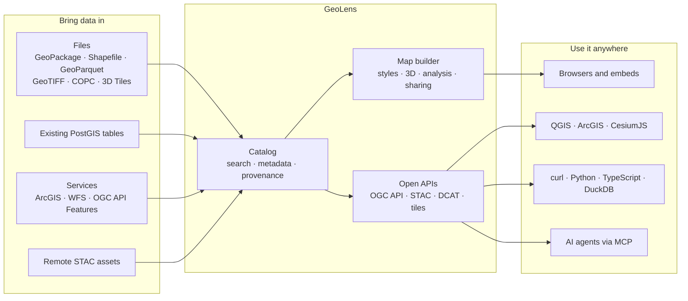

<p align="center">
  
</p>

<h1 align="center">GeoLens</h1>

<p align="center">
  <b>A self-hosted spatial data catalog and map builder that keeps track of where every dataset came from.</b>
</p>

<p align="center">
  <a href="https://demo.getgeolens.com"><b>Live demo</b></a> ·
  <a href="#install">Install</a> ·
  <a href="https://docs.getgeolens.com">Documentation</a> ·
  <a href="#use-the-data-from-anywhere">Connect QGIS or code</a> ·
  <a href="https://github.com/geolens-io/geolens/discussions">Discussions</a>
</p>

<div align="center">

[English](README.md) · [Español](README.es.md) · [Français](README.fr.md) · [Deutsch](README.de.md) · [简体中文](README.zh.md)

[](https://github.com/geolens-io/geolens/releases/latest)
[](https://github.com/geolens-io/geolens/actions/workflows/ci.yml)
[](LICENSE)

</div>

<p align="center">
  <a href="https://demo.getgeolens.com/maps">
    <picture>
      <source media="(prefers-color-scheme: dark)" srcset=".github/assets/geolens-manhattan-3d-hero-dark.jpg">
      
    </picture>
  </a>
  <br>
  <sub>Manhattan's buildings at their surveyed roof heights, colored by construction era, with the subway network. <a href="https://demo.getgeolens.com/maps">Browse the demo's maps</a>.</sub>
</p>

GeoLens is for teams whose spatial data is spread across file shares, PostGIS databases, web
services and STAC catalogs. It puts that data in one searchable catalog, records where each
dataset came from and checks whether the source is still current. Teams build and share maps in
the browser, and QGIS, scripts and AI agents read the same data through OGC API and STAC. It runs
on your own servers with Docker Compose, sends no telemetry and is licensed under Apache 2.0.

The [demo](https://demo.getgeolens.com) needs no install or account; sign in with Google, GitHub
or Microsoft to use the map builder. Demo data may be wiped at any time.

## How it fits together



## One catalog for scattered data

<p align="center">
  <picture>
    <source media="(prefers-color-scheme: dark)" srcset=".github/assets/geolens-catalog-search-dark.png">
    
  </picture>
  <br>
  <sub>Search by meaning: "where storms hit the coast" finds hurricane tracks, storm corridors and coastal exposure layers.</sub>
</p>

- Upload Shapefile, GeoPackage, GeoJSON, GeoParquet, FlatGeobuf, KML/KMZ, zipped File
  Geodatabase, CSV, Excel or GeoTIFF (converted to Cloud-Optimized GeoTIFF). 3D Tiles and COPC
  point clouds are hosted for CesiumJS, QGIS and Potree.
- Serve tables already in GeoLens's PostGIS database in place, import WFS, ArcGIS and OGC API
  Features layers and refresh them on demand, or reference remote STAC assets without copying
  them.
- Draw new datasets in the browser.
- Find data with fuzzy search, or by meaning once an embedding provider is configured. Filter by
  type, place and time, group datasets into collections, edit metadata and restore a dataset's
  previous version after a replacement.

## Know where every dataset came from

<p align="center">
  <picture>
    <source media="(prefers-color-scheme: dark)" srcset=".github/assets/geolens-provenance-dark.png">
    
  </picture>
  <br>
  <sub>A dataset imported from the USGS earthquake service.</sub>
</p>

Each dataset records the file, table, service or STAC item it came from and when it was last
refreshed. Give it an update cadence and GeoLens marks it fresh, due or overdue. For services and
STAC sources, GeoLens also checks that the source still answers and flags upstream schema changes
before they reach your maps. If a service disappears, the imported copy keeps working.

## Build and share maps

<p align="center">
  <picture>
    <source media="(prefers-color-scheme: dark)" srcset=".github/assets/geolens-matterhorn-terrain-dark.jpg">
    
  </picture>
  <br>
  <sub>The Matterhorn as 3D terrain from swissALTI3D lidar, with peaks and climbing routes from OpenStreetMap.</sub>
</p>

- Point, symbol, heatmap, cluster, line, arrow, fill, 3D extrusion, raster and hillshade layers,
  with data-driven styles, labels, icons, patterns, filters and popups. Terrain comes from your own
  elevation models.
- Buffer, centroid, clip, dissolve, spatial join, select by location, measure and intersect. Most
  operations preview on the map, and each result is saved as a new dataset, from the builder or
  the CLI.
- Public links show the map's title and image when pasted into Slack, Teams or social posts, and
  maps embed in other sites with private tokens.
- The interface is in English, Spanish, French, German and Simplified Chinese.

## Use the data from anywhere

Vector datasets are OGC API Features collections, the catalog is OGC API Records and STAC, and
every layer has a tile URL. You can try this against the demo without an account (the second
command needs `jq`):

```sh
# Search the catalog (OGC API Records)
curl "https://demo.getgeolens.com/api/collections/datasets/items?q=volcanic%20eruptions"

# Read the top match with a CQL2 filter (OGC API Features): eruptions of VEI 6 or larger
ID=$(curl -s "https://demo.getgeolens.com/api/collections/datasets/items?q=volcanic%20eruptions&limit=1" | jq -r '.features[0].id')
curl -G "https://demo.getgeolens.com/api/collections/$ID/items" \
  --data-urlencode "filter=vei >= 6" -d limit=3
```

In QGIS, add `https://demo.getgeolens.com/api/` as a WFS / OGC API Features connection to list the
public datasets as layers. The [QGIS guide](https://docs.getgeolens.com/guides/api/qgis/) has the
steps.

<p align="center">
  
  <br>
  <sub>QGIS reading the demo over OGC API Features, without a plugin.</sub>
</p>

| Standard | Where | Use it with |
|---|---|---|
| OGC API Features, with CQL2 filtering and queryables | `/api/collections/{id}/items` | QGIS, ArcGIS, GDAL/OGR and other OGC API clients |
| OGC API Records | `/api/collections/datasets/items` | Catalog search from other portals and tools |
| STAC API 1.0 | `/api/stac/` | STAC clients such as pystac-client and STAC Browser |
| DCAT 3, DCAT-US 3.0 and GeoDCAT-AP as JSON-LD | `/api/datasets/dcat/`, `/api/datasets/dcat-us/3.0/`, `/api/datasets/geodcat-ap/` | Harvesting into national and EU open-data portals |
| Vector tiles and COG raster tiles | a tile URL on every layer | MapLibre, OpenLayers, Leaflet |
| 3D Tiles and COPC | each 3D dataset's page | CesiumJS, QGIS, Potree |

Vector tiles drop attribute columns below zoom 10; add `cols=<column>,<column>` to a tile URL to
keep specific columns. Data exports as GeoJSON, Shapefile, GeoPackage, CSV, FlatGeobuf,
GeoParquet, PMTiles or Cloud-Optimized GeoTIFF.

The `geolens` CLI publishes files and applies catalog manifests, Python and TypeScript SDKs cover
the API, and a read-only MCP server lets AI agents search the catalog. The
[examples gallery](https://geolens-io.github.io/geolens-examples/) has runnable code for
MapLibre, Leaflet, OpenLayers, the ArcGIS Maps SDK, QGIS and DuckDB.

## Optional AI

<p align="center">
  <picture>
    <source media="(prefers-color-scheme: dark)" srcset=".github/assets/geolens-ask-ai-dark.png">
    
  </picture>
  <br>
  <sub>"How many of these hurricanes made landfall?" returns the count, a table and the assumption the answer rests on.</sub>
</p>

GeoLens can answer questions about a dataset, edit maps from plain-language requests, draft
metadata and search in natural language. It works with any OpenAI-compatible endpoint, including
a local server such as Ollama, and with Claude through Anthropic, Microsoft Foundry, Amazon Bedrock
or Google Vertex AI. AI stays off until an administrator configures a provider, and every workflow
works without it.

## Install

You need Git, Docker Engine 24+ and Docker Compose v2. A fresh install runs six containers in about
1.3 GB of memory on linux/amd64 or linux/arm64.

```sh
curl -fsSL https://getgeolens.com/install.sh | sh    # clone, generate secrets, start the stack
cd geolens
grep '^GEOLENS_ADMIN_PASSWORD=' .env                  # the generated admin password
```

Open http://localhost:8080 and sign in as `admin`, the installer's default username. The installer
generates secrets and the admin password, pulls the prebuilt images and starts the stack in about
a minute. To verify the script first,
download `install.sh` and `SHA256SUMS` from the same
[release](https://github.com/geolens-io/geolens/releases) and run `sha256sum -c SHA256SUMS`
(`shasum -a 256 -c SHA256SUMS` on macOS).

- To build from source, clone the repository and run `bash scripts/install.sh`. The first build
  takes 5-10 minutes.
- Prebuilt images are `ghcr.io/geolens-io/geolens-api` and `ghcr.io/geolens-io/geolens-frontend`,
  and `latest` is the newest stable release.
- For production, read the [Install Guide](https://docs.getgeolens.com/guides/quickstart/install/)
  and the guides for [managed cloud services](https://docs.getgeolens.com/guides/quickstart/cloud-deployment/).
  Docker Compose is the supported path; an experimental, community-maintained Helm chart lives in
  [geolens-deployments](https://github.com/geolens-io/geolens-deployments).

An external database must be PostgreSQL 15+ with PostGIS, pgvector 0.5+, pg_trgm and unaccent,
and its backups are up to you. The bundled database is backed up daily and weekly, with optional
off-site copies to S3. To upgrade a prebuilt-image install, run `./scripts/upgrade.sh` in the
install directory: it backs up the database, pulls the new images and migrates behind a health
check. Source builds update the checkout and rebuild. [UPGRADING.md](UPGRADING.md) covers both,
including rollback.

[RUNBOOK.md](RUNBOOK.md) covers operations, `infra/monitoring/` has Prometheus alert rules and a
Grafana dashboard, and the [Configuration Reference](https://docs.getgeolens.com/guides/quickstart/configuration/)
lists every setting.

## Your first dataset

Publish the sample file with the CLI, then read it back over OGC API Features:

```sh
pip install geolens-cli                               # needs Python 3.11+
geolens login http://localhost:8080/api               # your admin username and password
geolens publish examples/manifests/first-catalog/city-parks.geojson --name "City Parks"
export GEOLENS_API_KEY="paste-your-api-key-here"      # create one on your Settings page
curl -H "X-Api-Key: $GEOLENS_API_KEY" \
  "http://localhost:8080/api/collections/<dataset-id>/items?limit=5"
```

`geolens publish` prints the dataset's URL, which ends in its id. To manage a whole catalog,
describe the sources in a `geolens.yaml` manifest and run `geolens apply`;
[`examples/manifests/`](examples/manifests/) has templates and the
[CLI guide](https://docs.getgeolens.com/guides/cli/) has the schema.

To load the demo's maps and datasets (public open data) into your install, run the seed script.
Use your own admin username if you changed it.

```sh
pip install httpx                                     # the seed script needs Python 3.10+
GEOLENS_ADMIN_PASSWORD="$(grep '^GEOLENS_ADMIN_PASSWORD=' .env | cut -d= -f2-)" \
  python scripts/seed-showcase.py --username admin
```

The [API reference](https://docs.getgeolens.com/guides/api/) and the
[SDK guides](https://docs.getgeolens.com/guides/sdk/) cover the rest.

## Privacy and access

- GeoLens sends no telemetry. Apart from the default basemap tiles and the remote services or
  STAC sources your users register, it makes outbound calls only for features an administrator
  turns on. [EGRESS.md](EGRESS.md) lists them and explains how to run air-gapped.
- Your data stays readable without GeoLens. Vector datasets are ordinary PostGIS tables in a
  `data` schema, rasters are Cloud-Optimized GeoTIFFs in your own storage (local disk, S3/MinIO or
  Azure Blob), and the catalog exports through OGC API, STAC and DCAT.
- Sign-in uses local accounts or OAuth 2.0/OIDC (Google, Microsoft, GitHub or a generic provider),
  with roles, per-dataset permissions, per-user API keys and an audit log. Self-registration is
  off by default.
- Everything in this repository is Apache 2.0, and features released here stay free.
  [EDITIONS.md](EDITIONS.md) describes the optional paid support and add-ons.

## Known limitations

- One PostgreSQL instance, with no built-in high availability or clustering.
- One organization per deployment.
- Terrain rendering assumes elevation in meters; other vertical units render exaggerated.
- GeoLens's own REST API can change between minor releases (the standards endpoints follow their
  specifications). The [CHANGELOG](CHANGELOG.md) lists contract changes, and a breaking change
  keeps the old form working for one more minor release.

## Contributing

Bug reports, fixes, translations and docs are welcome. [CONTRIBUTING](.github/CONTRIBUTING.md)
covers setup (`make dev-init`, then `make dev`), tests and DCO sign-off, and
[ARCHITECTURE](.github/ARCHITECTURE.md) maps the code. Ask questions in
[GitHub Discussions](https://github.com/geolens-io/geolens/discussions), report bugs in
[Issues](https://github.com/geolens-io/geolens/issues), and report security problems privately as
described in [SECURITY.md](.github/SECURITY.md). The [roadmap](https://docs.getgeolens.com/roadmap/)
shows what's planned.

## License

GeoLens is licensed under the [Apache License 2.0](LICENSE). The GeoLens name, logo and brand
assets are not covered by this license; see [TRADEMARKS.md](TRADEMARKS.md). Sample-data
attribution is in [THIRD_PARTY_DATA.md](THIRD_PARTY_DATA.md).

Project policies: [editions](EDITIONS.md) · [support](SUPPORT.md) · [governance](GOVERNANCE.md) · [maintainers](MAINTAINERS.md) · [security](.github/SECURITY.md) · [release process](RELEASE.md) · [egress &amp; air-gap](EGRESS.md)
