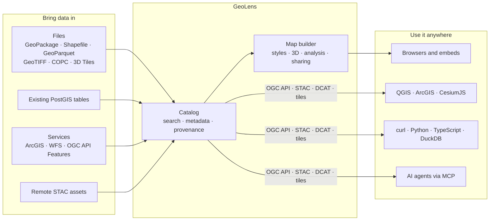

<p align="center">
  
</p>

<h1 align="center">GeoLens</h1>

<p align="center">
  <b>A self-hosted spatial data catalog and map builder that keeps track of where every dataset came from.</b>
</p>

<p align="center">
  <a href="https://demo.getgeolens.com"><b>Live demo</b></a> ·
  <a href="#install">Install</a> ·
  <a href="https://docs.getgeolens.com">Documentation</a> ·
  <a href="#use-the-data-from-anywhere">Connect QGIS or code</a> ·
  <a href="https://github.com/geolens-io/geolens/discussions">Discussions</a>
</p>

<div align="center">

[English](README.md) · [Español](README.es.md) · [Français](README.fr.md) · [Deutsch](README.de.md) · [简体中文](README.zh.md)

[](https://github.com/geolens-io/geolens/releases/latest)
[](https://github.com/geolens-io/geolens/actions/workflows/ci.yml)
[](LICENSE)

</div>

<p align="center">
  <a href="https://demo.getgeolens.com/maps/146eddc1-30af-4c8e-aa6f-a6569e663823">
    <picture>
      <source media="(prefers-color-scheme: dark)" srcset=".github/assets/geolens-manhattan-3d-hero-dark.jpg">
      
    </picture>
  </a>
  <br>
  <sub>Manhattan's buildings at their surveyed roof heights, colored by construction era, with the subway network. <a href="https://demo.getgeolens.com/maps/146eddc1-30af-4c8e-aa6f-a6569e663823">Open this map in the demo</a>.</sub>
</p>

Spatial data tends to live in many places at once: file shares, PostGIS databases, ArcGIS and
WFS services, STAC catalogs. GeoLens puts it all in one searchable catalog and records where each
dataset came from and whether its source is still current. People build and share maps from that
catalog in the browser, while QGIS, scripts and AI agents read the same data through OGC API and
STAC. GeoLens runs on your own servers with Docker Compose, sends no telemetry and is licensed
under Apache 2.0.

The [demo](https://demo.getgeolens.com) needs no install. Browse the catalog and maps without an
account, or sign in with Google, GitHub or Microsoft to try the map builder (demo data may be
wiped at any time).

## How it fits together



## One catalog for scattered data

<p align="center">
  <picture>
    <source media="(prefers-color-scheme: dark)" srcset=".github/assets/geolens-catalog-search-dark.png">
    
  </picture>
  <br>
  <sub>Search by meaning: "where storms hit the coast" finds hurricane tracks, storm corridors and coastal exposure layers, each marked with where it came from.</sub>
</p>

- **Upload files.** Shapefile, GeoPackage, GeoJSON, GeoParquet, FlatGeobuf, KML/KMZ, zipped File
  Geodatabase, CSV and Excel. GeoTIFFs become Cloud-Optimized GeoTIFFs, and many rasters can be
  mosaicked into one VRT. 3D Tiles tilesets and COPC point clouds are hosted for CesiumJS, QGIS
  and Potree.
- **Register what you already have.** Tables already in GeoLens's PostGIS database are served in
  place. WFS, ArcGIS FeatureServer and MapServer, and OGC API Features layers are imported and
  refreshed on demand. Remote STAC assets are referenced without being copied.
- **Draw new data** in the browser when it doesn't exist anywhere yet.
- **Find it again.** Fuzzy search works out of the box, and search by meaning turns on once you
  configure an embedding provider. Filter by type, place and time, group datasets into
  collections, edit typed metadata and restore earlier versions.

## Know where every dataset came from

<p align="center">
  <picture>
    <source media="(prefers-color-scheme: dark)" srcset=".github/assets/geolens-provenance-dark.png">
    
  </picture>
  <br>
  <sub>Earthquakes imported from the USGS service. GeoLens keeps its own copy and shows when it last refreshed and checked the source, and whether that source is healthy, current and unchanged.</sub>
</p>

Every dataset records how it entered the catalog: which file, table, service or STAC item it came
from, and when it was last refreshed. Declare how often a dataset should be updated and GeoLens
marks it fresh, due or overdue. For services and STAC sources it also checks that the source
still answers and flags schema changes upstream before they reach your maps. If a service goes
away, the imported dataset keeps working from GeoLens's copy.

## Build and share maps

<p align="center">
  <picture>
    <source media="(prefers-color-scheme: dark)" srcset=".github/assets/geolens-matterhorn-terrain-dark.jpg">
    
  </picture>
  <br>
  <sub>The Matterhorn as 3D terrain from swissALTI3D lidar, with peaks and climbing routes from OpenStreetMap.</sub>
</p>

- **Layers and styles.** Point, symbol, heatmap, cluster, line, arrow, fill, 3D extrusion, raster
  and hillshade layers, with data-driven styles, labels, icons, patterns, filters and popups.
  Terrain comes from your own elevation models.
- **Analysis.** Buffer, centroid, clip, dissolve, spatial join, select by location, measure and
  intersect. Most operations preview on the map first, and every result saves as a new dataset,
  from the builder or the CLI.
- **Sharing.** Public links unfurl with the map's own title and image in Slack, Teams and social
  posts. Maps embed in other sites with private embed tokens.
- **Everyday tools.** Drawing, a legend, measurement, map history and keyboard shortcuts, in
  English, Spanish, French, German or Simplified Chinese, with light and dark themes.

## Use the data from anywhere

Every vector dataset is an OGC API Features collection, the catalog itself is OGC API Records
and STAC, and every layer has a tile URL. Try it against the demo, no install or account needed:

```sh
# Search the catalog (OGC API Records)
curl "https://demo.getgeolens.com/api/collections/datasets/items?q=volcano"

# Read a dataset with a CQL2 filter (OGC API Features): eruptions of VEI 6 or larger
curl -G "https://demo.getgeolens.com/api/collections/3b549894-ad65-4fbf-8fe1-9a163a8e8215/items" \
  --data-urlencode "filter=vei >= 6" -d limit=3
```

In QGIS, add `https://demo.getgeolens.com/api/` as a WFS / OGC API Features connection and the
public datasets appear as layers; the [QGIS guide](https://docs.getgeolens.com/guides/api/qgis/)
has the steps.

<p align="center">
  
  <br>
  <sub>QGIS reading the demo catalog over OGC API Features, with no plugin: recent earthquakes, eruptions and plate boundaries, all served by GeoLens.</sub>
</p>

| Standard | Where | Use it with |
|---|---|---|
| OGC API Features, with CQL2 filtering and queryables | `/api/collections/{id}/items` | QGIS, ArcGIS, GDAL/OGR and other OGC API clients |
| OGC API Records | `/api/collections/datasets/items` | Catalog search from other portals and tools |
| STAC API 1.0 | `/api/stac/` | STAC clients such as pystac-client and STAC Browser |
| DCAT 3, DCAT-US 3.0 and GeoDCAT-AP as JSON-LD | `/api/datasets/dcat/` | Harvesting into national and EU open-data portals |
| Vector tiles and COG raster tiles | a tile URL on every layer | MapLibre, OpenLayers, Leaflet |
| 3D Tiles and COPC | each 3D dataset's page | CesiumJS, QGIS, Potree |

Vector tiles leave out attribute columns below zoom 10; add `cols=<column>,<column>` to a tile URL
to keep specific columns at every zoom. Data leaves as GeoJSON, Shapefile, GeoPackage, CSV or
FlatGeobuf with optional reprojection, as GeoParquet, as PMTiles archives for static hosting, or as
Cloud-Optimized GeoTIFF.

For scripts and automation there is the `geolens` CLI, which publishes files and applies catalog
manifests, Python and TypeScript SDKs generated from the OpenAPI spec, and a read-only MCP server
that lets AI agents search the catalog and query features. The
[examples gallery](https://geolens-io.github.io/geolens-examples/) has runnable code for MapLibre,
Leaflet, OpenLayers, the ArcGIS Maps SDK, QGIS and DuckDB. Its read-only examples run against the
demo, and CI replays them there every week.

## AI, only if you want it

<p align="center">
  <picture>
    <source media="(prefers-color-scheme: dark)" srcset=".github/assets/geolens-ask-ai-dark.png">
    
  </picture>
  <br>
  <sub>"How many of these hurricanes made landfall?" gets the count, a table and the assumption behind the answer, with a button that opens the result in the map builder.</sub>
</p>

GeoLens can answer questions about a dataset, edit maps from plain-language requests, draft
metadata and search in natural language. It works with any OpenAI-compatible endpoint, including
a local model server such as Ollama, or with Claude through Anthropic, Microsoft Foundry, Amazon
Bedrock or Google Vertex AI. All of it stays off until an administrator configures a provider,
and every workflow works without it.

## Install

You need Docker Engine 24+ and Docker Compose v2. A fresh install runs six containers in about
1.3 GB of memory, on linux/amd64 or linux/arm64.

```sh
curl -fsSL https://getgeolens.com/install.sh | sh    # clone, generate secrets, start the stack
cd geolens
grep '^GEOLENS_ADMIN_PASSWORD=' .env                  # the generated admin password
```

Then open http://localhost:8080 and sign in as `admin`. The installer clones GeoLens into
`./geolens`, writes `.env` with generated secrets and a random admin password, pulls the prebuilt
images and starts the stack in about a minute. To check the script before you run it, download
`install.sh` and `SHA256SUMS` from the same [release](https://github.com/geolens-io/geolens/releases)
and run `sha256sum -c SHA256SUMS` (`shasum -a 256 -c SHA256SUMS` on macOS).

Other ways in:

- **From source:** clone the repository and run `bash scripts/install.sh`. It builds every image
  locally, which takes 5-10 minutes the first time.
- **Prebuilt images:** `ghcr.io/geolens-io/geolens-api` and `ghcr.io/geolens-io/geolens-frontend`.
  The `latest` tag tracks the newest stable release.
- **Production:** the [Install Guide](https://docs.getgeolens.com/guides/quickstart/install/)
  covers production settings and troubleshooting, and there are guides for
  [managed cloud services](https://docs.getgeolens.com/guides/quickstart/cloud-deployment/).
  Docker Compose is the supported path; an experimental, community-maintained Helm chart lives in
  [geolens-deployments](https://github.com/geolens-io/geolens-deployments).

An external database must be PostgreSQL 15+ with PostGIS, pgvector 0.5+, pg_trgm and unaccent.
After install, backups run daily and weekly by default, with optional off-site copies to S3. To
upgrade, run `./scripts/upgrade.sh` from the install directory: it backs up the database, pulls
the new images and migrates behind a health check, and [UPGRADING.md](UPGRADING.md) has the
rollback steps. The admin pages show health, usage, jobs and the audit log, and Prometheus
metrics, alert rules and a Grafana dashboard ship in the repository.
[RUNBOOK.md](RUNBOOK.md) covers backups, restores, monitoring and incident response, and the
[Configuration Reference](https://docs.getgeolens.com/guides/quickstart/configuration/) lists
every setting.

## Your first dataset

Publish the sample file from the command line, then read it back the way any OGC API Features
client would:

```sh
pip install geolens-cli                               # needs Python 3.11+
geolens login http://localhost:8080/api               # your admin username and password
geolens publish examples/manifests/first-catalog/city-parks.geojson --name "City Parks"
export GEOLENS_API_KEY=<your-api-key>                 # create one on your Settings page
curl -H "X-Api-Key: $GEOLENS_API_KEY" \
  "http://localhost:8080/api/collections/<dataset-id>/items?limit=5"
```

`geolens publish` prints the new dataset's URL, which ends in its id. For a whole catalog,
describe the sources in a `geolens.yaml` manifest and run `geolens apply`;
[`examples/manifests/`](examples/manifests/) has templates and the
[CLI guide](https://docs.getgeolens.com/guides/cli/) has the schema.

To load the demo's maps and datasets into your own install (this downloads public open data):

```sh
pip install httpx
python scripts/seed-showcase.py --username admin \
  --password "$(grep '^GEOLENS_ADMIN_PASSWORD=' .env | cut -d= -f2-)"
```

The [API reference](https://docs.getgeolens.com/guides/api/) and the
[SDK guides](https://docs.getgeolens.com/guides/sdk/) go further.

## Private by design

- **No telemetry.** Apart from the default basemap tiles, GeoLens makes outbound calls only for
  features an administrator turns on. [EGRESS.md](EGRESS.md) lists each one and how to run
  air-gapped.
- **Your data stays readable without GeoLens.** Vector datasets are ordinary PostGIS tables in a
  `data` schema of your database, rasters are Cloud-Optimized GeoTIFFs in your own storage (local
  disk, S3/MinIO or Azure Blob), and the whole catalog exports through OGC API, STAC and DCAT.
- **Access control.** Local accounts or OAuth 2.0/OIDC sign-in (Google, Microsoft, GitHub or a
  generic provider), roles, per-dataset permissions, per-user API keys and an audit log of
  administrative actions. Self-registration is off by default.
- **Free to keep.** Everything in this repository is Apache 2.0, and features released here stay
  free. [EDITIONS.md](EDITIONS.md) describes the optional paid support and add-ons.

## Known limitations

- One PostgreSQL instance, with no built-in high availability or clustering.
- One organization per deployment.
- Terrain rendering assumes elevation in meters; other vertical units render exaggerated.
- The OGC API, STAC and tile endpoints follow their specifications, but GeoLens's own REST API can
  still change between minor releases. The [CHANGELOG](CHANGELOG.md) lists contract changes, and
  a breaking one keeps the old form working for at least one more minor release.

## Contributing

Bug reports, fixes, translations and documentation are all welcome. [CONTRIBUTING](.github/CONTRIBUTING.md)
explains the development setup (`make dev-init`, then `make dev`), the tests each change needs and
the DCO sign-off on commits. [ARCHITECTURE](.github/ARCHITECTURE.md) maps the services and the
code, and the [roadmap](https://docs.getgeolens.com/roadmap/) shows what's planned.

Questions and ideas go to [GitHub Discussions](https://github.com/geolens-io/geolens/discussions),
bugs to [Issues](https://github.com/geolens-io/geolens/issues), and [SUPPORT.md](SUPPORT.md)
covers where else to ask. Report security problems privately as described in
[SECURITY.md](.github/SECURITY.md).

## License

GeoLens is licensed under the [Apache License 2.0](LICENSE). The GeoLens name, logo and brand
assets are not covered by this license; see [TRADEMARKS.md](TRADEMARKS.md). Sample-data
attribution is in [THIRD_PARTY_DATA.md](THIRD_PARTY_DATA.md).

Project policies: [editions](EDITIONS.md) · [governance](GOVERNANCE.md) · [maintainers](MAINTAINERS.md) · [security](.github/SECURITY.md) · [release process](RELEASE.md) · [egress &amp; air-gap](EGRESS.md)
