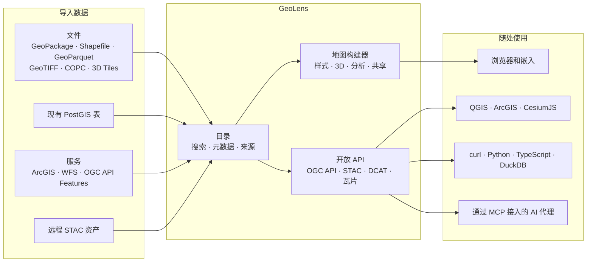

<p align="center">
  
</p>

<h1 align="center">GeoLens</h1>

<p align="center">
  <b>自托管的空间数据目录与地图构建器，记录每个数据集的来源。</b>
</p>

<p align="center">
  <a href="https://demo.getgeolens.com"><b>在线演示</b></a> ·
  <a href="#安装">安装</a> ·
  <a href="https://docs.getgeolens.com">文档</a> ·
  <a href="#在任何地方使用数据">连接 QGIS 或代码</a> ·
  <a href="https://github.com/geolens-io/geolens/discussions">讨论区</a>
</p>

<div align="center">

[English](README.md) · [Español](README.es.md) · [Français](README.fr.md) · [Deutsch](README.de.md) · [简体中文](README.zh.md)

[](https://github.com/geolens-io/geolens/releases/latest)
[](https://github.com/geolens-io/geolens/actions/workflows/ci.yml)
[](LICENSE)

</div>

<p align="center">
  <a href="https://demo.getgeolens.com/maps/146eddc1-30af-4c8e-aa6f-a6569e663823">
    <picture>
      <source media="(prefers-color-scheme: dark)" srcset=".github/assets/geolens-manhattan-3d-hero-dark.jpg">
      
    </picture>
  </a>
  <br>
  <sub>曼哈顿的建筑按实测屋顶高度挤出，按建造年代着色，并叠加地铁网络。<a href="https://demo.getgeolens.com/maps/146eddc1-30af-4c8e-aa6f-a6569e663823">在演示中打开这张地图</a>。</sub>
</p>

空间数据往往同时散落在许多地方：文件共享、PostGIS 数据库、ArcGIS 和 WFS 服务、STAC 目录。GeoLens 把它们汇集到一个可搜索的目录中，并记录每个数据集的来源，以及数据源是否仍然保持最新。团队在浏览器中基于这个目录构建和共享地图，QGIS、脚本和 AI 代理则通过 OGC API 和 STAC 读取同样的数据。GeoLens 用 Docker Compose 运行在您自己的服务器上，不发送遥测数据，采用 Apache 2.0 许可。

[演示](https://demo.getgeolens.com)无需安装。无需账号即可浏览目录和地图，也可以使用 Google、GitHub 或 Microsoft 登录体验地图构建器（演示数据可能随时被清除）。

## 整体结构



## 一个目录，汇集分散的数据

<p align="center">
  <picture>
    <source media="(prefers-color-scheme: dark)" srcset=".github/assets/geolens-catalog-search-dark.png">
    
  </picture>
  <br>
  <sub>按含义搜索：“where storms hit the coast”能找到飓风路径、风暴走廊和沿海暴露图层，每个结果都标明了来源。</sub>
</p>

- **上传文件。** 支持 Shapefile、GeoPackage、GeoJSON、GeoParquet、FlatGeobuf、KML/KMZ、zip 压缩的 File Geodatabase、CSV 和 Excel。GeoTIFF 会转换为云优化 GeoTIFF，多个栅格可镶嵌为一个 VRT。3D Tiles 瓦片集和 COPC 点云会托管起来，供 CesiumJS、QGIS 和 Potree 使用。
- **注册已有数据。** GeoLens 自身 PostGIS 数据库中已有的表原位提供服务。WFS、ArcGIS FeatureServer 和 MapServer 以及 OGC API Features 图层可按需导入和刷新。远程 STAC 资产只做引用，不复制。
- **在浏览器中绘制新数据。** 当数据在任何地方都还不存在时使用。
- **再次找到它。** 模糊搜索开箱即用，配置嵌入提供方后可启用按含义搜索。可按类型、地点和时间筛选，把数据集归入集合，编辑类型化元数据，并恢复早期版本。

## 了解每个数据集的来源

<p align="center">
  <picture>
    <source media="(prefers-color-scheme: dark)" srcset=".github/assets/geolens-provenance-dark.png">
    
  </picture>
  <br>
  <sub>从 USGS 服务导入的地震数据。GeoLens 保留自己的副本，并显示上次刷新和检查数据源的时间，以及该数据源是否健康、是否最新、是否未发生变化。</sub>
</p>

每个数据集都会记录它如何进入目录：来自哪个文件、表、服务或 STAC 条目，以及上次刷新的时间。声明数据集应多久更新一次，GeoLens 就会把它标记为时效正常、待刷新或已逾期。对于服务和 STAC 数据源，它还会检查数据源是否仍能响应，并在上游的字段结构变化影响您的地图之前发出提示。如果某个服务下线，已导入的数据集仍可使用 GeoLens 中的副本继续工作。

## 构建和共享地图

<p align="center">
  <picture>
    <source media="(prefers-color-scheme: dark)" srcset=".github/assets/geolens-matterhorn-terrain-dark.jpg">
    
  </picture>
  <br>
  <sub>由 swissALTI3D 激光雷达生成的马特洪峰 3D 地形，山峰和攀登路线来自 OpenStreetMap。</sub>
</p>

- **图层与样式。** 点、符号、热力图、聚类、线、箭头、面、3D 挤出、栅格和山体阴影图层，支持数据驱动样式、标注、图标、图案、筛选器和弹出窗口。地形来自您自己的高程模型。
- **分析。** 缓冲区、质心、裁剪、融合、空间连接、按位置选择、测量和相交。大多数操作会先在地图上预览，每个结果都保存为新数据集，可在构建器或 CLI 中完成。
- **共享。** 公开链接在 Slack、Teams 和社交媒体帖子中展开时，会带上地图自己的标题和图片。地图可通过私有嵌入令牌嵌入其他网站。
- **日常工具。** 绘制、图例、测量、地图历史记录和键盘快捷键，界面支持英语、西班牙语、法语、德语或简体中文，并有浅色和深色主题。

## 在任何地方使用数据

每个矢量数据集都是一个 OGC API Features 集合，目录本身提供 OGC API Records 和 STAC，每个图层都有瓦片 URL。可以直接对演示试用，无需安装或账号（第二条命令用到 `jq`）：

```sh
# Search the catalog (OGC API Records)
curl "https://demo.getgeolens.com/api/collections/datasets/items?q=volcanic%20eruptions"

# Read the top match with a CQL2 filter (OGC API Features): eruptions of VEI 6 or larger
ID=$(curl -s "https://demo.getgeolens.com/api/collections/datasets/items?q=volcanic%20eruptions&limit=1" | jq -r '.features[0].id')
curl -G "https://demo.getgeolens.com/api/collections/$ID/items" \
  --data-urlencode "filter=vei >= 6" -d limit=3
```

在 QGIS 中，把 `https://demo.getgeolens.com/api/` 添加为 WFS / OGC API Features 连接，公开数据集就会作为图层出现；具体步骤见 [QGIS 指南](https://docs.getgeolens.com/guides/api/qgis/)。

<p align="center">
  
  <br>
  <sub>QGIS 通过 OGC API Features 读取演示目录，无需插件：近期地震、火山喷发和板块边界，全部由 GeoLens 提供。</sub>
</p>

| 标准 | 位置 | 适用于 |
|---|---|---|
| 支持 CQL2 过滤和 queryables 的 OGC API Features | `/api/collections/{id}/items` | QGIS、ArcGIS、GDAL/OGR 及其他 OGC API 客户端 |
| OGC API Records | `/api/collections/datasets/items` | 从其他门户和工具搜索目录 |
| STAC API 1.0 | `/api/stac/` | pystac-client 和 STAC Browser 等 STAC 客户端 |
| JSON-LD 格式的 DCAT 3、DCAT-US 3.0 和 GeoDCAT-AP | `/api/datasets/dcat/`, `/api/datasets/dcat-us/3.0/`, `/api/datasets/geodcat-ap/` | 汇入国家和欧盟开放数据门户 |
| 矢量瓦片和 COG 栅格瓦片 | 每个图层上的瓦片 URL | MapLibre、OpenLayers、Leaflet |
| 3D Tiles 和 COPC | 每个 3D 数据集的页面 | CesiumJS、QGIS、Potree |

矢量瓦片在缩放级别 10 以下会省略属性列；在瓦片 URL 上添加 `cols=<column>,<column>` 可让指定列在所有缩放级别保留。数据可导出为 GeoJSON、Shapefile、GeoPackage、CSV 或 FlatGeobuf（可选重投影），也可导出为 GeoParquet、用于静态托管的 PMTiles 档案，或云优化 GeoTIFF。

脚本和自动化方面，有可发布文件并应用目录清单的 `geolens` CLI，由 OpenAPI 规范生成的 Python 和 TypeScript SDK，以及让 AI 代理搜索目录和查询要素的只读 MCP 服务器。[示例库](https://geolens-io.github.io/geolens-examples/)提供可运行的代码，涵盖 MapLibre、Leaflet、OpenLayers、ArcGIS Maps SDK、QGIS 和 DuckDB。其中的只读示例直接运行在演示上，CI 每周都会在那里重放它们。

## AI，仅在您需要时使用

<p align="center">
  <picture>
    <source media="(prefers-color-scheme: dark)" srcset=".github/assets/geolens-ask-ai-dark.png">
    
  </picture>
  <br>
  <sub>“How many of these hurricanes made landfall?”会得到计数、一张表和答案背后的假设，还有一个在地图构建器中打开结果的按钮。</sub>
</p>

GeoLens 可以回答关于数据集的问题，根据自然语言请求编辑地图，起草元数据，并支持自然语言搜索。它可以使用任何 OpenAI 兼容端点（包括 Ollama 这样的本地模型服务器），也可以通过 Anthropic、Microsoft Foundry、Amazon Bedrock 或 Google Vertex AI 使用 Claude。在管理员配置提供方之前，这些功能全部关闭，没有它们，所有工作流依然可用。

## 安装

需要 Docker Engine 24+ 和 Docker Compose v2。全新安装会运行六个容器，占用约 1.3 GB 内存，支持 linux/amd64 或 linux/arm64。

```sh
curl -fsSL https://getgeolens.com/install.sh | sh    # clone, generate secrets, start the stack
cd geolens
grep '^GEOLENS_ADMIN_PASSWORD=' .env                  # the generated admin password
```

然后打开 http://localhost:8080 并以 `admin` 登录。安装程序会把 GeoLens 克隆到 `./geolens`，生成带有随机密钥和随机管理员密码的 `.env`，拉取预构建镜像，并在约一分钟内启动整个服务栈。如需在运行前检查脚本，请从同一个[发布版本](https://github.com/geolens-io/geolens/releases)下载 `install.sh` 和 `SHA256SUMS`，然后运行 `sha256sum -c SHA256SUMS`（macOS 上用 `shasum -a 256 -c SHA256SUMS`）。

其他安装方式：

- **从源码安装：** 克隆仓库并运行 `bash scripts/install.sh`。它会在本地构建所有镜像，首次需要 5-10 分钟。
- **预构建镜像：** `ghcr.io/geolens-io/geolens-api` 和 `ghcr.io/geolens-io/geolens-frontend`。`latest` 标签跟踪最新的稳定版本。
- **生产环境：** [安装指南](https://docs.getgeolens.com/guides/quickstart/install/)涵盖生产环境设置和故障排查，另有[托管云服务](https://docs.getgeolens.com/guides/quickstart/cloud-deployment/)的指南。Docker Compose 是受支持的方式；社区维护的实验性 Helm chart 位于 [geolens-deployments](https://github.com/geolens-io/geolens-deployments)。

外部数据库必须是 PostgreSQL 15+，并带有 PostGIS、pgvector 0.5+、pg_trgm 和 unaccent。安装后，备份默认每日和每周运行，并可选择异地复制到 S3。升级时，在安装目录中运行 `./scripts/upgrade.sh`：它会备份数据库、拉取新镜像，并在健康检查保护下完成迁移，回滚步骤见 [UPGRADING.md](UPGRADING.md)。管理页面显示健康状况、用量、任务和审计日志，仓库中还附带 Prometheus 指标、告警规则和 Grafana 仪表板。[RUNBOOK.md](RUNBOOK.md) 涵盖备份、恢复、监控和事件响应，[配置参考](https://docs.getgeolens.com/guides/quickstart/configuration/)列出了每一项设置。

## 您的第一个数据集

用命令行发布示例文件，然后像任何 OGC API Features 客户端那样把它读回来：

```sh
pip install geolens-cli                               # needs Python 3.11+
geolens login http://localhost:8080/api               # your admin username and password
geolens publish examples/manifests/first-catalog/city-parks.geojson --name "City Parks"
export GEOLENS_API_KEY="paste-your-api-key-here"      # create one on your Settings page
curl -H "X-Api-Key: $GEOLENS_API_KEY" \
  "http://localhost:8080/api/collections/<dataset-id>/items?limit=5"
```

`geolens publish` 会打印新数据集的 URL，URL 末尾就是它的 id。要处理整个目录，可以在 `geolens.yaml` 清单中描述各个数据源，然后运行 `geolens apply`；[`examples/manifests/`](examples/manifests/) 提供了模板，[CLI 指南](https://docs.getgeolens.com/guides/cli/)说明了清单的结构。

要把演示中的地图和数据集加载到您自己的安装中（会下载公开的开放数据）：

```sh
pip install httpx
python scripts/seed-showcase.py --username admin \
  --password "$(grep '^GEOLENS_ADMIN_PASSWORD=' .env | cut -d= -f2-)"
```

想了解更多，请参阅 [API 参考](https://docs.getgeolens.com/guides/api/)和 [SDK 指南](https://docs.getgeolens.com/guides/sdk/)。

## 隐私优先的设计

- **没有遥测。** 除默认底图瓦片以及用户自行选择注册的远程服务和 STAC 数据源外，GeoLens 只会为管理员开启的功能发起出站连接。[EGRESS.md](EGRESS.md) 列出了每一项，并说明如何在隔离网络中运行。
- **没有 GeoLens 也能读取您的数据。** 矢量数据集是您数据库 `data` 模式中的普通 PostGIS 表，栅格是您自己存储（本地磁盘、S3/MinIO 或 Azure Blob）中的云优化 GeoTIFF，整个目录可通过 OGC API、STAC 和 DCAT 导出。
- **访问控制。** 本地账号或 OAuth 2.0/OIDC 登录（Google、Microsoft、GitHub 或通用提供方）、角色、逐数据集权限、按用户的 API 密钥，以及管理操作的审计日志。自助注册默认关闭。
- **永久免费。** 此仓库中的一切均采用 Apache 2.0 许可，在这里发布的功能会一直免费。[EDITIONS.md](EDITIONS.md) 介绍了可选的付费支持和附加组件。

## 已知限制

- 仅支持单个 PostgreSQL 实例，没有内置的高可用或集群。
- 每个部署对应一个组织。
- 地形渲染假定高程单位为米；其他垂直单位会被夸大渲染。
- OGC API、STAC 和瓦片端点遵循各自的规范，但 GeoLens 自身的 REST API 在小版本之间仍可能变化。[CHANGELOG](CHANGELOG.md) 列出了契约变更，破坏性变更会让旧形式至少再兼容一个小版本。

## 参与贡献

欢迎提交缺陷报告、修复、翻译和文档。[CONTRIBUTING](.github/CONTRIBUTING.md) 说明了开发环境搭建（`make dev-init`，然后 `make dev`）、每项更改需要的测试，以及提交上的 DCO 签名。[ARCHITECTURE](.github/ARCHITECTURE.md) 描绘了各项服务和代码结构，[路线图](https://docs.getgeolens.com/roadmap/)展示了计划中的工作。

问题和想法请发到 [GitHub Discussions](https://github.com/geolens-io/geolens/discussions)，缺陷请提交到 [Issues](https://github.com/geolens-io/geolens/issues)，[SUPPORT.md](SUPPORT.md) 说明了还可以去哪里提问。请按 [SECURITY.md](.github/SECURITY.md) 中的说明私下报告安全问题。

## 许可证

GeoLens 采用 [Apache License 2.0](LICENSE) 许可。GeoLens 的名称、标志和品牌资产不在此许可范围内，参见 [TRADEMARKS.md](TRADEMARKS.md)。示例数据的署名见 [THIRD_PARTY_DATA.md](THIRD_PARTY_DATA.md)。

项目政策：[版本](EDITIONS.md) · [治理](GOVERNANCE.md) · [维护者](MAINTAINERS.md) · [安全](.github/SECURITY.md) · [发布流程](RELEASE.md) · [出站连接与隔离网络](EGRESS.md)
