<p align="center">
  <picture>
    <source media="(prefers-color-scheme: dark)" srcset=".github/assets/geolens-emblem-dark.svg">
    
  </picture>
</p>

<h1 align="center">GeoLens</h1>

<p align="center">
  <b>自托管的空间数据目录与地图构建器，记录每个数据集的来源。</b>
</p>

<p align="center">
  <a href="https://demo.getgeolens.com"><b>在线演示</b></a> ·
  <a href="#安装">安装</a> ·
  <a href="https://docs.getgeolens.com">文档</a> ·
  <a href="#在任何地方使用数据">连接 QGIS 或代码</a> ·
  <a href="https://github.com/geolens-io/geolens/discussions">讨论区</a>
</p>

<div align="center">

[English](README.md) · [Español](README.es.md) · [Français](README.fr.md) · [Deutsch](README.de.md) · [简体中文](README.zh.md)

[](https://github.com/geolens-io/geolens/releases/latest)
[](https://github.com/geolens-io/geolens/actions/workflows/ci.yml)
[](LICENSE)
[](https://securityscorecards.dev/viewer/?uri=github.com/geolens-io/geolens)
[](https://www.bestpractices.dev/projects/15857)

</div>

<p align="center">
  <a href="https://demo.getgeolens.com/maps">
    <picture>
      <source media="(prefers-color-scheme: dark)" srcset=".github/assets/geolens-manhattan-3d-hero-dark.jpg">
      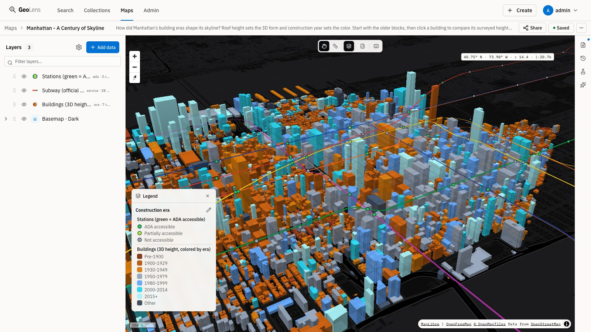
    </picture>
  </a>
  <br>
  <sub>曼哈顿的建筑按实测屋顶高度挤出，按建造年代着色，并叠加地铁网络。<a href="https://demo.getgeolens.com/maps">浏览演示中的地图</a>。</sub>
</p>

GeoLens 面向空间数据分散在文件共享、PostGIS 数据库、网络服务和 STAC 目录中的团队。它把这些数据放进一个可搜索的目录，记录每个数据集的来源，并检查数据源是否仍然保持最新。团队在浏览器中构建和共享地图，QGIS、脚本和 AI 代理则通过 OGC API 和 STAC 读取同样的数据。它用 Docker Compose 运行在您自己的服务器上，不发送遥测数据，采用 Apache 2.0 许可。

[演示](https://demo.getgeolens.com)无需安装或账号；使用 Google、GitHub 或 Microsoft 登录即可体验地图构建器。演示数据可能随时被清除。

## 界面一览

<table>
<tr>
<td width="50%" valign="top">
<picture>
<source media="(prefers-color-scheme: dark)" srcset=".github/assets/geolens-catalog-search-dark.png">
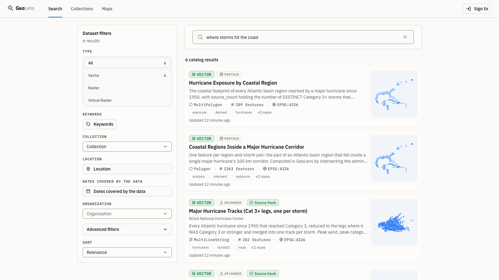
</picture>
<br><sub>按含义搜索：“where storms hit the coast”能找到飓风路径和沿海暴露图层。</sub>
</td>
<td width="50%" valign="top">
<picture>
<source media="(prefers-color-scheme: dark)" srcset=".github/assets/geolens-dataset-page-dark.png">
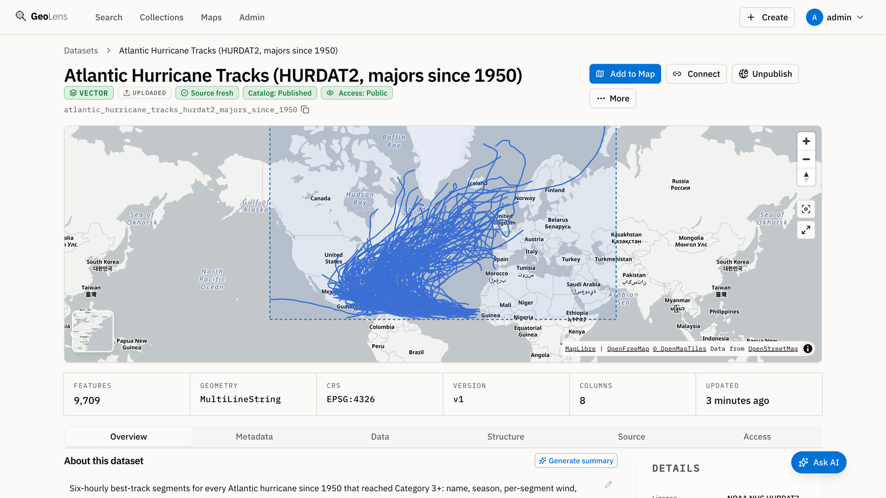
</picture>
<br><sub>每个数据集都有一个页面，包含元数据和来源，有范围时还有地图预览。</sub>
</td>
</tr>
<tr>
<td width="50%" valign="top">
<picture>
<source media="(prefers-color-scheme: dark)" srcset=".github/assets/geolens-import-preview-dark.png">
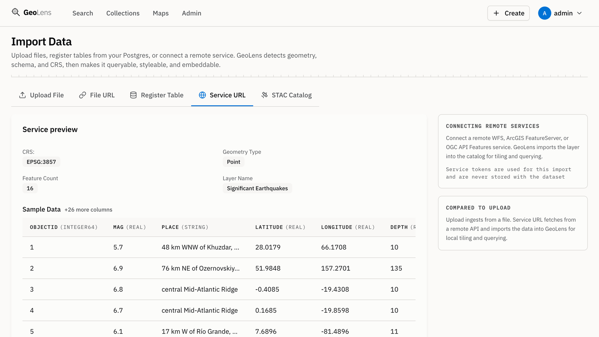
</picture>
<br><sub>导入服务图层之前，GeoLens 会预览其列和前几行数据。</sub>
</td>
<td width="50%" valign="top">
<picture>
<source media="(prefers-color-scheme: dark)" srcset=".github/assets/geolens-version-history-dark.png">
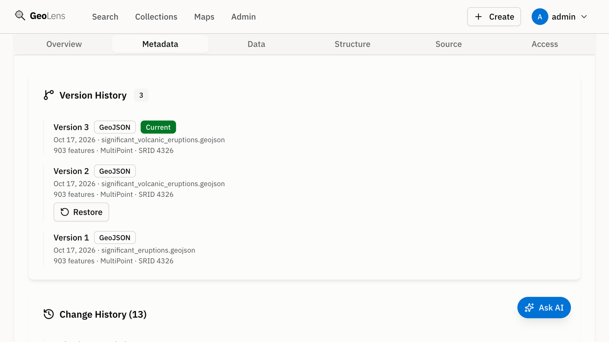
</picture>
<br><sub>每次替换都会记入历史，并可恢复上一个版本。</sub>
</td>
</tr>
<tr>
<td width="50%" valign="top">
<picture>
<source media="(prefers-color-scheme: dark)" srcset=".github/assets/geolens-builder-style-dark.png">
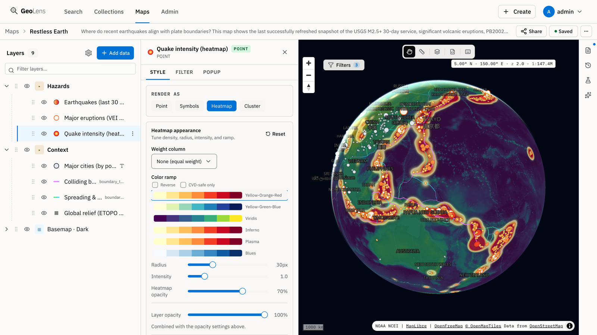
</picture>
<br><sub>图层可渲染为点、符号、热力图或聚类，色带列表可限定为色盲友好的色带。</sub>
</td>
<td width="50%" valign="top">
<picture>
<source media="(prefers-color-scheme: dark)" srcset=".github/assets/geolens-matterhorn-terrain-dark.jpg">
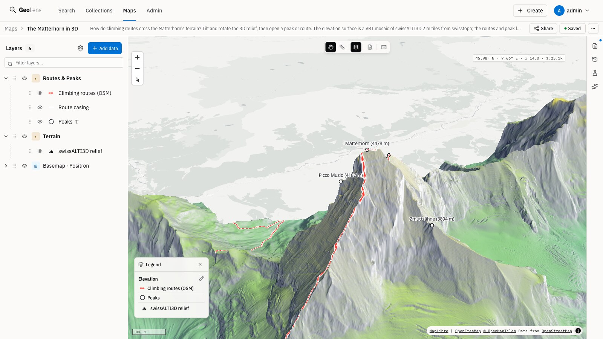
</picture>
<br><sub>用您自己的高程数据生成 3D 地形，这里是由 swissALTI3D 激光雷达生成的马特洪峰。</sub>
</td>
</tr>
<tr>
<td width="50%" valign="top">
<picture>
<source media="(prefers-color-scheme: dark)" srcset=".github/assets/geolens-stac-imagery-dark.jpg">
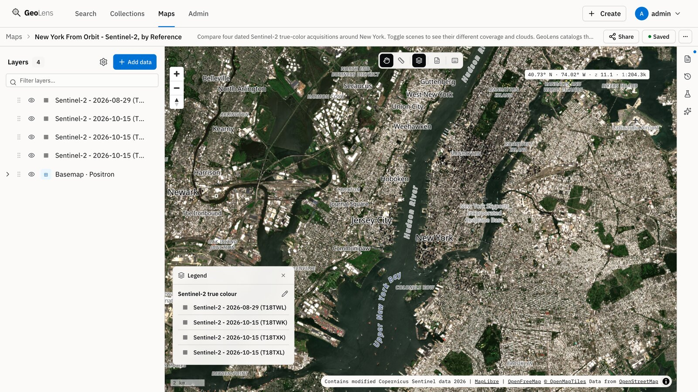
</picture>
<br><sub>引用自 STAC 目录的 Sentinel-2 影像。影像保留在原处，按请求切片。</sub>
</td>
<td width="50%" valign="top">
<picture>
<source media="(prefers-color-scheme: dark)" srcset=".github/assets/geolens-share-embed-dark.png">
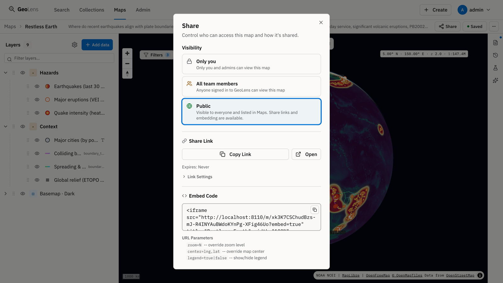
</picture>
<br><sub>可以只留给自己、向团队开放，或通过链接和嵌入代码公开地图。</sub>
</td>
</tr>
<tr>
<td width="50%" valign="top">
<picture>
<source media="(prefers-color-scheme: dark)" srcset=".github/assets/geolens-admin-overview-dark.png">
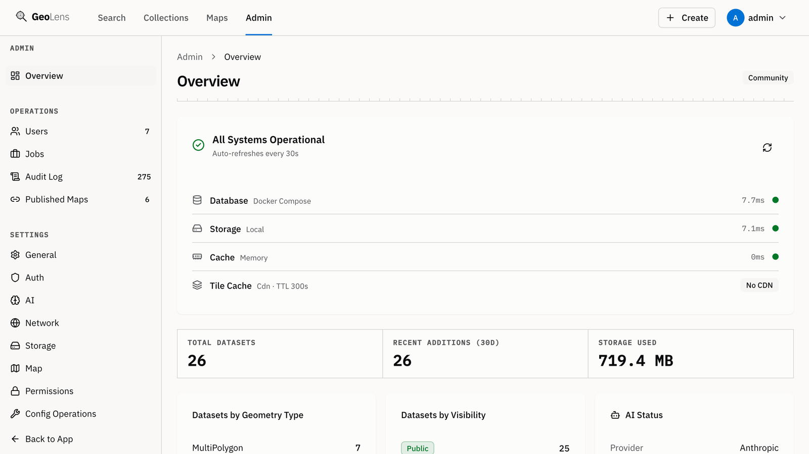
</picture>
<br><sub>管理概览在数据集和存储总数旁边显示服务健康状况。</sub>
</td>
<td width="50%" valign="top">
<picture>
<source media="(prefers-color-scheme: dark)" srcset=".github/assets/geolens-admin-permissions-dark.png">
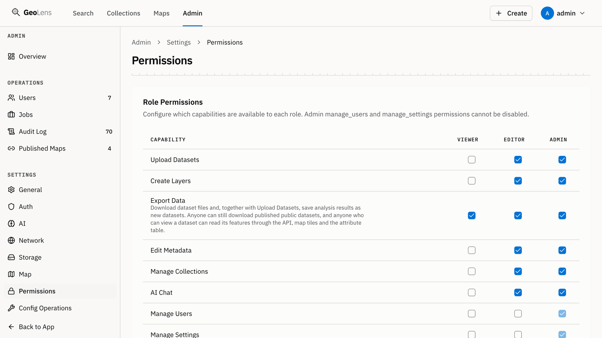
</picture>
<br><sub>查看者、编辑者和管理员三种角色，每个角色可单独开启或关闭各项权限。</sub>
</td>
</tr>
</table>

## 整体结构

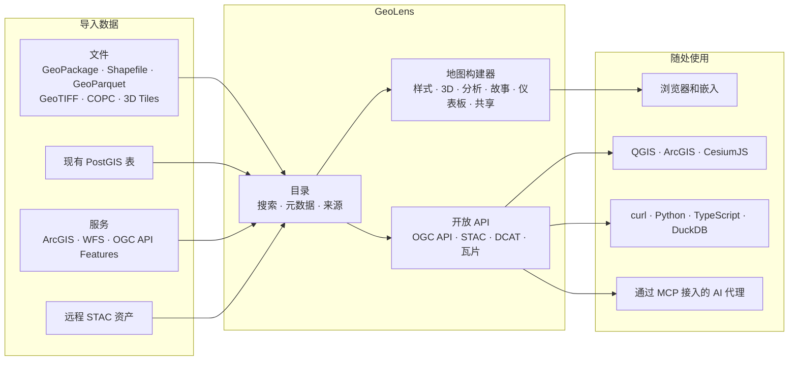

## 一个目录，汇集分散的数据

- 上传 Shapefile、GeoPackage、GeoJSON、GeoParquet、FlatGeobuf、KML/KMZ、zip 压缩的 File Geodatabase、CSV、Excel 或 GeoTIFF（会转换为云优化 GeoTIFF）。3D Tiles 和 COPC 点云会托管起来，供 CesiumJS、QGIS 和 Potree 使用。
- 原位提供 GeoLens 自身 PostGIS 数据库中已有的表，按需导入并刷新 WFS、ArcGIS 和 OGC API Features 图层，或引用远程 STAC 资产而不复制。
- 在浏览器中绘制新数据集。
- 通过模糊搜索查找数据，配置嵌入提供方后也可按含义搜索。可按类型、地点和时间筛选，把数据集归入集合，编辑元数据，并在数据集被替换后恢复其上一个版本。

## 了解每个数据集的来源

<p align="center">
  <picture>
    <source media="(prefers-color-scheme: dark)" srcset=".github/assets/geolens-provenance-dark.png">
    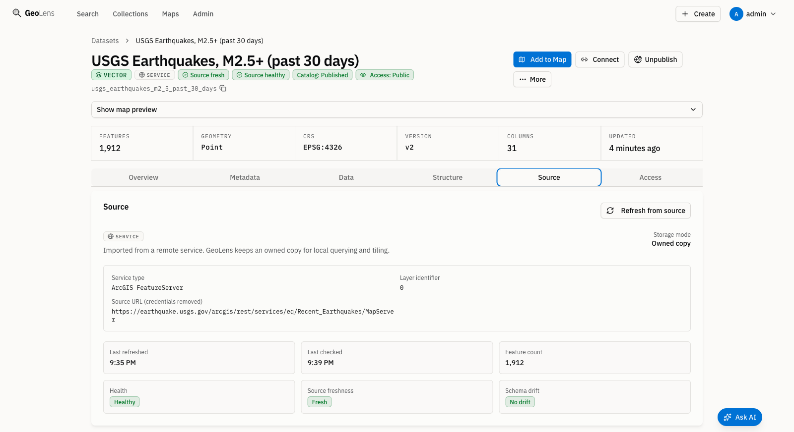
  </picture>
  <br>
  <sub>从 USGS 地震服务导入的数据集。</sub>
</p>

每个数据集都会记录它的来源：上传的文件、数据库表、服务、STAC 条目，或在浏览器中绘制的数据。导入的数据集还会记录上次刷新的时间，设定更新节奏后，GeoLens 会把它们标记为时效正常、待刷新或已逾期。对于服务和 STAC 数据源，GeoLens 还会检查数据源是否仍能响应；对于服务，它还会在上游字段结构的变化影响您的地图之前发出提示。如果某个服务下线，已导入的副本仍可继续使用。

## 构建和共享地图

- 点、符号、热力图、聚类、线、箭头、面、3D 挤出、栅格和山体阴影图层，支持数据驱动样式、标注、图标、图案、筛选器和弹出窗口。地形来自您自己的高程模型。
- 缓冲区、质心、裁剪、融合、空间连接、按位置选择、测量和相交。大多数操作可在地图上预览，每个结果都保存为新数据集，可在构建器或 CLI 中完成。
- 故事地图带读者逐个场景浏览地图，支持 Markdown 文本和图片。仪表板把指标、图表和筛选器放在地图旁边。地图数据面板以表格或列表显示每个图层的行。
- 公开地图和已发布的故事链接粘贴到 Slack、Teams 或社交媒体帖子中时，会显示标题和图片；地图可通过私有令牌嵌入其他网站。
- 界面支持英语、西班牙语、法语、德语和简体中文。

## 在任何地方使用数据

矢量数据集是 OGC API Features 集合，目录提供 OGC API Records 和 STAC，每个图层都有瓦片 URL。可以直接对演示试用，无需账号（第二条命令需要 `jq`）：

```sh
# Search the catalog (OGC API Records)
curl "https://demo.getgeolens.com/api/collections/datasets/items?q=volcanic%20eruptions"

# Read the top match with a CQL2 filter (OGC API Features): eruptions of VEI 6 or larger
ID=$(curl -s "https://demo.getgeolens.com/api/collections/datasets/items?q=volcanic%20eruptions&limit=1" | jq -r '.features[0].id')
curl -G "https://demo.getgeolens.com/api/collections/$ID/items" \
  --data-urlencode "filter=vei >= 6" -d limit=3
```

QGIS 可以把同一个 API 添加为 OGC API Features 连接，做法见 [QGIS 指南](https://docs.getgeolens.com/guides/api/qgis/)。[GeoLens QGIS 插件](https://github.com/geolens-io/qgis-geolens-plugin)还增加了目录搜索、私有数据集访问，以及同步回 GeoLens 的编辑。

<p align="center">
  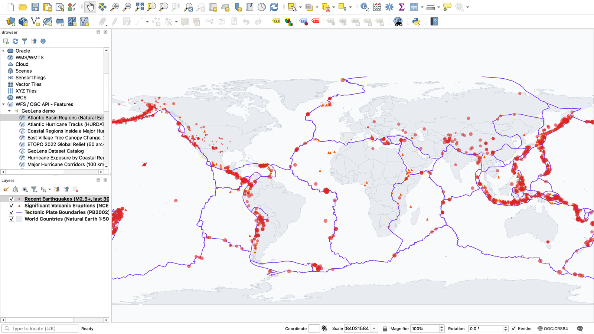
  <br>
  <sub>QGIS 通过 OGC API Features 读取演示，无需插件。</sub>
</p>

| 标准 | 位置 | 适用于 |
|---|---|---|
| 支持 CQL2 过滤和 queryables 的 OGC API Features | `/api/collections/{id}/items` | QGIS、ArcGIS、GDAL/OGR 及其他 OGC API 客户端 |
| OGC API Records | `/api/collections/datasets/items` | 从其他门户和工具搜索目录 |
| STAC API 1.0 | `/api/stac/` | pystac-client 和 STAC Browser 等 STAC 客户端 |
| JSON-LD 格式的 DCAT 3、DCAT-US 3.0 和 GeoDCAT-AP | `/api/datasets/dcat/`, `/api/datasets/dcat-us/3.0/`, `/api/datasets/geodcat-ap/` | 汇入国家和欧盟开放数据门户 |
| 矢量瓦片和 COG 栅格瓦片 | 每个图层上的瓦片 URL | MapLibre、OpenLayers、Leaflet |
| 3D Tiles 和 COPC | 每个 3D 数据集的页面 | CesiumJS、QGIS、Potree |

数据可导出为 GeoJSON、Shapefile、GeoPackage、CSV、FlatGeobuf、GeoParquet、PMTiles 或云优化 GeoTIFF。

`geolens` CLI 可发布文件并应用目录清单，Python 和 TypeScript SDK 覆盖整个 API，只读 MCP 服务器让 AI 代理搜索目录。[API 参考](https://docs.getgeolens.com/guides/api/)和 [SDK 指南](https://docs.getgeolens.com/guides/sdk/)有详细说明，[示例库](https://geolens-io.github.io/geolens-examples/)提供可运行的代码，涵盖 MapLibre、Leaflet、OpenLayers、ArcGIS Maps SDK、QGIS 和 DuckDB。

## 可选的 AI

<p align="center">
  <picture>
    <source media="(prefers-color-scheme: dark)" srcset=".github/assets/geolens-ask-ai-dark.png">
    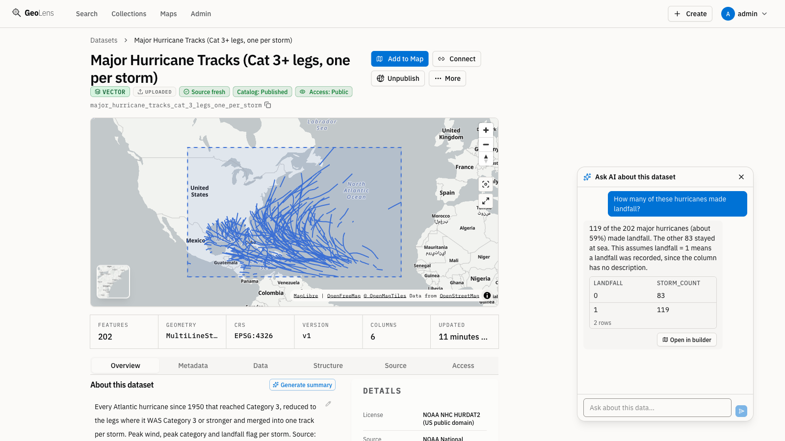
  </picture>
  <br>
  <sub>“How many of these hurricanes made landfall?”会返回计数、一张表和答案所依据的假设。</sub>
</p>

GeoLens 可以回答关于数据集的问题，根据自然语言请求编辑地图，起草元数据，并支持自然语言搜索。它可以使用任何 OpenAI 兼容端点（包括 Ollama 这样的本地服务器），也可以通过 Anthropic、Microsoft Foundry、Amazon Bedrock 或 Google Vertex AI 使用 Claude。在管理员配置提供方之前 AI 保持关闭，没有它，所有工作流依然可用。

## 安装

需要 Git、curl 和带 Compose 插件的 Docker。[安装指南](https://docs.getgeolens.com/guides/quickstart/install/)列出了所需的版本、内存和端口。

```sh
curl -fsSL https://getgeolens.com/install.sh | sh    # clone, generate secrets, start the stack
cd geolens
grep '^GEOLENS_ADMIN_PASSWORD=' .env                  # the generated admin password
```

打开 http://localhost:8080，以 `admin` 和该密码登录。每个[发布版本](https://github.com/geolens-io/geolens/releases)都附带 `SHA256SUMS` 文件，可在运行前用来校验 `install.sh`。如需改为从源码构建，请克隆仓库并运行 `bash scripts/install.sh`；首次构建需要 5-10 分钟。

生产环境请阅读[云部署指南](https://docs.getgeolens.com/guides/quickstart/cloud-deployment/)，其中也列出了外部数据库的要求。Docker Compose 是受支持的方式，[geolens-deployments](https://github.com/geolens-io/geolens-deployments) 提供社区维护的 Helm chart，以及适用于 AWS ECS Fargate 和 Azure Container Apps 的 Terraform 方案。

内置数据库每日备份，[备份指南](https://docs.getgeolens.com/guides/admin/backups/)涵盖异地复制和恢复。升级和回滚见 [UPGRADING.md](UPGRADING.md)，运维见 [RUNBOOK.md](RUNBOOK.md)，每一项设置见[配置参考](https://docs.getgeolens.com/guides/quickstart/configuration/)。

## 您的第一个数据集

安装 [CLI](https://docs.getgeolens.com/guides/cli/) 后，在安装目录中发布示例文件：

```sh
geolens login http://localhost:8080/api               # your admin username and password
geolens publish examples/manifests/first-catalog/city-parks.geojson --name "City Parks"
```

`geolens publish` 会打印新数据集的 URL。要管理整个目录，可以在 `geolens.yaml` 清单中描述各个数据源，然后运行 `geolens apply`；[`examples/manifests/`](examples/manifests/) 提供了模板。

要加载演示中的地图和数据集，请从 `.env` 导出 `GEOLENS_ADMIN_PASSWORD`，然后运行 `python scripts/seed-showcase.py --username admin`。该脚本需要 Python 3.10+ 和 `httpx`，会从大约十几个来源下载公开数据；大小和选项见 [scripts/README.md](scripts/README.md)。

## 隐私与访问

- GeoLens 不发送遥测数据。除默认底图瓦片以及您的用户注册的远程服务或 STAC 数据源外，它只会为管理员开启的功能发起出站连接。[EGRESS.md](EGRESS.md) 列出了这些连接，并说明如何在隔离网络中运行。
- 没有 GeoLens 也能读取您的数据。矢量数据集是 `data` 模式中的普通 PostGIS 表，栅格是您自己存储（本地磁盘、S3/MinIO 或 Azure Blob）中的云优化 GeoTIFF，目录可通过 OGC API、STAC 和 DCAT 导出。
- 登录使用本地账号或 OAuth 2.0/OIDC（Google、Microsoft、GitHub 或通用提供方），并提供角色、逐数据集权限、按用户的 API 密钥和审计日志。自助注册默认关闭。
- 在此仓库中发布的功能会一直免费。[EDITIONS.md](EDITIONS.md) 介绍了可选的付费支持和附加组件。

## 已知限制

- 受支持的安装方式 Docker Compose 运行在单台主机上。如需高可用，请为 API、worker、前端和 Titiler 各运行多个副本，连接支持自动故障转移的托管 PostgreSQL，并配置共享的对象存储和同一个 Valkey 或 Redis 缓存。使用 Azure Blob 或本地存储时，API 和 worker 副本还需要一个共享的暂存卷，因为只有 S3 会把上传文件保存在存储桶中。本地存储把所有文件都放在这个卷上，因此 Titiler 副本也要挂载它。[geolens-deployments](https://github.com/geolens-io/geolens-deployments) 提供社区维护的 Helm chart、适用于 AWS 和 Azure 的 Terraform 方案，以及 AWS、Azure、Google Cloud 和 DigitalOcean 的部署指南。GeoLens 本身不做数据库集群，也不从只读副本读取数据。
- 每个部署对应一个组织。
- 地形渲染假定高程单位为米；其他垂直单位会被夸大渲染。
- GeoLens 自身的 REST API 在小版本之间可能变化（标准端点遵循各自的规范）。[CHANGELOG](CHANGELOG.md) 列出了契约变更，破坏性变更会让旧形式再兼容一个小版本。

## 参与贡献

欢迎提交缺陷报告、修复、翻译和文档。[CONTRIBUTING](.github/CONTRIBUTING.md) 涵盖环境搭建和测试，[ARCHITECTURE](.github/ARCHITECTURE.md) 描绘了代码结构。[QGIS 插件](https://github.com/geolens-io/qgis-geolens-plugin)、[示例](https://github.com/geolens-io/geolens-examples)和[部署](https://github.com/geolens-io/geolens-deployments)仓库同样接受 issue 和 pull request。问题请发到 [GitHub Discussions](https://github.com/geolens-io/geolens/discussions)，缺陷请提交到 [Issues](https://github.com/geolens-io/geolens/issues)，安全问题请按 [SECURITY.md](.github/SECURITY.md) 中的说明私下报告。[路线图](https://docs.getgeolens.com/roadmap/)展示了计划中的工作。

## 基于开源项目构建

GeoLens 构建在以下开源项目之上，感谢所有维护者。

- [PostgreSQL](https://www.postgresql.org/) 和 [PostGIS](https://postgis.net/) 存储目录和所有矢量数据集，[pgvector](https://github.com/pgvector/pgvector) 存储按含义搜索所用的嵌入向量。
- [GDAL](https://gdal.org/) 读取 GeoLens 导入的文件和服务，并写出导出的格式；[PROJ](https://proj.org/) 负责坐标转换。
- [TiTiler](https://developmentseed.org/titiler/) 基于云优化 GeoTIFF 提供栅格瓦片。
- [FastAPI](https://fastapi.tiangolo.com/) 提供 API，[Procrastinate](https://procrastinate.readthedocs.io/) 以 PostgreSQL 作为队列运行后台任务。
- [MapLibre GL JS](https://maplibre.org/) 绘制地图，[deck.gl](https://deck.gl/) 和 [loaders.gl](https://loaders.gl/) 渲染 3D Tiles 和点云，[Terra Draw](https://terradraw.io/) 负责绘制与编辑。
- Web 应用用 [React](https://react.dev/) 编写。

这些名称归各自所有者所有，列出它们并不表示它们为 GeoLens 背书，参见 [TRADEMARKS.md](TRADEMARKS.md#other-projects-names)。

## 许可证

GeoLens 采用 [Apache License 2.0](LICENSE) 许可。GeoLens 的名称、标志和品牌资产不在此许可范围内，参见 [TRADEMARKS.md](TRADEMARKS.md)。示例数据的署名见 [THIRD_PARTY_DATA.md](THIRD_PARTY_DATA.md)。Web 应用在 `/third-party-licenses.txt` 提供其打包代码的许可声明，后端镜像的 copyleft 声明见 [backend/licenses](backend/licenses/)。

项目政策：[版本](EDITIONS.md) · [支持](SUPPORT.md) · [治理](GOVERNANCE.md) · [维护者](MAINTAINERS.md) · [安全](.github/SECURITY.md) · [发布流程](RELEASE.md) · [出站连接与隔离网络](EGRESS.md)
